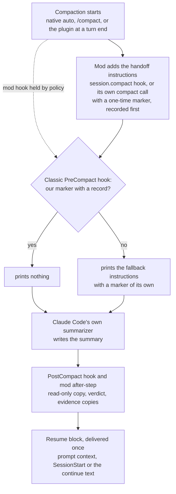

# afk-compact

When a Claude Code session compacts, afk-compact asks Claude Code's own summarizer for a handoff instead of a plain summary. It keeps a read-only copy of every summary, checks that the summary has the expected shape, and gives the next turn a short resume block. It also adds six skills: `/afk-compact:handoff`, `/afk-compact:resume`, `/afk-compact:status`, `/afk-compact:report`, `/afk-compact:settings` and `/afk-compact:prune`.

> [!NOTE]
> Early version (0.x). The parts that need a live session or a managed machine have not been run yet; see [Limits](#limits). This page describes the design and reports no measurements.

## What it does

- **Shapes every compaction.** Native auto-compaction, a manual `/compact` (your note comes first and wins), and compactions the plugin starts itself all get the same handoff instructions. Subagent compactions get a shorter subagent form.
- **Compacts at a clean turn end.** When the context passes a target size and a turn has ended normally, the plugin can compact before native auto-compaction cuts in mid-task. Past a higher soft maximum, it adds one checkpoint nudge to a tool result.
- **Keeps a copy of every summary.** Each copy is written once, read-only, with frontmatter taken from the plugin's own records (session, branch, commit, trigger, verdict, the plugin version and folder that saved it), never from the summary text.
- **Checks the result.** A one-time marker at the top of the summary and a sentinel at the end show whether the summary is complete and in handoff form. The result is one verdict per compaction.
- **Delivers the resume block once.** After a compaction, the next turn gets one short block: the saved copy's path, a fresh git and project-state measurement, and a fallback note when the summary is not in handoff form. When the last turn ended on a question you have not answered (in its text, or in a question dialog that timed out), the block quotes that question, so it is in front of you when you return. The first reply after a compaction opens with one status line, before any tool call: `Resumed · step 1: <the summary's Step 1>`, or `Resumed after compaction` when no Step 1 can be read; after a handoff whose report was cut off, its `✓ Handoff saved: <path>` line takes that place (when the cut-off handoff can still be finished, after the one call that finishes it). When a script reads the reply (`claude -p`, the Agent SDK) the line is left out, so the output a script reads does not start with it; a terminal session, the desktop app, the IDE extensions and Claude Code's other apps where you read the reply (mobile, Slack, Cowork, an SSH remote) keep it. The plugin tells them apart by the `CLAUDE_CODE_ENTRYPOINT` value Claude Code sets and by whether the session draws on any surface; where its classic hooks deliver the block, by `CLAUDE_CODE_ENTRYPOINT` alone, or, when that is not set, by whether the mod has recorded this session as headless. A question whose dialog timed out is not asked again in a dialog until you write: it is listed at the end of the turn instead (after a compaction, the same holds for one whose dialog closed with no answer).
- **Copies evidence.** Temp files that the session cited are copied to a dated disposable folder, with caps and secret checks, so nothing the next window needs lives only in a temp folder.
- **Writes a handoff before a last compaction.** When a run will not resume by itself (the hourly limit is reached, or auto-continue is off or halted), the plugin asks for one more turn that writes a handoff while the full context is still there. See [The handoff turn of a last cycle](#the-handoff-turn-of-a-last-cycle). By default it does the same before each planned compaction; see [The handoff turn before a planned compaction](#the-handoff-turn-before-a-planned-compaction).
- **Handles idle compactions.** With `"idleCompaction": false` in your Claude Code settings, the plugin compacts a long idle session itself (plugin idle compaction), about 54 minutes after its last request and before the prompt cache expires, so in sessions that read your `~/.claude/settings.json` idle compaction runs only where the plugin is enabled (terminal sessions; headless and Desktop: see [Limits](#limits)). When Claude Code compacts an idle session itself (native idle compaction), the summary is shaped the same way. Either way the resume block is measured again when you come back. See [Idle compaction](#idle-compaction).
- **Re-checks lost background jobs.** A background shell that is gone after the session ended is re-checked from facts the plugin recorded. A read-only job, or one you allowlisted, may start again by itself; everything else asks. See [Lost background jobs](#lost-background-jobs).
- **Exports to a repository, only if both sides agree.** The private store stays the default. A repository can also receive a portable copy of each published handoff. See [Handoffs in git](#handoffs-in-git-repo-mode).
- **Watches, never acts.** A shadow watcher writes content-free rows for every compaction, nudge, continue and resume, and raises alerts in `/afk-compact:status`. The rows stay on your machine; `/afk-compact:report` bundles them into a zip that you can send yourself. See [Watcher](#watcher).

## How it works



1. **Trigger.** Claude Code compacts on its own, you run `/compact`, or the plugin compacts at a clean turn end once the context passes `compact_target_tokens`.
2. **Shaping by the mod.** The plugin's module (a Claude Code mod) appends the handoff instructions to the compaction request; for the compactions it starts itself, it passes them in its own compact call, because Claude Code skips the caller's hook for those. They carry a marker with a fresh nonce, and the plugin records that nonce before the summarizer runs.
3. **Classic fallback.** A classic `PreCompact` command hook runs on every compaction. If it finds the marker and its record, it stays silent. Otherwise it prints the same instructions with its own nonce, so the summary is shaped even when the mod's hook did not run.
4. **Summary.** Claude Code's own summarizer writes the summary. The plugin never edits a summary and never blocks a compaction.
5. **Copy and verdict.** The `PostCompact` hook saves the copy first; the mod saves it only if that did not happen. Both use the same file name, so there is one copy. The marker and sentinel give the verdict: `ok`, `ok-trailer`, `ok-unclosed`, `truncated`, `unshaped`, `scope-leak` or `stale`. `ok-unclosed` is a summary with every required section through its last one (Next steps) but no closing line. It counts as ok: no fallback note, and it never counts toward halt mode. The copy, the log and `/afk-compact:status` show the word. A summary cut off inside its body is still `truncated`.
6. **Resume.** The first channel that claims the compaction delivers the resume block: the mod's prompt context, the classic `SessionStart` hook, or the auto-continue text. A turn-end check at `Stop` saves anything both savers missed and logs what is still open. If the session exits or restarts before its next turn, the block waits on disk and goes to the first turn after `claude --resume` of the same session, built again by the running version and measured again when it is more than 10 minutes old. Only that first turn gets it, and only once the earlier process has ended; a newer compaction replaces it, `/clear` drops it, and a forked session never gets it.

## Requirements

- Claude Code **2.1.287** or newer (mods). The one-line install below needs **2.1.292** or newer. This version was tested against **2.1.306**; the `PermissionDenied` and `StopFailure` hooks are not yet checked on older versions.
- **Perl 5.28** or newer, using only modules that ship with every perl. It is already on macOS and on Debian and Ubuntu (slim images too). On Alpine, run `apk add perl` first; on a minimal Fedora image, `dnf install perl-interpreter`.
- `git` for the git measurements. On a Mac without the Command Line Tools, the plugin skips git rather than open the install dialog.
- Claude Code in a terminal, or a local session of the desktop app (the desktop app runs Claude Code headless, where the plugin compacts by running `/compact`; not yet checked live there, see [Limits](#limits)). claude.ai and Cowork are not tested yet: whether they install the plugin and run its hooks, mod and helper has not been checked.

## Platforms

| Platform | This version |
|---|---|
| macOS 13 or newer | Supported. The full test suite runs on macOS (Apple silicon). |
| Linux with glibc | Supported, with perl 5.28 or newer. In containers, the helper compiles and its smoke checks pass on Debian 10 and 12, Ubuntu 20.04 and a current Ubuntu, and Fedora, with perl 5.28 to 5.42, on arm64 and emulated amd64. Perl 5.28 itself is checked on two images; with perl 5.26 or no perl, the plugin falls back as described in [Limits](#limits). Not yet done on Linux: a clean run of the full test suite and a real Claude Code session. |
| Alpine and other musl systems | Expected to work, not yet tested in a session. With `apk add perl`, the helper's smoke checks pass in an Alpine container; without perl, the fallback works there. |
| WSL 2 | Expected to work like Linux, not yet tested. |
| Windows, native | Not supported yet; planned for a later release. |

The plugin has never run on native Windows. What follows is expected from the way it is built, not something that has been seen:

- **Without Git for Windows**, Claude Code runs hook commands in PowerShell, which cannot start the plugin's launcher. Each plugin hook is then expected to fail with a visible hook error at its event. These errors do not block a tool call or a compaction, but compactions are not reliably shaped, no summary or evidence copies are saved, and the skills cannot call the helper.
- **With Git for Windows**, the hooks may reach the helper through Git Bash and its perl, but nothing on that path has been tested: process start times, file locks and paths may be wrong, and the mod's own helper calls are expected to fail.

On Windows, running Claude Code inside WSL 2 is the expected route until native support lands.

## Install

At the prompt of a terminal session:

```
/plugin install afk-compact --marketplace <owner>/<repo>
```

From a shell:

```
claude plugin install afk-compact --marketplace <owner>/<repo>
```

In the desktop app, where `/plugin` does not run: click **+** next to the prompt box, then **Plugins**, **Add marketplace** with `<owner>/<repo>`, then **Add plugin**.

Answer `y` to add the marketplace, pick a scope (user scope is first), then review the settings screen. Every setting has a working default (see [Settings](#settings)); `/afk-compact:settings` goes through them later, section by section.

To check the install, run `/afk-compact:status` in a session. It prints the effective thresholds and, after the first compaction, its verdict and the copy's path.

## Update

Auto-update is off for third-party marketplaces. Update by hand, then reload open sessions (or start a new one):

```
claude plugin update afk-compact
```

```
/reload-plugins
```

A session keeps the plugin copy it loaded until it reloads. When sessions started later run another version (an update, or a rollback), the session says so in one line, `this session runs 0.1.2; sessions started since 2026-11-01 14:02 +0200 run 0.1.3: /reload-plugins`: in `/afk-compact:status` (which always shows the session's version and plugin folder), in the resume block after a compaction, and in `/afk-compact:handoff`'s report. The other version is the one the newest session start on this machine loaded from the same install: a project pinned to another version (a project-scope install) is compared only with sessions of that project, and a `--plugin-dir` copy only with sessions of that folder. There is no line when that start is more than 7 days old, or when this session's copy was installed after it. Both sessions need 0.1.3 or later: an older session neither records its start nor shows the line, so the first notice comes with the first update after 0.1.3 while a 0.1.3 session still runs. When an update or an uninstall replaces the copy a session runs, Claude Code marks that copy in its plugin cache (and removes it 14 days later), and from 0.1.4 on the session says so at once, with no later session start needed: `this session runs 0.1.4, replaced by an install at 2026-11-01 14:02 +0200: /reload-plugins` (beside a newer start, both parts in one line). After `/reload-plugins` the session runs the new copy, which carries no mark, and the line goes.

After a Claude Code update, `/afk-compact:status` may say a check is due and offer a user-run `! "<plugin folder>/scripts/afk-compact-store" smoke`, printed with the real folder. It validates the plugin, runs its offline tests, and compares the Claude Code binary and its type declarations with the version this release was tested on. In the binary it counts the strings the plugin relies on. It fails only when the count of a rare string changes, or when the compaction experiment's list of arms changes. A rare string is one the tested binary holds at most a few times (the recorded limit is `rare_max` in `assets/canary-baseline.json`), such as the experiment flag, its environment variable and the idle-compaction notices. Common words such as `control` and `short` appear thousands of times in unrelated code, and their counts move with every release. A changed count of a common word prints an `info c8` line and does not fail smoke. The type declarations come from Claude Code's built-in plugin-authoring skill, which writes them to a temporary folder when it loads; Claude Code clears that folder after a few days. If smoke says none were found, type `/plugin-authoring` once in any session (it costs one model turn), then run smoke again while that session is open (or pass `--types FILE`).

## Uninstall

```
claude plugin uninstall afk-compact
```

Uninstalling removes the hooks and skills. It leaves your handoffs, copies, evidence and logs in place; see [What it writes](#what-it-writes-on-your-machine) to remove them.

## Skills

| Skill | Use it for |
|---|---|
| `/afk-compact:handoff [ticket-or-topic] [note]` | Write a handoff file that a fresh session can resume from: before `/clear`, before a break, or when the session is getting long. The model writes intent, decisions, findings and next steps; the helper measures git state, background work and evidence, lints the draft, scans it for secrets and publishes it. |
| `/afk-compact:resume [path or ticket] [instructions]` | Resume from a handoff or a saved compaction copy. It finds the newest fitting file, checks its claims against the live state, reports drift and restarts background work only where the handoff allows it, then continues with the next step. Right after a compaction, when you have not invoked it yourself, the model follows a light path instead: at most three tool calls before real work. |
| `/afk-compact:status` | Show a one-line verdict (saved copies and open alerts), the watcher state, effective thresholds, the last five compactions (trigger, verdict, copy path, how they were shaped), open escalations and alerts, auto-continue and halt state, the handoff mode of the current repository, the state of automatic relaunch and of the question queue, and the allow rule and user-run commands with the real plugin folder. It shows no summary content. |
| `/afk-compact:settings [advanced \| all]` | Go through the plugin's settings section by section, with each value, where it comes from and its default, and change or reset the ones you pick. Only when you ask: it shows the change and asks before it writes your settings file, and it never changes a consent key (see [Changing settings from a session](#settings)). `advanced` lists the rare tuning keys, `all` both. |
| `/afk-compact:report [--since 7d]` | Bundle the plugin's content-free logs, version, settings and recorded probe results into a zip that you can send to the developer yourself. Nothing is uploaded. Use it only when you want to share; see [Sending a report](#sending-a-report). |
| `/afk-compact:prune [--days N] [--min-mb N] [--root DIR]` | Only when you ask: list the evidence folders of old handoffs and the old dated folders of temporary evidence, with their age, size, bucket and handoff, then delete them after your yes. Handoff files, summary copies and the files a newer handoff cites always stay; see [Pruning old evidence](#pruning-old-evidence). |

The handoff and the compaction instructions share one format, so `/afk-compact:resume` reads both. A published handoff's frontmatter names the plugin version and folder that wrote it, as a summary copy's does (from 0.1.4).

**The ledger stays (from 0.1.5).** The `U-`, `D-` and `X-` lines (your constraints and asks, the decisions, the rejected options) carry from one handoff to the next, and so do the lines that mark one superseded or moved to `ledger.md`. When a draft drops one without marking it superseded, publish copies it back unchanged and says so. A draft that gives an existing id, or one already superseded or moved to `ledger.md`, to a different item is refused until that item takes a new id; a reworded line or a new status is only reported. A carried line with a private path or a secret is refused too. A saved compaction copy of the main conversation gets the same carry from the session's newest earlier copy that had the expected shape (not when a copy is saved late from a stash), and its frontmatter lists the added lines under `ledger_carried`.

**The helper.** The skills and the plugin call one helper, `scripts/afk-compact-store` in the plugin folder, always by its full path; nothing is added to your `PATH`. Where this page shows a command for you to run, it is written `! "<plugin folder>/scripts/afk-compact-store" …`, and `/afk-compact:status` prints it with the real folder.

**After `/clear`.** After `/clear` the plugin delivers no resume block, submits no prompt and runs no skill on its own; work resumes only when you ask for it. A continue or handoff turn that was about to start when you cleared is dropped.

## Settings

Set on the install screen, later in `/config` (rows named `afk-compact.<key>`), or with `/afk-compact:settings`. An empty value means the default.

**On/off settings take `true` or `false` (from 0.1.6).** The seven settings that switch one behaviour on or off (`handoff_turn`, `precompact_turn`, `watcher`, `unattended_prod_reads`, `idle_handoff_turn`, `idle_compact` and `resume_proceed`) take `true` or `false`, and `relaunch_auto`, `restart_on_update`, `idle_handoff_near_limit` and `idle_digest` take one of their words. In `/config` each of them opens a list to pick from, with the setting's description above it (a plain on/off setting flips in place there and shows none; checked on 2.1.319). Releases before 0.1.6 saved other words for the seven, and the plugin still reads them as before: `halt`, `model`, `shadow`, `allow` and `auto` as `true`; `off`, `code`, `forbid` and `confirm` as `false` (the idle settings also take `yes`, `no`, `on`, `1`, `0` and the like); `settings set` takes them too and saves `true` or `false`. Claude Code, though, reads a saved value that is not on the setting's list as unset, so the hooks run the default (the helper steps they run get it too; only `/afk-compact:status`, `settings show` and the skills' own helper steps read your word): a behaviour you turned off would run again (`/config` still shows the saved word on its row, and its list marks no value). `/afk-compact:status` and `settings show` warn when such a value is saved. The same holds for any other value not on a setting's list: where the rules below say what "any other value" counts as, that is how `/afk-compact:status`, `settings show` and the skills' helper steps read it, while the hooks run the default, and the warning says so. `! "<plugin folder>/scripts/afk-compact-store" settings migrate` lists what it would change (for example `idle_compact: "off" -> "false"`), and with `--apply` it saves the new form through the same writer as `settings set`, with its checks and backup (a value equal to its default is removed). It never writes a consent key: for one of those, pick the value again in `/config`. The lists need Claude Code 2.1.271 or newer, which this version's 2.1.287 covers.

**Not in `/config` in this version.** `otel_log_path` is left out of the install screen and `/config` because it does nothing yet: the plugin reads no OpenTelemetry file.

**Defaults you can see.** Claude Code fills a setting's default into the install and configure dialogs only for on/off (boolean) settings and settings with a list of values, so every other setting's title ends with its default (the listed ones say it too), for example `[default 400,000]` or `[default: empty = inside the handoff folder]`, and a blank field means that default. (`/config` shows the title on each row, checked on Claude Code 2.1.319. A setting with a list of values opens there as a picker with the setting's description above it in recent Claude Code versions: checked in the code of 2.1.312 to 2.1.319 and seen on 2.1.319; older versions are not checked.) Leave a field blank rather than saving it empty: the plugin reads a saved empty value as the default, but Claude Code's code reads as passing the empty text to the hooks (not tested), and `/afk-compact:status` warns with the command that clears it. `/afk-compact:status` lists every value the plugin uses under `settings values:`. Each one whose value is not its default (wherever it is set) gets a line with where it comes from (`your settings.json`, `plugin option`, `flag` or `safe value`) and the default, for example `compact_target_tokens 350000 (your settings.json; default 400000)`; the rest share one or two `at default:` lines. A clamped number says what it was clamped from. The ticket pattern shows only `built-in`, `custom` or `invalid`, and a list only its entry count. `"<plugin folder>/scripts/afk-compact-store" settings show` prints all of them, one line each, with value, source and default; a value set equal to its default still names where it is set, for example `triggers true (your settings.json; default true)`.

**Changing settings from a session.** `/afk-compact:settings` and the helper's two writing commands change the plugin's saved options for you: `"<plugin folder>/scripts/afk-compact-store" settings set <key>=<value>…` and `settings reset <key>…` (or `--all`). What they may change: only `pluginConfigs["afk-compact@<marketplace>"].options` in `~/.claude/settings.json`, one member per key of this plugin; a missing `options`, plugin entry or `pluginConfigs` is added. Every other key of the file keeps its bytes: the commands edit the text of those members only (a value replaced, a member added after the last one with its spacing, a member removed), and before writing they check that the new text reads back as your settings with exactly those changes. Setting a key to its default, or to an empty value, removes it, so a later release's default still applies; no default is ever written. What they never change: the six consent keys below, from any caller, set or reset alike (the plugin cannot tell a command you typed from one the model ran); a protective list loses no entry and `resume_proceed` goes back from `false` to `true` only by your hand, as with flags; any other file. A value the plugin would not read as written on its own is refused with the reason (not a number, outside its minimum or maximum, not one of its values, a relative path, a pattern the plugin cannot run, over 4,096 bytes, a list over 32 entries). A number the clamp lowers against your other settings (a target over two thirds of the soft maximum, a soft maximum or target over what a set window allows; see "How the thresholds are clamped" below) is written as given with a note, not refused: the window is often the model's own, known only when a session runs, and `/afk-compact:status` shows the value used. Also refused: a file that is not plain JSON (comments, a trailing comma), one that names a member twice, one with two keys for the plugin, a `settings.json` with a second name (a hard link: the write puts a new file under one name only), a `--plugin-dir` run, and a `CLAUDE_CONFIG_DIR` or `HOME` that names another folder than your own `~/.claude` (a command can set both). Each is a dry run unless you add `--apply`: the dry run lists every change as old -> new (never a pattern's or a list's text) and the `--plan` hash of the file, and the apply refuses a file that changed since, or that another program writes while it runs. The apply first saves the whole file next to it as `settings.json.afk-compact-<date>_<time>.bak` (mode 0600, never pruned; it holds any tokens under your `env` too; a backup that fails partway is removed and nothing is written), writes the new text to a temporary file in the same folder with the file's mode and renames it over the file (through a symbolic link, the link stays), so a failed write leaves your file as it was and no partial file; then it reads the file back. It prints each change and the backup's path. The model may run these commands for you after you say yes to the change it showed; the settings skill does. `--all` leaves the consent keys, the three protective lists and `resume_proceed`. The plugin's helper reads the new values at its next call; whether a running Claude Code picks them up for the hooks without a restart is not checked yet, so run `/reload-plugins` or restart it to be sure. By hand: edit or delete the key under `pluginConfigs["afk-compact@<marketplace>"].options` in `~/.claude/settings.json`.

Five keys let the plugin act without asking: `repo_roots`, `relaunch_auto`, `relaunch_allow`, `unattended_prod_reads` and `restart_on_update`. A sixth, `queue_cmd`, names a program the plugin runs, so it is treated the same way. The plugin reads these six **from your settings file only**: `~/.claude/settings.json`, under the plugin's `options` in `pluginConfigs`. Flags and plugin option values are ignored for these keys, and `/afk-compact:status` prints a note when it ignores one. The plugin itself never sets or removes them, whoever runs its commands: change them in `/config`, in the file by hand, or by typing `! printf '%s' '{"<key>":"<value>"}' | claude plugin configure afk-compact@<marketplace> --values-stdin` (Claude Code's own command; the settings skill and `settings set` print that line with the value filled in, for you to type). These keys are read only from `~/.claude/settings.json`. If `CLAUDE_CONFIG_DIR` names another folder, the plugin uses their safe values (no repository accepted, automatic relaunch off, no allow patterns, production reads asked, no queue, no restart on update) and `/afk-compact:status` prints a note, so a command that sets `CLAUDE_CONFIG_DIR` cannot pick another settings file for these keys. One exception: when that folder's `settings.json` is your `~/.claude/settings.json` itself (a symbolic link to it, or a hard link), it is the same file, so these keys are read from it as usual.

`prod_patterns`, `secret_extra_rules` and `protected_branches` can only make the plugin ask or withhold more. Flags and plugin option values are ignored for them too, so a command cannot replace your list with a shorter one, but they are read from the settings file of the folder `CLAUDE_CONFIG_DIR` names, when one is set.

Your own regular expressions (`secret_extra_rules`, `prod_patterns`, `ticket_pattern`, `relaunch_allow` and `deny_class_patterns`) run with a time limit. One that runs longer than a second on one text (less inside a hook or a quick plugin call, and a quarter second for `ticket_pattern`; a large file adds 0.3 seconds per MB) is stopped, and all your patterns together get a fixed share of each call's time, so a pattern that backtracks badly cannot hold a hook past its timeout. `ticket_pattern` has a small share of its own, so the folder a copy is filed under does not depend on what ran before it. A pattern that is stopped, or not run because that share is used up, takes the safe side. A stopped secret rule counts as a hit of its kind on the whole text: for a `HARD` rule the text is withheld, and for a `WARN` rule the plugin does what it does with any `WARN` hit (your rules after it still run). A production pattern counts as production, a ticket pattern gives no ticket, and a `relaunch_allow` or `deny_class_patterns` pattern does not match. A pattern stopped for being slow is skipped for the rest of the session on texts as long as the one it was stopped on (a text whose larger size gives it more time gets another try); shorter texts still run it. A pattern with a wildcard property such as `\p{name=/…/}` is refused when the settings are read, because Perl runs it while the pattern is compiled, before any time limit applies. `/afk-compact:status` then prints a warning with the setting and the pattern's position (never the pattern). `deny_class_patterns` takes up to 32 entries of up to 200 characters each, as `prod_patterns` does. Globs (`NAME:` rules and `protected_branches`) cannot run long; a `protected_branches` entry that mixes `*` and `**` gets the same limit and counts as protected when it is stopped.

Claude Code reads `pluginConfigs` from your user settings (`~/.claude/settings.json`, which `/config` writes) and from a `--settings` file. A `--settings` file works for every other key, but not for these nine: the plugin reads them from the settings file alone. So an opt-out such as `relaunch_auto: "off"` belongs in the user settings file; in a `--settings` file it has no effect, the default stays, and `/afk-compact:status` prints the note. Claude Code does not read `pluginConfigs` from a repository's `.claude/settings.json` or `.claude/settings.local.json`, so a value set there has no effect on any key.

| Key | Default | What it does |
|---|---|---|
| `handoff_root` | `~/.local/state/afk-compact/handoffs` | Where the plugin keeps your handoffs (notes a fresh session can pick the work up from) and its saved copy of every compaction summary, in one subfolder per repository and ticket or topic. Default `~/.local/state/afk-compact/handoffs` (`$XDG_STATE_HOME/afk-compact/handoffs` when `XDG_STATE_HOME` is an absolute path), outside `~/.claude`, where Claude Code asks before every write in the default permission mode; while this is unset (or set to that default), handoffs an earlier version saved in `~/.claude/handoffs` are still read, never written (see [The folders moved](#the-handoff-and-evidence-folders-moved-in-012)). Change it to keep them somewhere else, such as a synced drive, but keep it outside any git repository. |
| `log_dir` | empty = `<handoff_root>/.watch` | Where the plugin keeps its local logs (which hold no conversation text) and its per-compaction records. Empty (the default) means the `.watch` folder inside the handoff folder; set a path only if you want the logs kept apart from the handoffs. |
| `disposable_root` | `~/.local/state/afk-compact/disposable` | Where the plugin copies temporary files the session referred to (for example test output or logs in a temp folder), in one dated folder per day, so they are still there after the system clears its temp folder. Default `~/.local/state/afk-compact/disposable` (`$XDG_STATE_HOME/afk-compact/disposable` when `XDG_STATE_HOME` is an absolute path), outside `~/.claude`, for the same reason as the handoff folder; while this is unset (or set to that default), copies an earlier version made in `~/.claude/trash-staging` are still read, never written. Nothing in it is deleted automatically; `/afk-compact:prune` lists old folders and deletes them after your yes. |
| `disposable_keep_days` | `0` (kept until you remove them) | How many days you plan to keep the temporary evidence copies: the handoff reports print it, and `/afk-compact:prune` lists evidence older than it (14 days while it is `0`). The plugin never deletes on its own. Default `0` means "kept until you remove them". |
| `evidence_quota_mb` | `500` | Size, in MB, at which the plugin warns that the saved evidence and summary copies of one ticket or topic folder have grown large. Default 500 MB; it only warns and never deletes, so raise it if the warning is noise, lower it to hear sooner, or set `0` for no warning. |
| `queue_cmd` | empty = off | Optional: the path of a program of your own that collects the questions an unattended session needs to ask you, so they wait in one queue as well as in the handoff (the program must follow the contract in `assets/queue-contract.md`; see [Connect your own question queue](#connect-your-own-question-queue)). Empty (the default) turns this off and the plugin calls nothing; only your settings file counts for this option, flags and environment variables are ignored. |
| `triggers` | `true` | Lets the plugin start compactions itself at a clean point, nudge the model toward one, and tell the session to carry on afterwards. Default `true`; set `false` if you only want every compaction written as a handoff, saved and checked, while Claude Code alone decides when to compact. |
| `compact_target_tokens` | `400000` (min 100000) | Conversation size, in tokens, at which the plugin compacts (has Claude Code summarize the conversation and continue from the summary) as soon as the model finishes a turn, instead of waiting for Claude Code to compact in the middle of a task. Default 400,000 (minimum 100,000); lower it to compact earlier and more often, raise it to keep more history in view; on smaller context windows the plugin lowers it by itself. |
| `compact_soft_max_tokens` | `600000` (min 150000) | Conversation size, in tokens, at which the plugin asks the model, once, in the middle of a long turn to reach a stopping point so the compaction can run cleanly. Default 600,000 (minimum 150,000); keep it above the compaction target, and lower it if long turns keep running into Claude Code's own mid-task compaction. |
| `native_window_tokens` | `0` = the compaction window Claude Code reports | The context size within which Claude Code runs its own automatic compaction; the plugin keeps its own thresholds below Claude Code's compaction point (about 33,000 tokens under this window). Default `0` means the compaction window Claude Code reports (set by `CLAUDE_CODE_AUTO_COMPACT_WINDOW`, your `autoCompactWindow` setting or the model's default), with its own compaction point when it reports one; a Claude Code that reports none: the window your `autoCompactWindow` setting names, else the model's context window. Enter a number only if Claude Code compacts within another window (values under 100,000 count as 100,000). |
| `boundary_delay_ms` | `2000` | How long, in milliseconds, the plugin waits after a turn ends before it compacts or sends a turn of its own; a message you send during the wait cancels it. Default 2,000 (2 seconds; 500 ms after a nudged turn); raise it if you want more time to step in before the plugin acts. |
| `cooldown_ms` | `30000` | Shortest time, in milliseconds, between two compactions the plugin starts, so a session that fills up fast cannot compact over and over. Default 30,000 (30 seconds); raise it if you see plugin compactions bunched together. |
| `max_auto_continues_per_hour` | `6` (0 to 10) | How many times in any one hour the plugin may tell a session to keep working by itself after a compaction. Default 6 (allowed 0 to 10); lower it to limit unattended usage, or set `0` so that every run stops after its compaction and waits for you (by default the model is first given a turn to write a handoff, see `handoff_turn`). |
| `handoff_turn` | `true` | `true` (the default): when the plugin will not continue the work by itself after the coming compaction, it first gives the model one extra turn to write a handoff you can resume from later; `false` skips that turn, which saves its usage but leaves only the compaction summary. |
| `handoff_turn_max_tokens` | `64000` (20000 to 150000) | How many tokens the extra handoff-writing turn may use; the plugin keeps that much room free below Claude Code's own compaction point. Default 64,000 (allowed 20,000 to 150,000); raise it if handoffs get cut short, lower it on small context windows, where a large budget makes the plugin compact earlier. |
| `precompact_turn` | `true` | `true` (the default): before each compaction the plugin starts at the compaction target, the model gets one extra turn to write a handoff while it still sees the whole conversation; `false`: the plugin records its own checkpoint without that turn, which uses less of your usage allowance. |
| `idle_handoff_turn` | `true` | `true` (the default): if a long session sits idle and nobody will compact it before Claude Code's one-hour prompt cache (the stored conversation that keeps the next request cheap) expires, the plugin gives the model one turn, about 49 to 56 minutes in, to write a handoff (the idle handoff turn, which does not compact; see [Idle compaction](#idle-compaction)); `false` never runs that turn, which saves its usage (it costs several times as much as an idle compaction). |
| `idle_compact` | `true` | `true` (the default) turns on plugin idle compaction: when a conversation at the idle-compaction minimum or more (200,000 tokens by default) has been idle for about 54 to 56 minutes and native idle compaction (Claude Code's own) has not run, the plugin compacts it itself before the one-hour prompt cache expires, so coming back costs less (terminal sessions only, for now; see [Idle compaction](#idle-compaction)); `false`: the plugin never compacts idle sessions, and the idle handoff turn runs instead where it applies. |
| `idle_handoff_min_tokens` | `200000` (100000 to 1000000) | The smallest conversation, in tokens, that gets the idle handoff turn; it is not an idle-compaction threshold. That turn writes a handoff without compacting and runs only from this value up to the idle-compaction minimum (`CLAUDE_CODE_IDLE_COMPACT_MIN_TOKENS`, 200,000 by default), since native or plugin idle compaction takes the sessions above it; when the plugin does not compact (`idle_compact: false`, for example), it runs above it too. Default 200,000 (allowed 100,000 to 1,000,000), the same as that minimum, so by default no session gets the turn while the plugin compacts; lower it to cover medium-size sessions too. A work lane that reads finished after an idle compaction (until your next message) gets the turn at any known size. |
| `idle_handoff_near_limit` | `run` | `run` (the default): the idle handoff turn runs even when one of your usage limits (the five-hour or seven-day plan window, or a spend limit) is at 90% or more, so you get the handoff anyway; that turn then counts toward a nearly used allowance, and with extra usage on for your plan, usage past the limit may be billed. `skip-spend`: no such turn while a spend limit (a money cap, for example a Claude gateway's) is at 90% or more; it still runs near a plan limit. `skip`: no such turn while any reported limit is at 90% or more, which saves that usage (see [Idle compaction](#idle-compaction)). Plugin idle compaction never runs at 90% or more, whatever the value. |
| `idle_digest` | `off` | `off` (the default in this version): when a session compacted while you were away has finished its work or is only waiting on you, the plugin sends no turn of its own and asks for no summary; the next reply starts nothing new and says in one line where the work stands, then what needs you. `submit`: with nothing still running, the plugin sends one turn right away that prints a short summary (what is done, what is left, what needs you), ready when you return; `return` sends nothing and puts that summary at the top of the reply to your next message, which saves the turn (see [The away digest](#the-away-digest)). |
| `keep_warm_hours` | `6` (0 to 24) | How many hours the plugin keeps an idle session's one-hour prompt cache (the stored conversation that keeps the next request cheap) warm while one of that session's own background jobs (an agent, a workflow or a background shell) is still running: about every 50 minutes it sends one small hidden request that reads the cache and adds nothing to the conversation, so the turn the job's result opens does not read the whole conversation again at full price. When that time is up and a job is still running, the plugin compacts the session (or runs the idle handoff turn) while the cache is still warm. It never runs while you are simply away with nothing running, nor with the five-minute cache, and stops when a usage limit reaches 90% or a turn starts. Default 6 (allowed 0 to 24); `0` turns it off, which saves those requests (each one counts toward your usage limits as a cached read of the conversation; see [Keeping the cache warm while jobs run](#keeping-the-cache-warm-while-jobs-run)). |
| `resume_proceed` | `true` | `true` (the default): when you run `/afk-compact:resume` yourself, it reports what it found and then carries on with the next step; `false`: it stops after the report and waits for your go-ahead. Resumes after the plugin's own compactions are not affected, and when your settings file, a flag and an environment variable disagree, `false` wins. |
| `handoff_reuse_window_min` | `15` (0 to 60) | When the model starts a handoff on its own less than this many minutes after the last one, and nothing has changed since (same commit, same files, no new decisions), the plugin reuses that handoff instead of writing a new one. Default 15 (allowed 0 to 60); `0` turns this time-based reuse off (a handoff is still reused when nothing at all happened since the last one), a higher value saves usage when handoffs come often. |
| `ticket_pattern` | `[A-Z][A-Z0-9]+-[0-9]+` | A regular expression that finds a ticket id (such as ABC-123) in the git branch name, so that handoffs for one ticket share one folder; if the pattern has a group in parentheses, that group is the id. Default `[A-Z][A-Z0-9]+-[0-9]+` (ids like ABC-123); change it to match your tracker's ids (an invalid pattern falls back to the default, and folders made earlier are still found). |
| `secret_extra_rules` | empty | Your own rules for spotting secrets in handoffs and copied files, added to the built-in ones and separated by `;`: `HARD:pattern` blocks the handoff and withholds the file, `WARN:pattern` warns and masks the match (for `HARD` and `WARN` the pattern is a regular expression), and `NAME:wildcard` withholds files whose names match a simple wildcard such as `*.pem` (not a regular expression). Empty (the default) means the built-in rules only; add rules for your own token formats, they can only withhold more (only your settings file counts for this option, flags and environment variables are ignored). |
| `evidence_total_max_mb` | `50` (10 to 500) | The most data, in MB, that one evidence copy run (after a compaction, or for one handoff) copies in full; files beyond it are listed as withheld and left where they are, and nothing is deleted. Default 50 (allowed 10 to 500); raise it if large logs you need later are being withheld, lower it to save disk space. |
| `watch_quota_mb` | `50` (0 to 10000) | When the plugin's local logs grow past this size, in MB, it shows a storage warning; nothing is deleted. Default 50 (allowed 0 to 10,000); `0` turns the warning off, raise it if you keep large logs on purpose. |
| `measured_block` | `false` | When on, the plugin adds freshly measured facts (git branch, commit, changed files, background jobs) to the instructions Claude Code's summarizer gets; this applies only when the plugin's main module shapes the compaction. Default `false`, because the first turn after every compaction gets these facts, measured again, anyway; turn it on if summaries keep getting them wrong. |
| `auto_evidence` | `true` | After each compaction, copy temporary files the session mentioned (such as logs or test output in a temp folder) into the temporary evidence folder, with size limits and a secret check, so they are still there when the work resumes. Default `true`; set `false` if you do not want these copies on disk. |
| `warn_ui` | `true` | Show the plugin's short pop-up notices in Claude Code when something needs your attention, for example when it pauses automatic work or saves a handoff, and one dim line in the conversation after each compaction saying whether it went well (the model does not see it). Default `true`; set `false` for fewer interruptions and check `/afk-compact:status` instead. |
| `watcher` | `true` | `true` (the default) keeps local logs of how each compaction went, without any conversation text, and nothing is ever sent (you can share them yourself with `/afk-compact:report`); `false` stops new log entries and keeps the ones already written. |
| `stall_min` | `60` | How long, in minutes, a background job must have been running before the local logs may flag it as stalled in `/afk-compact:status`; it is flagged once it has run this long and its output file has not changed for the last 15 minutes; a job whose output cannot be checked is never flagged. Default 60; lower it to hear about stuck jobs sooner, raise it if your jobs normally run for a long time with quiet stretches. |
| `cache_ttl_s` | `300` | How long, in seconds, the local logs assume Claude Code's prompt cache (the stored conversation that makes the next request cheaper) stays fresh; a large compaction after a longer pause is flagged as likely costly. Default 300 (5 minutes); set `3600` if your sessions use the one-hour cache, so pauses that cost nothing are not flagged. |
| `deny_class_patterns` | empty = the built-in rules | Your own rules for sorting blocked tool calls (permission denials) into categories in the local logs, written as `category=pattern` pairs (pattern: a regular expression) separated by `;`, where the category is `sleep-poll`, `routing`, `secret`, `write-guard`, `scope` or `other`. Empty (the default) uses the built-in rules; change it only if your own hooks block tools with messages the built-in rules put in the wrong category. |
| `repo_roots` | empty = no repository | Main checkout folders, separated by `;`, into which each published handoff may also be exported so a team can review and commit it; a repository also has to opt in with a `.claude/handoffs.json` file (see [Handoffs in git](#handoffs-in-git-repo-mode)). Empty (the default) keeps handoffs only in your private handoff folder; only your settings file counts for this option, flags and environment variables are ignored. |
| `relaunch_auto` | `on` | `on` (the default): when a resumed session finds that a background job (such as a long test run) was lost when Claude Code exited, it starts the job again by itself if the job is read-only or on your allowlist and every safety check passes, otherwise it asks (see [Lost background jobs](#lost-background-jobs)); `shadow` only logs what it would have done and asks; `off` always asks (only your settings file counts for this option, flags and environment variables are ignored). |
| `relaunch_allow` | empty | Patterns (regular expressions, each starting with `^`), separated by `;`, for commands that are safe to run twice, such as a local test or build, which a resumed session may then restart by itself after a lost-job check. Empty (the default) means only read-only jobs restart by themselves; a command chained with others, one that reaches outside your machine, or a production command always asks (only your settings file counts for this option, flags and environment variables are ignored). |
| `relaunch_quiet_s` | `120` (30 to 3600) | When the plugin cannot tell when a lost background job ended, the job's output must have been silent for this many seconds before the job counts as stopped and may be restarted. Default 120 (allowed 30 to 3,600); raise it for jobs that normally go quiet for longer. |
| `restart_on_update` | `off` | `on`: right after a compaction, with nothing running and nobody typing, the plugin restarts the session on a newly installed Claude Code and keeps the same conversation (not active in this version yet, see [Restart on update](#restart-on-update-beta-opt-in) and `/afk-compact:status`); `shadow` only logs what it would do; `off` (the default) never restarts (any other value counts as `off`; only your settings file counts for this option, flags and environment variables are ignored). |
| `unattended_prod_reads` | `false` | `false` (the default): a resumed session asks before any command that touches production and offers it for you to run, unless an approval you gave names that read-only command; `true`: a read-only production check the session writes itself may run without asking. Changes to production always ask, and so do production commands copied from a handoff unless an approval you gave names that read command (only your settings file counts for this option, flags and environment variables are ignored). |
| `prod_patterns` | empty = the built-in rule only | Extra patterns (regular expressions), separated by `;`, that mark a command as touching production, on top of the built-in rule, which looks for `prod`, `production` or `prd` as a separate word or part (as in `--context=prod-eu`). Empty (the default) means the built-in rule only; add your own environment or host names so the plugin asks before those commands too (these patterns can only make it ask more). |
| `protected_branches` | empty = the built-in list only | Branch names or wildcard patterns, separated by `;`, that count as protected on top of the built-in list (the remote's default branch, main, master, develop, staging, release and hotfix branches and similar): a push to one, or a merge into one, always asks you again, whatever you approved before. Empty (the default) means the built-in list only; add your own deployment branches, for example `qa-env;uat/*`, and note that entries can only add, never unprotect a built-in branch (only your settings file counts for this option, flags and environment variables are ignored). |
| `driver_skills` | empty = the built-in list only | Names of extra skills, separated by `;`, that drive a session as a repeating work loop, like the built-in `gsd-autonomous`, `gsd-execute-phase`, `gsd-manager`, `superpowers:executing-plans` and `superpowers:subagent-driven-development`; when such a loop is clearly still running at a compaction, the plugin starts it again afterwards so the loop goes on. Empty (the default) means the built-in list only; add your own loop skills (a paused, finished or unclear loop is shown to the model but never restarted, and a skill the session never used is never run). |

<details>
<summary>Exact rules for each setting</summary>

- `handoff_root`: Folder for handoffs and summary copies. Buckets are `<root>/<repo>/<ticket-or-topic>/`. Unset in every source (flag, environment, settings file), or set to the default path itself (Claude Code fills unset options in with their defaults), the default root is the only one written, and the old default `~/.claude/handoffs`, if it exists, is read too: its buckets, pins, `/clear` lineage, session records, successor claims and approval records count as the private store's. That default root is `$XDG_STATE_HOME/afk-compact/handoffs` when `XDG_STATE_HOME` is set to an absolute path (a relative one is ignored, as the XDG Base Directory rules say), else `~/.local/state/afk-compact/handoffs`. Any other value you set, `~/.claude/handoffs` included, is the only root read.
- `log_dir`: Watcher logs and per-compaction records.
- `disposable_root`: Automatic evidence copies, in dated folders. Unset in every source, or set to the default path itself, the default folder (`$XDG_STATE_HOME/afk-compact/disposable` when `XDG_STATE_HOME` is an absolute path, else `~/.local/state/afk-compact/disposable`) is the only one written; copies an earlier version made in the old default `~/.claude/trash-staging` stay there and are still read, because each handoff's `MANIFEST.tsv` names its copies by their full path. Any other value you set, `~/.claude/trash-staging` included, is used as it is.
- `disposable_keep_days`: Retention note, shown in handoff reports, and `prune`'s default age (14 days while it is 0). The plugin deletes nothing on its own.
- `evidence_quota_mb`: Per-bucket evidence size that triggers a warning. Warn only.
- `queue_cmd`: An executable of your own for an optional question queue. It answers `list --json --session <sid>` with a `queue-stub/v1` object (the version tag is required), `adopt --lane <id> [--if-free] [--must-exist]` and `add --json ...` (the draft arrives on stdin); the full contract is `assets/queue-contract.md`, and `queue check` tests a program against it. **Settings file only.** See [Connect your own question queue](#connect-your-own-question-queue).
- `triggers`: `false`: no plugin compactions, no nudge, no auto-continue. Shaping, copies and verdicts still run.
- `compact_target_tokens`: Compact at a clean turn end at or above this.
- `compact_soft_max_tokens`: Add one checkpoint nudge mid-turn at or above this.
- `native_window_tokens`: Your native auto-compact window, used for the clamp below. Unset (`0`): the compaction window Claude Code reports, read once when the plugin loads from its summary context breakdown (estimated locally, no API request), and Claude Code's own auto-compact threshold as the native trigger when it reports one; from a Claude Code that reports no breakdown, or when the read fails, the `autoCompactWindow` setting when it holds a number (at most the model's window), else the model's window. A number you set here wins (the native trigger is then 33,000 tokens under it). The `config_effective` row records where the window came from (`window_from`) and Claude Code's `autocompact_source`.
- `boundary_delay_ms`: Wait before a turn-end compaction (500 ms after a nudge). A new turn cancels it.
- `cooldown_ms`: Minimum gap between plugin compactions.
- `max_auto_continues_per_hour`: Cap on automatic continues in a rolling hour. `0` turns auto-continue off, so every nudged cycle is a last cycle.
- `handoff_turn`: `true` (before 0.1.6 `halt`): before the last compaction of a run that will not auto-continue, one more turn writes a handoff. `false` (`off`): no handoff turn. Case and spaces are ignored; any other value counts as `true`.
- `handoff_turn_max_tokens`: Tokens the handoff turn may use. The plugin reserves them below the native trigger, so a larger value lowers the soft maximum on small windows.
- `precompact_turn`: `true` (before 0.1.6 `model`): before each planned compaction (the turn-end compaction at `compact_target_tokens`) the model gets one extra turn to write a handoff. `false` (`code`): code records the checkpoint alone, which saves usage. Case and spaces are ignored; any other value counts as `false`. See [The handoff turn before a planned compaction](#the-handoff-turn-before-a-planned-compaction).
- `idle_handoff_turn`: `true` (before 0.1.6 `auto`): while native idle compaction is off in your settings and the plugin does not compact the session either (it is below the idle-compaction minimum, `idle_compact` is `false`, `"autoCompactEnabled": false`, or the plugin's compaction failed twice), the model gets the idle handoff turn, one turn to write a handoff, about 49 minutes into an idle period, before the prompt cache expires. While your settings let Claude Code compact idle sessions, or cannot be read, the plugin checks about 55.5 minutes in and, if native idle compaction did not run, runs that turn only when it does not compact the session itself (see `idle_compact`): below the idle-compaction minimum, with `idle_compact: false`, or after its compaction failed twice. `false` (`off`): never. `yes`, `1` and the old `on` count as `true`; `no`, `none`, `disabled` and `0` count as `false`; any other value counts as `false`, and `/status` shows a note. Case and spaces are ignored. See [Idle compaction](#idle-compaction).
- `idle_compact`: `true` (before 0.1.6 `auto`): plugin idle compaction. While native idle compaction is off in your settings (`"idleCompaction": false`) and automatic compaction is on, the plugin compacts a main conversation of 200,000 tokens or more itself, about 54 minutes after its last request, before the prompt cache expires (`CLAUDE_CODE_IDLE_COMPACT_MIN_TOKENS` changes the minimum, as it does for Claude Code). While your settings let Claude Code compact idle sessions, or cannot be read, the plugin compacts such a conversation itself at its 55.5-minute check when Claude Code did not, agents running or not. `false` (`off`): never; the idle handoff turn runs in its place. `yes`, `1` and `on` count as `true`; `no`, `none`, `disabled` and `0` count as `false`; any other value counts as `false`, and `/status` shows a note. Case and spaces are ignored. See [Idle compaction](#idle-compaction).
- `idle_handoff_min_tokens`: No idle handoff turn below this context size, unless the work lane reads finished after an idle compaction (until your next message), nor at an unknown size. Not a compaction threshold: native and plugin idle compaction go by `CLAUDE_CODE_IDLE_COMPACT_MIN_TOKENS` (200,000 by default, never below 100,000), and while the plugin compacts, the turn runs only from this value up to that minimum.
- `idle_handoff_near_limit`: `run`: the idle handoff turn runs at any usage share, also with a limit at 90% or more. `skip-spend`: no idle handoff turn while a spend limit (the window Claude Code reports as `spend_limit`, a money cap such as a Claude gateway's) is at 90% or more; the five-hour and seven-day plan windows do not stop it. `skip`: no idle handoff turn while any reported limit is at 90% or more. Plugin idle compaction skips at 90% or more whatever the value. Each such skip's log row (`handoff_skipped`, and keep-warm's `keep_warm_stop`) names every window Claude Code reported with its share, in `windows` (for example `["seven_day:94", "five_hour:40"]`, or `["arm:95"]` when no window was reported yet and the reading from when the timer was set decided); Claude Code reports only the five-hour, seven-day and a gateway's spend window to plugins, no per-model weekly window. Case and spaces are ignored; any other value counts as `run`, and `/status` shows a note.
- `idle_digest`: After an idle compaction whose work is finished or blocked on you, with nothing running (no agents, background shells or workflows): `off` (the default in this version) sends nothing and asks for no digest: the next turn starts nothing and says in one line where the lane stands, with its `Basis:` line, then what needs you; `submit` sends one turn right away that prints the away digest; `return` sends nothing, and your next message opens with a short pointer before its answer. Case and spaces are ignored; any other value counts as `off`. See [The away digest](#the-away-digest).
- `keep_warm_hours`: While the main session is idle and one of its own background jobs is open (an agent, a workflow or a background shell; a Monitor or a scheduled task does not count), on the one-hour cache and below 90% of every usage limit Claude Code reports, the plugin sends a hidden one-word request on the session's own conversation about every 50 minutes, for at most this many hours of the idle gap; then, with a job still open, the idle path runs while the cache is warm. `0`: off. Allowed 0 to 24, fractions too (`1.5` is an hour and a half; below about 50 minutes nothing is ever sent, since the first request comes 50 minutes into the gap); a value outside is clamped, and `/status` shows a note. See [Keeping the cache warm while jobs run](#keeping-the-cache-warm-while-jobs-run).
- `resume_proceed`: `true` (before 0.1.6 `auto`): a resume you start goes on with the handoff's next step after its report. `false` (`confirm`): it stops after the report and waits for your go. The resume after a compaction is not affected. The stricter value of your settings file, a flag or an environment value wins.
- `handoff_reuse_window_min`: A handoff the model starts on its own less than this many minutes after its last one, with nothing changed since, reuses that one instead of writing a new one. `0`: no reuse by time; the newest handoff is still reused when nothing at all happened since it.
- `ticket_pattern`: Regular expression that finds the ticket id in a branch name, for the handoff folder (group 1 if it has one, else the whole match). The id must be letters, digits, `.`, `_` or `-`. An invalid pattern counts as the default, and folders made under the default are still found after a change.
- `secret_extra_rules`: Your own secret rules beside the shipped ones, separated by `;`: `HARD:<regex>` blocks a handoff and withholds a file, `WARN:<regex>` warns and redacts, `NAME:<glob>` withholds a file by its name. At most 32 rules, each regex at most 200 characters. They can only withhold more. **Settings file only** (see above).
- `evidence_total_max_mb`: The most evidence one sweep or handoff copies in full; a file beyond it is not copied (`withheld: over-total`, listed with its size and hash) and stays where it is. Nothing is deleted.
- `watch_quota_mb`: Size of the local compaction logs that raises a storage warning. Warn only; nothing is deleted. `0`: no warning.
- `measured_block`: Also send the measured facts block to the summarizer (mod path only). The resume block always carries a fresh measurement.
- `auto_evidence`: Copy the temp files a session cited into `disposable_root` after a compaction.
- `warn_ui`: Toasts and status-line warnings for escalations, and the `afk-compact: compaction ok · …` line (`compaction ok-unclosed · …` for a summary with no closing line, or `compaction NOT …` with a pointer to `/afk-compact:status`) after each main compaction: the summary's verdict, whether its copy was saved, a handoff it follows and the jobs still running (`compaction done · plugin step failed` when the plugin's own step after it failed). Never in a subagent, and not yet after a compaction only the classic hooks handled (`classic-only` in `/afk-compact:status`); the model does not read it.
- `watcher`: `true` (before 0.1.6 `shadow`) keeps local, content-free logs of every compaction; `false` (`off`) writes no watcher rows. Nothing is sent; share them with `/afk-compact:report`. Case and spaces are ignored. Any other value counts as `true`, with one note per session in the log and a line in `/afk-compact:status`.
- `stall_min`: Minutes without progress before the watcher calls work stalled.
- `cache_ttl_s`: Warm/cold prompt-cache estimate used by the watcher.
- `deny_class_patterns`: Patterns that sort permission denials into classes.
- `repo_roots`: Main checkouts, separated by `;`, in which you accept exports into the repository. **Settings file only.** See [Handoffs in git](#handoffs-in-git-repo-mode).
- `relaunch_auto`: `on`: a lost background job may start again by itself when every check passes. `shadow`: log the verdict, always ask. `off`: always ask. **Settings file only.** See [Lost background jobs](#lost-background-jobs).
- `relaunch_allow`: Patterns (each starts with `^`, at most 200 characters, at most 32), separated by `;`, for repeat-safe local commands that may start again by themselves after a lost-job check. A chained command, an outward step or a production command always asks. An invalid pattern is dropped and logged. **Settings file only.** See [Lost background jobs](#lost-background-jobs).
- `relaunch_quiet_s`: Seconds without output before a lost job counts as quiet, when its end time is unknown.
- `restart_on_update`: `on`: the plugin moves a session onto a newly installed Claude Code by itself, right after a compaction. `shadow`: log what it would do, restart nothing. `off`: never. Any other value counts as `off`. **Settings file only.** See [Restart on update](#restart-on-update-beta-opt-in).
- `unattended_prod_reads`: `false` (before 0.1.6 `forbid`): a resumed session asks before any production step and offers a command for you to run, unless an approval of yours that carried over names that production read command and its targets (your explicit approval wins over the setting; see Approvals below). `true` (`allow`): a read-only production check that the session builds itself, or a lost read-only production job, may run without asking. Production writes always ask, and so do production commands copied from a handoff unless an approval of yours that carried over names that read command. Case and spaces are ignored; any other value counts as `false`. **Settings file only.**
- `prod_patterns`: Extra patterns, separated by `;`, that mark a command as production, beside the shipped class (`prod`, `production` or `prd` between non-letters, as in `--context=prod-eu` or `db.prod.example.com`, but not `product`). At most 32, each at most 200 characters; an invalid one is dropped and logged. They can only make the plugin ask more.
- `protected_branches`: Extra branch names or globs, separated by `;`, that count as protected beside the shipped list (the remote's default branch, `main`, `master`, `trunk`, `develop`, `development`, `stable`, `staging`, `gh-pages`, `prod`, `production` and their `-`, `_` or `/` children, `release`, `releases` and theirs, `hotfix/…`). A push to one, or a local merge into one, is an explicit gate: it always asks again, whatever you approved before (see Approvals below). `*` matches any characters within one part of the name, `**` any characters across `/`, `?` one character; a leading `refs/heads/` is ignored, and case does not matter. Example: `qa-env;uat/*`. They can only add: there is no exclusion, so no entry can unprotect `main` or any other shipped branch. At most 32 entries, each at most 200 characters. An entry that starts with `!`, `-` or `/`, holds a space, `..`, `:` or a regular-expression character (`^ $ ( ) [ ] { } |` and `\`), or is otherwise no possible branch name is ignored: the rest of your list and the shipped list still apply, the entry is logged by its position, and `/afk-compact:status` prints a warning for it. **Settings file only** (see above).
- `driver_skills`: Skill names, separated by `;`, that drive a session as a loop, beside the shipped list (`gsd-autonomous`, `gsd-execute-phase`, `gsd-manager`, `superpowers:executing-plans`, `superpowers:subagent-driven-development`). When a session invoked one and the loop is clearly live at the compaction (one of its own steps is mid-turn, or an agent, workflow or teammate it launched still runs), its measured facts carry an `Active driver:` line with the exact command, and the resume after a compaction or a handoff runs that command again (with the session's GSD workstream for a GSD loop). A skill whose own text runs gsd-tools (a GSD loop) counts without being listed; a listed skill typed after a GSD command in one message (`/gsd-resume-work --ws <name> and /<skill> <args>`) counts with its arguments. The driver is the outermost loop the session invoked: a loop that another one runs as its own step (`gsd-autonomous` running `gsd-execute-phase`) never replaces it; another kind of loop invoked after your prompt takes over. A loop that paused itself (`/gsd-pause-work`, or a new HANDOFF.json or .continue-here file of its own) shows as a `Paused driver:` line; one that ended (a finishing skill, GSD work on another workstream) has no line. In every other case a `Was driving:` hint names the command to re-enter only if the next step belongs to it, until the loop is invoked again: its turn ended with none of its agents, workflows or teammates running (a background command, a monitor, a scheduled task or a wake-up may be a server, a watch or a timer that outlives the loop, for example while it waits for you), a single-phase `gsd-execute-phase` marked its phase complete or went on to another GSD command (its own review gate too), it was invoked with arguments the command cannot repeat whole (prose that may limit the run), you interrupted it, you sent a prompt of any kind (also one typed while its turn runs, a status look, `/goal`, `/loop` or one of this plugin's skills), another session sent a message, the session was resumed in a new process, a checkpoint says `Step 1: none: task done`, or the transcript leaves it unclear. A loop that is live but quiet may show as that hint. The plugin's handoff turn never counts as the loop stopping, and neither does the checkpoint turn its nudge asks for when the plugin will resume the work by itself (not when auto-continue is paused, or that turn asks you something). Only an `Active driver:` line is ever run. A skill the session never invoked is never run.

</details>

<details>
<summary>How the thresholds are clamped</summary>

The plugin keeps its own thresholds below the point where native auto-compaction fires, which it estimates as your window minus 33,000 tokens:

- soft maximum = the smallest of `compact_soft_max_tokens`, that native point minus a reserve, and 80% of the window. The reserve is 52,000 plus `handoff_turn_max_tokens` (116,000 with the defaults) while `handoff_turn` is `true`, and 100,000 when it is `false`;
- target = the smaller of `compact_target_tokens` and two thirds of the soft maximum;
- if the target ends up below 120,000 tokens (windows under about 329K with the defaults, 313K with `handoff_turn` off), plugin compactions and the nudge are off for that session. Native auto-compaction, shaping, copies and verdicts still run.
- Claude Code treats windows below 100,000 as 100,000. `/afk-compact:status` ends its `thresholds:` line with `min_window <N>`, the smallest window that turns plugin compactions on with your settings (`min_window 329000` with the defaults), or `min_window never` when `compact_target_tokens` or `compact_soft_max_tokens` is set too low for any window. On a window below it, the next line reads `plugin compactions off: window <W> is below <N>, the smallest for these settings`.

Every clamped value is logged, and `/afk-compact:status` marks it with `(clamped from <configured>)`. It never shows a negative threshold: a window too small for plugin compactions is shown as off.

</details>

<details>
<summary>Nudge, auto-continue and halt</summary>

- The nudge is added once per main turn, to a main-agent tool result, never to a subagent's or a denied call's.
- After a compaction that a nudge led to, the plugin submits one short continue note, but only if the turn ended normally, did not end with a question to you, and the hourly cap allows it. A question dialog you answered does not count as a question to you; one still open when the turn ends, or one that closed unanswered (it timed out while you were away, or you dismissed it), does, here and for the handoff turn and restart below.
- Two non-ok verdicts in a row, a compaction loop, or the hourly cap put the session in **halt mode**: no auto-continue, no plugin compactions, and the nudge says the plugin will not resume the work by itself, and that it compacts afterwards only after a cap or auto-continue-off halt. Your next message clears it: one you type, or send yourself from another client or through the SDK. A background job's or agent's result, a scheduled prompt or another plugin's prompt does not clear it. Native auto-compaction is never touched. A cycle that will not auto-continue also gets a handoff turn; see below.

</details>

## The handoff turn of a last cycle

A **last cycle** is a nudged cycle that will not be followed by an automatic continue. That is the case when halt mode is on, when the hourly cap would refuse this cycle's continue, or when `max_auto_continues_per_hour` is `0`.

The nudge of a last cycle tells the model that the plugin will not resume the work by itself. It does not ask for a handoff in the middle of the task. With `handoff_turn` set to `true` (the default), the plugin acts when the nudged turn has ended normally:

1. It checks that the turn did not end on a question to you, that no native compaction ran meanwhile, and that the handoff turn would get at least 20,000 tokens. The plugin keeps a 15,000-token margin below the native trigger, so this needs at least 35,000 tokens of room there. If not, it skips the handoff turn. After a cap or auto-continue-off halt it then compacts as usual; after a halt for failed verdicts or a loop it runs no compaction.
2. After `boundary_delay_ms` it submits one turn of its own to the same session. That turn has the full context, runs on your model and effort, and starts from a warm prompt cache. The plugin names no model, effort or agent in any turn or compaction it starts; the watcher warns in `/afk-compact:status` when a compaction or a handoff turn read its context cold from the cache, which is the sign that it ran on another model. It asks the model to run `/afk-compact:handoff` and to put one plain line above the report that says auto-continue paused and why; unless the task is done, the first thing the report says it needs from you is any message, to resume the work. You see this turn in the chat like any other.
3. If the handoff is published after a cap or auto-continue-off halt, the plugin runs one compaction and submits no continue. A toast says `afk-compact: auto-continue paused (<reason>); handoff saved: <path>`. After a halt for failed verdicts or a loop, it runs no compaction: native auto-compaction stays the backstop, and the toast says why.

**The limits are advice.** The plugin counts tool calls and tokens in the handoff turn. It adds a note to a tool result when the budget is nearly spent, when it is spent, and when native compaction is close. Each note tells the model what to do next, for example to publish the draft now or to end the turn with the report. The plugin denies no call and stops nothing.

Edge cases:

- A message you type during the delay cancels the handoff turn. If the plugin's prompt was already queued behind your message, the plugin ends that leftover turn as it starts, before anything runs in it. A message you type during the turn lifts the plugin's limits, and you lead from there.
- If native compaction fires during the turn, the summary is complete anyway. The resume block says a draft exists and gives the exact command that publishes it.
- A handoff the session wrote in the last 15 minutes is reused only when nothing has changed since: the same commit, the same working-tree state, and no new decision or background change. Then nothing new is published, and the compaction uses the full summary text. Otherwise the turn writes and publishes a new handoff.
- There are at most two handoff turns per session in a rolling hour. The turn before a planned compaction (below) and the optional idle handoff turn (see [Idle compaction](#idle-compaction)) only run when no handoff turn ran in the last hour, so the second one stays free for a last cycle.
- There is no last-cycle handoff turn on the turn-end compaction at `compact_target_tokens` (that compaction has its own turn, below), for subagents, or in a cycle that will auto-continue.
- Windows too small for plugin compactions get no nudge, so no handoff turn.

Set `handoff_turn` to `false` to turn this off. `handoff_turn_max_tokens` sets how much the turn may use.

## The handoff turn before a planned compaction

Before each planned compaction the model gets one extra turn to write a handoff (up to `handoff_turn_max_tokens`, 64K by default, and 34 tool calls). Set `precompact_turn` to `false` to save usage: code then records the checkpoint alone. The planned evaluation run measures this turn; if it shows no recall gain worth its cost, the default becomes `false` and this README says why.

A planned compaction is the one at a clean turn end once the context passes `compact_target_tokens`, in a turn that had no nudge (a nudged turn follows the rules of the last cycle above). With `precompact_turn` set to `true`, the plugin submits one turn of its own before it compacts. It uses the same machinery and limits as the last-cycle handoff turn, and asks for a handoff while the context is still there; the turn ends with the skill's report and does not continue the task.

- If the handoff is published, the plugin runs one compaction that points to the handoff, and submits no continue: your next message leads.
- If nothing is published, the plugin runs the usual compaction with the full summary.
- The turn is skipped, and the usual compaction runs as with `code`, when the turn ended on a question to you, when the turn would get less than 20,000 tokens, when any handoff turn ran in the last hour, or when this turn already ran since the session's last compaction. A message you type during the delay cancels both the turn and the compaction.

## Idle compaction

With `"idleCompaction": false` in your Claude Code settings, afk-compact now compacts long idle sessions itself; before this version that setting meant no idle compaction at all. Set the plugin option `idle_compact` to `false` to keep none.

Three things can happen to a long session that sits idle, and this README keeps their names apart:

- **Native idle compaction** is Claude Code's own: about 54 minutes after the last request of a main conversation at or above the idle-compaction minimum. That minimum is `CLAUDE_CODE_IDLE_COMPACT_MIN_TOKENS`: 200,000 tokens by default, never below 100,000.
- **Plugin idle compaction** is afk-compact's (`idle_compact`): it compacts the session itself: about 54 minutes after the last request when native idle compaction is off in your settings, or at a check at 55.5 minutes when native idle compaction did not run. It uses the same minimum, read from the same variable.
- **The idle handoff turn** (`idle_handoff_turn`) does not compact. It gives the model one turn to write a handoff, and it runs only where neither compaction does: from `idle_handoff_min_tokens` up to the idle-compaction minimum. With `idle_compact: false`, automatic compaction off, or after plugin idle compaction failed twice, it also runs above the minimum. `idle_handoff_min_tokens` is not a compaction threshold. At the default minimum a 265,000-token session goes to idle compaction, whatever that setting holds.

With `idle_handoff_min_tokens` at 100,000, the default minimum and a default install, an idle session gets this: 200,000 tokens or more, native idle compaction (Claude Code), else plugin idle compaction at the 55.5-minute check; 100,000 to 200,000, the idle handoff turn; below that, nothing (a work lane that reads finished gets the turn at any known size). At the default 200,000 there is no handoff band. `/afk-compact:status` prints these bands from the values your session uses.

Native idle compaction compacts the conversation before the one-hour prompt cache expires, so coming back does not mean reading the whole context again at full price. It is on by default and runs in every session of a long main conversation, with or without this plugin; Claude Code decides per account whether it actually runs. `"idleCompaction": false` in your Claude Code settings turns it off. The plugin never changes that setting.

**Who compacts an idle session.**

| Your Claude Code settings | Sessions with afk-compact enabled | Sessions without it |
|---|---|---|
| `"idleCompaction": false` | plugin idle compaction, in the terminal, about 54 minutes after the last request, with plan usage limits and 200,000 tokens or more (below); in headless and Desktop sessions see [Limits](#limits) | nobody |
| no `idleCompaction` key, or `true` (a default install) | native idle compaction; in the terminal afk-compact shapes it, checks at 55.5 minutes and runs plugin idle compaction when native idle compaction did not run; in headless and Desktop sessions it shapes it only | native idle compaction, unshaped |
| `"autoCompactEnabled": false` | nobody (the idle handoff turn may run) | nobody |

To have idle compaction only in sessions where afk-compact is enabled, set `"idleCompaction": false` in your user `settings.json` (`~/.claude/settings.json`, or the one under `CLAUDE_CONFIG_DIR`). A default install keeps native idle compaction in every session, plugin or not, and the plugin cannot stop that. A project's `.claude/settings.json` or `.claude/settings.local.json`, a `--settings` value or managed settings can turn native idle compaction back on for one session; `/afk-compact:status` shows what the current session uses and notes when native idle compaction is on. Cowork and remote sessions read their own settings and do not load the plugin from your machine, so neither your setting nor the plugin reaches them (not tested). If your organization allows managed mods only, plugin idle compaction does not run either.

**Plugin idle compaction (`idle_compact`, `true` by default).** While native idle compaction is off in your settings and automatic compaction is on, the plugin compacts an idle main conversation itself: about 54 minutes after the last request of a turn that left it at 200,000 tokens or more (`CLAUDE_CODE_IDLE_COMPACT_MIN_TOKENS` sets another minimum, as it does for Claude Code, never below 100,000), with nothing new since. It is one compaction with the plugin's instructions, shaped, copied and given a verdict like the plugin's other compactions, and its resume block is an idle one (below). The plugin sends nothing after it, except, with `idle_digest: submit`, the away digest turn when the work reads finished or blocked and nothing is running (see [The away digest](#the-away-digest)). Agents and workflows keep running through it. In a headless session (`claude -p` with streamed input, the Agent SDK, the desktop app) it does not run yet; see [Limits](#limits).

It does not run when:

- the cache has probably expired: more than 58 minutes passed since the last request, or the plugin's timer came more than a minute late (for example after the computer slept);
- the conversation's prompt cache is the five-minute one: Claude Code is set to it (`"promptCacheTtl": "5m"` in your settings, or `CLAUDE_CODE_PROMPT_CACHE_TTL=5m`, `FORCE_PROMPT_CACHING_5M` or `CLAUDE_CODE_MESSAGES_PROMPT_CACHE_TTL=5m`), or no cache length is set and Claude Code reports no five-hour or seven-day plan usage window (an API key, Bedrock, Vertex, or a Claude gateway, which reports only a spend limit); or prompt caching is turned off (`DISABLE_PROMPT_CACHING`), or any reported limit is at 90% or more. A one-hour cache set the same way (`"1h"`, or `ENABLE_PROMPT_CACHING_1H`) counts without a plan window;
- a turn is running, a prompt is arriving, another compaction is running or ran since the turn ended, or you typed in or recalled into the prompt box in the last minute, or you started or resumed the session in the last minute (the plugin does not see scrolling or dialogs);
- the session changed (for example after `/clear`), or another Claude Code process took it over;
- the Claude Code version or the model is not the one that set the timer (a new Claude Code process picked up the session, or you switched the model with `/model` since the last request), so its cache would be cold;
- `triggers` is `false`, the window is too small for plugin compactions, or halt mode is on after a thrash or after bad summaries (halt for the auto-continue cap does not stop it);
- the conversation is below the minimum.

If it fails twice in a row in a session (a hook refused it, or Claude Code did not compact), it stays off until the plugin loads again, and the idle handoff turn below takes its place. `idle_compact: false` turns it off.

**Cost.** One summary call that reads the warm cache (about $0.15–0.35 on Opus at 240,000 tokens), plus a smaller first request when you come back: together about half of what coming back to the same session uncompacted costs once its cache has expired (about $1.95 at 240,000 tokens). The idle handoff turn below costs several times the summary call, so the plugin does not run it before plugin idle compaction.

What the plugin does with an idle compaction, native or plugin:

- **Shaping and copy.** It shapes it like any other automatic compaction, saves the copy and gives the verdict. It tells it apart from a mid-turn compaction by the long gap since the last turn and by Claude Code's own notice after it; the watcher records which compactions ran while idle, and warns when one ran without the plugin's shaping. Should Claude Code start naming idle compactions with a trigger of their own, the plugin treats them like automatic ones.
- **Resume on return.** The resume block goes to the first turn after the compaction. While a background agent runs, Claude Code's own side requests, such as the summary it writes of that agent, do not take it. If the block is more than 10 minutes old by then, the plugin measures git and background work again before it delivers the block. Its list of background work shows a task as ended once a notification reported it ended (the one that opens the turn, or an earlier one while the session sat idle); the list itself is written only when a turn ends. The block says the session was idle: the messages Claude Code keeps after the summary are checked first and what they show done is skipped (the summary is written without them, so its next step can be stale), and the message that opens the turn leads, so a new request of yours replaces the handoff's next step unless it asks to continue. The session tells you in at most three lines what ended, what is still running and what waits on you. A turn opened by a background result handles that result, then goes on with the next step unless that step needs you or is an explicit gate (a deploy, a change to an environment, its secrets or production data, infrastructure, or a push to a protected branch); when the next step waits on you or on such a gate, the session goes on with the other next steps that do not depend on it. While halt mode is on, it handles the result and then stops and waits for you. When such a turn took the block, your first message gets the whole block again, measured afresh, with a note of when it went out before.
- **Nothing on its own.** After a compaction the plugin did not start, it sends nothing on its own, except, with `idle_digest: submit`, the digest turn of a finished or blocked lane, right after the compaction or after a background result's turn did the step that result unblocked (see [The away digest](#the-away-digest)); a background result can still open a turn, and that turn gets the resume block.
- **Background work.** Background shells, agents and workflows keep running through an idle compaction. Resume checks them as after any compaction, and a background result does not clear halt mode.
- Subagents are not compacted while idle; only the main conversation is.

**The idle handoff turn (`idle_handoff_turn`, `true` by default).** It writes a handoff and does not compact; it runs only where neither idle compaction does, from `idle_handoff_min_tokens` up. While native idle compaction is off in your settings and the plugin does not compact the session either (the conversation is below the idle-compaction minimum, `idle_compact` is `false`, `"autoCompactEnabled": false`, or the plugin's compaction failed twice), about 49 minutes after a turn ends with nothing new since, the plugin submits one turn of its own that writes a handoff while the context and the cache are still there. With the default minimums (`idle_handoff_min_tokens` is also 200,000) that means: only with `idle_compact: false`, automatic compaction off, or after two failures. While your settings let Claude Code compact idle sessions, or the plugin cannot read them, it goes by what actually happened: about 55.5 minutes after the turn ends (Claude Code compacts at about 54, and the cache lasts until 60) it looks in its own records for a compaction since that turn. If there was one, it does nothing; if there was none, for whatever reason (Claude Code can keep native idle compaction off for your account even when your settings allow it, or skip it, and it never compacts while agents or workflows run), the plugin compacts the session itself while the cache is still warm (see **Plugin idle compaction at the 55.5-minute check** below), and submits the idle handoff turn then only when it does not compact: below the idle-compaction minimum, with `idle_compact: false`, or after its compaction failed twice. It logs how often Claude Code stayed silent, with the idle mode Claude Code last cached as a hint it never decides on. `false` turns it off. That turn uses the machinery and the limits of [the handoff turn](#the-handoff-turn-of-a-last-cycle), launches no agents or workflows, and ends with the skill's report, whose `Needs you:` list repeats any question its previous reply asked you. No compaction and no auto-continue follow it. It runs at most once per absence: a background result does not start a new one, only a message you send does.

It is skipped when:

- at the 55.5-minute check: Claude Code compacted the session since the turn ended, the plugin compacts instead (at its minimum or more), its compaction there was skipped (see below for the two skips that still run this turn), or agents or workflows are running;
- `triggers` is `false`, or the window is too small for plugin compactions;
- the context size is unknown, or below `idle_handoff_min_tokens` while the work lane does not read finished (it can read finished only after an idle compaction, until your next message: see [The away digest](#the-away-digest)); the other limits here still apply;
- a turn is running, a prompt is arriving or a plugin compaction is in flight, or the last turn did not end normally;
- the cache lasts five minutes: Claude Code is set to the five-minute cache (as for plugin idle compaction above), or no cache length is set and it reports no five-hour or seven-day plan usage window (for example with an API key, Bedrock, Vertex or a Claude gateway, which reports only a spend limit); or prompt caching is turned off;
- with `idle_handoff_near_limit: skip`, any reported limit is at 90% or more; with `skip-spend`, a spend limit is at 90% or more;
- a handoff was published since your last message, or any handoff turn ran in the last hour;
- the session changed (for example after `/clear`);
- the turn would start after minute 55.5 (for example after the computer slept).

**Cost.** Each tool call of that turn reads the context again from the cache. At 15 calls on a 250,000-token context that is about 3.75 million cached input tokens, roughly 15 times the input of the idle compaction alone. On a subscription it counts toward your usage limits. This is why it runs only as the fallback when native idle compaction is off or did not run; set `idle_handoff_turn` to `false` to save that usage. By default (`idle_handoff_near_limit: run`) it also runs when a limit is at 90% or more, so it counts toward an allowance that is nearly used up and can take you past it; if your plan has extra usage turned on, usage past a plan limit may be billed as extra usage. Set `idle_handoff_near_limit` to `skip` to keep it out near any limit, or to `skip-spend` to keep it out near a spend limit (a money cap) while it still runs near a plan limit.

**Plugin idle compaction at the 55.5-minute check.** When your settings let Claude Code compact idle sessions (or cannot be read) and, at the 55.5-minute check, the plugin finds no compaction since the turn ended, it compacts the main session itself instead of submitting the turn above, while the cache is still warm: a conversation of 200,000 tokens or more (the idle-compaction minimum, as above), also while agents or workflows run (subagents, teammates, workflow agents), since Claude Code does not compact a session while they run. It is one compaction with the plugin's instructions, shaped, copied and given a verdict like its other compactions. The agents keep running through it. Its resume block is an idle one, so the turn their result opens, or your return, gets it as described above; the plugin sends nothing after the compaction, except, with `idle_digest: submit`, the away digest turn when the work reads finished or blocked and nothing is running. It is skipped for the same reasons as plugin idle compaction above, also when automatic compaction was turned off since the turn ended (`"autoCompactEnabled": false`), and it counts toward the same two failures in a row. A skipped compaction is not followed by the idle handoff turn, except in two cases with no agents or workflows running: halt mode after a thrash or bad summaries, which stops the plugin's compactions but not that turn (with `idle_handoff_near_limit: run` also when a limit is at 90% or more, and with `skip-spend` when that limit is not a spend limit), and automatic compaction turned off; then the check runs the idle handoff turn, as it did before it could compact. Below the minimum it runs the idle handoff turn instead, unless agents or workflows are running. When Claude Code refuses it (a turn started at that moment, or a headless session such as `claude -p` or the SDK, which cannot compact between turns), the plugin logs the refusal and does not try again before another turn has ended and the next check comes round. With `idle_compact: false` it does not run: the check runs the idle handoff turn, and does nothing while agents or workflows run. While native idle compaction is off in your settings, plugin idle compaction above takes its place.

### Keeping the cache warm while jobs run

An agent, a workflow or a background shell that runs for more than an hour while the session waits for it outlives the one-hour prompt cache: the turn its result opens then reads the whole conversation again at full price. With `keep_warm_hours` (6 by default) the plugin keeps that cache warm while the job runs: about 50 minutes after the last request of the main session, and then about every 50 minutes, it sends one hidden request on the session's own conversation ("reply with one word"), which reads the conversation from the cache and refreshes it. The request adds nothing to the conversation, runs no tools, and starts no turn of its own (no Stop or prompt hook runs for it).

It runs only:

- in the main session, while it is idle, and while at least one of that session's own background jobs is open (an agent, a workflow or a background shell; a Monitor or a scheduled task does not count). It never runs because you are simply away with nothing running;
- on the one-hour cache, as plugin idle compaction reads it (with the five-minute cache, warming would cost more than it saves);
- while every usage limit Claude Code reports is below 90% (when no limit is reported, for example with an API key and the one-hour cache set, this check is skipped, and the log's `keep_warm_start` row says `windows: 0`);
- at most 58 minutes after the last request that refreshed the cache: a request that would start later is not sent, since the cache may have expired and the request would write it all again;
- while plugin idle compaction or its idle handoff turn waits to take the gap over once warming stops: not with `idle_handoff_turn` and `idle_compact` both off (or with no idle path for the conversation's size), nor with `triggers` off, since nothing would compact the session after the requests (the log has one `keep_warm_stop` row with `why: no-idle-path` for such a gap, and `/afk-compact:status` shows it).

It stops when a turn starts (the job's result, your message), the session ends or is compacted, no job is open any more, the cache is not the one-hour one any more, the main model or the Claude Code version changed (`/model` sends no request, and a request on the new model would write the whole conversation again), a usage limit reaches 90%, one of its requests does not read the conversation from the cache (the hidden request can differ from the session's own, for example in how it sets thinking, and then misses it; the session's own cache stays as warm as its last request left it, and the plugin keeps no later idle gap warm until the session's next request), finds nothing to fork, or is refused, no idle path is left to take the gap over, or after `keep_warm_hours` hours of the idle gap. While it keeps the cache warm, plugin idle compaction and the idle handoff turn above wait; when it stops for one of these reasons but a turn start, the session's end or a compaction, they run then, while the cache is warm (the idle path's own checks still apply: near a usage limit, for example, the compaction does not run). A request that fails (the API overloaded, say) is tried again a minute later, but never past the time the waiting compaction or turn can still run: it runs then instead. After an idle handoff turn it starts, the plugin does not keep the next gap warm until a turn of someone else's starts (a job's result, your message). If the plugin is reloaded while it keeps the cache warm (a plugin update, `claude respawn`, a restart that resumes the session), the new process stops keeping it warm and runs plugin idle compaction or the idle handoff turn at the time of the next request, while the cache is still warm.

**Cost.** Each request reads the conversation from the cache and writes a few tokens; on a subscription it counts toward your usage limits. A request that finds nothing to fork costs nothing: while a request of the session is running it is tried again a minute later; with none running there is nothing to fork at all (after `/clear`, for example), so keeping warm stops there. `/afk-compact:status` shows whether keep-warm is on and, for the last idle gap that warmed, how many requests kept the cache warm and why it stopped. Running it starts a turn, which itself ends the gap's warming (it then shows `stopped: turn`); to see a gap that is still warming, type `! <store> status --sid <session id>` yourself (the session id `/afk-compact:status` prints), which starts no turn. Set `keep_warm_hours` to `0` to turn it off.

### The away digest

In this version the digest is off by default (`idle_digest: off`): the lane is read as described below, but wherever the away digest would be printed, the turn starts nothing and says in one line where the lane stands, with the `Basis:` line, then last what needs you (numbered, each with what it blocks) or `Nothing needed from you`, and the plugin sends no turn of its own. Set `idle_digest` to `submit` or `return` for the full digest.

Every compaction summary carries the work lane's state on its `Status:` line, which the model sets when it writes the summary, and marks each next step `todo` or `done` (`· done`; a mark after a dash, a bullet or a colon, or in brackets of its own (`(done)`), reads the same, also with a note in brackets after it (`— done (commit 1a2b3c)`); a mark inside brackets is a note's and never counts: `— todo (review: done)` and `· todo (build · done)` stay todo): `working` (a step can start, or a job runs whose result the work acts on), `finished` (every listed step done, nothing running), `hard-blocked` (all that is left waits on you, nothing running) or `soft-blocked` (all that is left waits on you, something still running). A step still to do that waits is also marked `waits: job` (on a running job's result) or `waits: you` (on you), after a dash, a bullet or a colon too (`- waits: you - todo`); unlike a step mark, a wait mark inside brackets counts, so it only ever holds a step. After an idle compaction the plugin reads that state and checks it against the summary's own steps and what code can see running: the session's agents, and the background shells and workflows that Claude Code listed at the end of the last turn (a Monitor or a scheduled task does not count; a background result's own turn counts its task as ended when its notification says it completed, failed or was stopped, or gives no status). After `claude --resume` only agents count: the background shells and workflows listed then ran in the process that ended.

- A finished lane counts as working while something runs, a step is still marked `todo` or has no mark, its first step is set or missing, its steps are only in a handoff file (`see handoff`), or the summary has no next steps section at all (a summary cut near its size limit can lose it; `## Next steps: none` is fine).
- A blocked lane counts as working while a step can still run: one marked `todo` that names no gate, question, wait (`waits for`, `waiting on`, `awaiting`, `blocked on`) or needed approval, or a first step whose gate is `none` and that has no `waits:` mark (the first of the next steps still to do is the first step, so its mark is the first step's). Work that does not depend on you goes on. A step that waits on CI or a reviewer counts as waiting too: the state the model wrote leads. A step that names none of these but starts with a running job's result as its trigger (`On the timer notification, reply …`, `When CI finishes, report …`, `After the tests pass, …`, `After the run, …`, `Once the results arrive, …`), waits on that job: the blocked state stands while the job runs, and the turn that job's result opens counts as working, so the session does that step. You win over a job: when such a step names, anywhere, a person or a pronoun (you, I, we, the user, a reviewer, the team, a manager, them) or a person's say in any form (approval, permission, go-ahead, sign-off, OK, a nod, an ack, a vote, a verdict, feedback, an answer, input, a decision, a question, an ask, something pending or needed, a manual step, a gate), it reads as before: it can still run. A reply or an answer with no object that opens the step or a clause after a comma, a dash or `then` is the session's own (`On the timer notification, reply …` waits on the timer). Every other step reads exactly as before: no step waits on a job where it waited on you before, and none can run where it waited before. A step's `waits:` mark leads all of this: `waits: you` waits on you, and `waits: job` waits on the job (unless the step is gated, or, for that first step's own item, the first step is gated or marked `waits: you` itself), whatever the step's words; the reading by words is for a step with no mark, such as one in an older summary. Without a mark, a step that waits for a job in so many words (`Wait for the timer, then reply`, `Wait for CI, then merge`) still waits on you, as every wait did before, so its result does not unblock it; the turn that result opens reads blocked and gives the digest (with `off`, the one line). A step that only mentions a job or its end (`log a message when the build is done`) can still run.
- A hard-blocked lane with something running counts as soft-blocked, and a soft-blocked lane with nothing running counts as hard-blocked.
- A working lane counts as finished once nothing runs, every listed step is marked `done` and the first step is `none`: the state was written while agents ran, as at plugin idle compaction. A summary with no readable state counts the same way.
- A summary not in the handoff format, a mid-turn compaction, a half-done step or an active loop skill counts as working, whatever the state says. Anything else counts as working too, which is the behaviour described above.

- **Working:** the session continues as described above. When it then finds no step left, or only steps that wait on you, it prints the away digest below instead of continuing (with `off`, the one line), with the same `Basis:` line, which code fills in when the resume block goes out, and stops; after one digest, a later turn says what changed in one line.
- **Finished, hard-blocked or soft-blocked:** the turn after the compaction starts nothing and prints the away digest instead: first, as is, a `Basis:` line that code fills in when the block or note goes out (how many listed steps are marked done, how many units run, commits not pushed and files changed; on a branch with no upstream, such as a new local or worktree branch, the commits not pushed read unknown, and a later note gives the time of the git facts it shows), then the lane state and why, what is done, what is left (commits not pushed included) and what blocks each item, what still runs, what the session decided without you, and last what needs you (or `Nothing needed from you`). With `off` (this version's default) it prints one line instead: the lane state with the `Basis:` line, then what needs you or `Nothing needed from you`. A blocked lane is not done: a new request of yours, or a background result that unblocks a step, makes the lane working again, and the session goes on with it. A cron or Monitor turn still runs its iteration first.
- **Later results.** Until you send a message, each later turn opened by a background result reads the lane again. When the last running task has ended and the lane now reads finished or hard-blocked, a short note goes with that turn's prompt asking for the digest (with `off`, for the one line; or to continue, if the result unblocks a step); when a digest already went out in this idle period, the note asks for one line on the new state instead of a second digest. A turn whose result unblocked a step held on its job reads the lane again when it ends: when only work that waits on you is left and nothing runs (hard-blocked) or all is done (finished), and that turn did not end with the digest itself, the plugin sends one digest turn of its own with `idle_digest: submit` (about `boundary_delay_ms` later, with the same limits as the digest turn below), or your next message gets the digest with `return`; with `off`, neither (your next message gets the block read again, which asks for the one line). When a digest already went out in this idle period, no turn is sent: the next turn opened by a background result says what changed in one line, and your next message gets the block read again. Once the session starts new work after the resume block (an agent, a workflow or a background shell), the summary's state no longer describes the work: the lane counts as working until you return, and no note asks it to stop.
- **Nothing running (`idle_digest: submit`; `off` is the default in this version).** With nothing running, no result would open a turn before you return, so the plugin sends one turn of its own right away, about `boundary_delay_ms` after the compaction, carrying the resume block; that turn prints the digest. It counts against `max_auto_continues_per_hour` (`0` turns it off) and is skipped in halt mode, in a headless session, or when a turn or a prompt came first (that turn gets the block). With `return`, nothing is sent; your next message gets the block, and the reply opens with at most five lines of the digest before it answers you. With `off`, nothing is sent either, and the turn that gets the block gives the one line instead of the digest.

## Restart on update (beta, opt-in)

Long unattended sessions keep the Claude Code version they started with. With `restart_on_update: "on"` (settings file only), the plugin moves a session onto a newly installed Claude Code by itself, keeping the same session. It does that only right after a compaction, when nothing runs in the background, no question is open and nobody is typing. This does on its own what Claude Code's `/restart` only does when a person types it; turning the setting on is your choice to allow that. With `shadow` it only logs what it would do.

**Background sessions** (`claude --bg`): it runs `claude respawn` for the session. **Terminal sessions** need the plugin's launcher, `afk-compact-claude` (`/afk-compact:status` prints its install line): the plugin ends the session with `/exit`, and the launcher starts it again with `--resume`, your original arguments and your current model, effort and permission mode. Neither kind of restart is enabled in this version yet. Terminal restarts wait for a decision on Claude Code's exit dialog: when Claude Code tracks background work the plugin cannot see, the plugin's `/exit` opens that dialog and it stays open until someone answers. Background restarts wait for a live check of the plugin's own `claude respawn`. Until then `/afk-compact:status` says so and no session is restarted: with `on` the plugin logs that it skipped the restart, with `shadow` what it would have done and which background work and agents were running at that moment. A permission bypass you left during the session is not restored, in either kind of session: a background session that would get it back is not restarted.

The permission mode a terminal session comes back in is the newest one Claude Code reported to the plugin at a turn (at its prompt, a permission question or its end), never wider than that one. When the plugin saw none from the last turn, it takes the narrower of that newest one and the mode the launcher started the session in. Before the first turn after a start or a restart, a mode reported to the earlier process counts as not from the last turn.

A line in the transcript says when it happens. You can stop it by typing within 5 seconds, or with Ctrl+C at the launcher's 3-second countdown. Your own `/exit`, Ctrl+C or Ctrl+D do not restart a session. The one exception is a key pressed in the 5 seconds right after the plugin's own `/exit`, which cannot be told apart from it; the countdown still lets you stop. A release Claude Code holds back is not a target, and neither is a downgrade or a development build. A session restarts at most twice a day, at most twice for one version, and not within 10 minutes of the last try.

Limits:
- "Allow for this session" answers are not carried; Claude Code's own `/restart` does not carry them either.
- A session where you ran `/permissions`, `/add-dir` or `/sandbox`, entered a worktree, or used Remote Control is not restarted.
- Deny or ask rules that another plugin's hook adds for this session only cannot be seen and are lost, so such a session may afterwards be allowed more.
- MCP servers are started again: live connections and any server-side state are reset.
- The environment comes from the shell you started the launcher in (terminal sessions; a `--via` wrapper runs again), or from Claude Code's background service (background sessions), not from the old process.
- A background session you are watching through `claude attach` may be restarted after the 5-second notice; typing in it stops the restart.
- If a background restart fails after the old process has stopped, the session stays stopped until you start it again; `/afk-compact:status` prints the command, and the next session that starts on this machine says so once.
- A background session started with a flag that a restart of it does not apply again is not restarted, since it would come back without that restriction. Claude Code 2.1.311 and 2.1.312 apply again the tool, permission, settings, MCP, system prompt and plugin flags (`--tools`, `--allowedTools`, `--disallowedTools`, `--settings`, `--mcp-config`, `--strict-mcp-config`, `--add-dir`, `--system-prompt`, `--plugin-dir` and others); a flag that is neither in that list nor a session-selection, model short-form, debug or display flag counts as one it would lose. A restart onto a newer Claude Code, whose list the plugin has not checked yet, skips a background session started with any flag other than the model, effort, name, session id, debug output, the bypass flags and a permission mode other than `plan` or `dontAsk`.
- A permission mode you change with Shift+Tab after the last turn, with no prompt after it, is not seen: the session comes back in the mode of its last turn.
- Not on Windows yet.
- Sessions started with `-p`, `--bg` through the launcher, `-w`, `--remote-control` or `--no-session-persistence` are not restarted by the launcher.
- Anything running as you can ask the launcher for a relaunch: its folder is yours, and its path is in the environment of Claude Code and every command it runs. A program that writes a valid note there gets a relaunch, and when the launch had a bypass flag the relaunch can come back in bypass mode even if you had left it; the countdown line then names that mode. Such a program could already change your settings, so this gives it nothing new, but "a bypass you left is not restored" holds only for the plugin's own notes.
- The launcher keeps its folder in your cache folder (`~/.cache/afk-compact`, or under `$XDG_CACHE_HOME`). A tool that empties the cache folder during a session ends restart on update for that session: it then exits as usual.
- On Linux without `getfacl` (busybox systems), an access control list on the launcher's folder is not seen.
- A `kill` or a hang-up sent to the launcher alone takes effect only after Claude Code has exited; closing the terminal ends both.

## Waiting for background work

Claude Code refuses a foreground command that starts with a long sleep (25 seconds or more), in the main session and in subagents. The plugin adds no such block and does not remove it. Its rules avoid the need for it.

- **Main session.** Start long work with `run_in_background`. Its notification wakes the session, so the model can keep working or end the turn. To watch something the session did not start, run `"<plugin folder>/scripts/afk-compact-store" wait` with `run_in_background` (see below; `<store>` below stands for `"<plugin folder>/scripts/afk-compact-store"`, the full path, since the helper is not on your `PATH`). No foreground sleeps, no polling loops.
- **Subagents, workflow agents, teammates, and a main session with background tasks turned off.** Ending a turn is not a wait: a subagent that ended its turn while its own job ran was not woken by the job's notification on the version this was checked on. The model waits in the foreground with `<store> wait --for <spec> --max 270` (Bash timeout 300000), runs it again on exit code 10, then reads the output itself. The 270-second step keeps the five-minute cache of subagents warm.
- **Monitor** is for a stream of events, not for one completion.

A job that the model will wait on is started with `; echo "__exit $?"` at the end, so the wait has an end marker to look for.

`<store> wait` is a bounded check that polls inside the helper. It is met when any `--for` condition holds:

| Condition | Met when |
|---|---|
| `pid-exit:<pid>[@<start-epoch>]` | the process is gone, or its start time changed |
| `file:<path>` | the path exists as a regular file |
| `marker:<path>:<regex>` | a line of the file matches the regex |
| `exit:<path>` | the file holds an `__exit <n>` line or ends with Claude Code's `[exited with code <n>]`; the code is printed. `[killed]` (stopped with TaskStop or at exit) prints `killed` |

`--while <guard>` ends the wait early when a pid or file stops holding. `--stall <s>` ends it when the marker or exit file does not grow (or does not appear) for that long. `--deadline <epoch>` ends it when a time has passed. `--max <s>` takes 0 to 7200 and defaults to 270; `--max 0` checks once and returns at once.

It prints one line and exits with 0 (done), 10 (still pending, run it again), 11 (stalled), 12 (a guard ended), 13 (deadline passed), 3 (refused, for example a path that is not a regular file) or 64 (bad arguments). It only reads: it writes no file, row or lock, and it exits by itself at `--max`.

Limits and tips:

- The command only reads. Auto mode: nothing to add; `wait` ran without a prompt (Claude Code 2.1.306).
- Default mode: each helper call prompts until you add the rule below. The plugin's own notes outside a skill call the helper by its full path, for example a subagent's wait after a compaction. To stop the prompt for that read-only wait, add the rule that `/afk-compact:status` prints, with the real folder, as `allow rule (default mode): Bash("<plugin folder>/scripts/afk-compact-store" wait *)`. The plugin folder name contains the version, so after an update the old rule stops matching. When your user or project settings still name an older folder, `/afk-compact:status` says so in a line `allow rule for an older plugin folder: <old folder>; current: <plugin folder>` and prints the new rule. It only reads your settings files; it never edits them.
- Commands you type yourself are listed in `/afk-compact:status` under `user-run commands (type them yourself, with the leading !):`, one `! "<plugin folder>/scripts/afk-compact-store" <command>` line each, with the real folder: `smoke`, `project init`, `project copy`, `watch prune`, `reconcile --sid <session> --orphans --full` (only with a session id), `report`, `settings reset <key> --apply` (the model may also run that one for you after your yes, but never for a consent key), while an old default folder from before 0.1.2 is read, `migrate`, and while `queue_cmd` is set, `queue check`.
- Monitor is not available on Amazon Bedrock, Google Cloud Agent Platform or Microsoft Foundry, nor when `DISABLE_TELEMETRY` or `CLAUDE_CODE_DISABLE_NONESSENTIAL_TRAFFIC` is set. Each Monitor watch ends after 5 minutes by default and 30 at most.
- With `CLAUDE_CODE_DISABLE_BACKGROUND_TASKS=1` there is no `run_in_background` and no notification. Every wait then follows the subagent rule above.
- In sessions run without a person (`-p`, the SDK, the cloud), background commands get 30 minutes by default and 2 hours at most. `wait` prints its pending line only after `--max` has passed, so keep `--max` a little under the limit, for example `--max 1740`. With exactly 1800 the limit can end the wait before it prints exit code 10.
- Cache: on a subscription within plan usage, the main conversation's prompt cache lives one hour. With an API key or a cloud provider it lives five minutes, so a long wait costs one cache rewrite when the session wakes. Set `promptCacheTtl` to `1h` in your Claude Code settings to avoid that (Claude Code 2.1.242 or newer). Polling to keep the cache warm costs more than it saves for most waits.

## Lost background jobs

Background shells survive a compaction and `/clear` (Claude Code 2.1.306). At exit they stop, unless you pick "Move to background and exit". So after `/clear` resume first checks a listed job with `<store> wait` and treats it as possibly still running; after an exit or a restart the job may be gone. `/afk-compact:resume` does not trust the handoff's text for this. It uses a record the plugin wrote when the job started: the exact command, the folder, the time and the output file. The mod writes it from the tool call itself, so the model cannot edit it. A command with a hard secret hit (a provider key, a token in an auth header, a password in a URL and similar) is stored as a hash and rule ids only, and such a job is never started again by itself. A weaker hit (a `password=` or `token=` pair, a cookie, a long random-looking string) does not withhold the command: it is stored as typed, and a published handoff's restart recipe can carry it. Keep credentials out of background commands; read them from a file or the environment instead.

Resume re-checks seven facts:

1. the record exists and matches the original transcript;
2. the process that owned the job has ended (a `/clear` does not count: the shell survives it);
3. the job was still running at the end;
4. the output holds no exit marker;
5. the output has been quiet since the end;
6. nothing the job was expected to write is newer than its start;
7. the folder exists and the command can be found.

Resume starts the job again by itself only when the relation is the same session or a successor (`/clear` or a proven lineage), and then in two cases: all seven hold, or the job failed (its output ends with a non-zero exit code, so check 4 fails) while checks 1 and 7 hold. Either way it starts a job at most once per resume and twice per chain. It runs the recorded command byte for byte, through the Bash tool, so your permission mode judges it as usual. Otherwise it asks, with the exact command and its source ("recorded by the plugin" or "written in the handoff, not recorded"). A command written in your own handoff's restart recipe, with no record of the job, may start again by itself under the same checks; a teammate's or another session's never does. The command is never run by the helper itself.

What may start again by itself:

- **read-only jobs**, as Claude Code's own read-only check decides;
- **jobs you allowlisted**: the recorded command matches a `relaunch_allow` pattern, is a single command (no `;`, `&&`, `||`, `|`, `&`, newline, `$(` or backtick outside quotes), its restart recipe lists the files it is expected to write, and nothing in it reaches outside your machine.

A **production** command is one that matches the shipped production class or one of your `prod_patterns`. A production match always outranks an allowlist match. A read-only production job starts again by itself only with `unattended_prod_reads: true`; otherwise it asks, and resume recommends that you run it yourself. A production write always asks, whatever any setting says. Anything with outside effects (a push, a deploy, a write to a service) always asks. Nothing is ever stopped to make room: an old process that may still run blocks the start. A job whose output ends with `[killed]` (stopped with TaskStop or at exit) always asks.

The same production rule holds for the checks resume runs itself: with `unattended_prod_reads: false` it runs a production read only when an approval of yours that carried over names that read command and its targets, and lists any other production command for you to run with `! <command>`; with `true` a read-only production check it builds in this session may run. A production command copied from a handoff asks either way, unless an approval of yours that carried over names that read command.

**Commands written in a handoff.** Other commands a handoff holds (Step 1, a re-check, a probe) depend on who wrote it. From your own handoff (one this plugin wrote in your private store, in this session or in one it continued after `/clear` or a resume), resume first checks the facts the command rests on, rebuilds it only if they changed, and then runs it under your permission mode. From another session's or a teammate's handoff, it runs a command without asking only when the command carries no real risk: local and read-only inside the repository, byte for byte a command the plugin recorded, or the repository's own test, lint or build target (`test`, `check`, `spec`, `lint`, `typecheck` or `build`, also with `-fast`, `-unit`, `_unit`, `:unit` or `-quick` for make, npm, pnpm and yarn; `npm run test:e2e` and other suffixes ask). A test or build run, and a recorded command too, asks when the session did not start in that work tree, when a test or build file (a Makefile, `package.json`, a Rakefile and the like) changed since the session started, committed or not, or when git cannot tell. "Since the session started" reaches back through `/clear` and handoff-resume to the session they continued; a fork starts afresh. Stated limits: a test or build file that git ignores (an ignored `.bundle/config` or `.npmrc`) and git hooks are not checked, and a test file the handoff had the session write still runs with the test command. Anything else asks first, with the command and where it came from: outside effects, network calls, writes or reads outside the repository, credentials, production, an explicit gate, or a command it cannot judge. A command that came from someone else's handoff keeps that mark in every later handoff and summary, so it never turns into your own. A restart recipe written only in someone else's handoff, with no record of the job, always asks.

**Approvals.** When you approve an outward action (for example "push feat/x to origin"), a handoff or a summary records your words, the action, its targets and the state they rest on, and whether it is for once or standing. After a compaction or a resume along your own chain (this session, or one it continued after `/clear` or by resuming your newest handoff of a session that has ended; not a fork, and only one session per handoff), the approval still covers that action only when the plugin found your words in a message you typed in this session (a prompt sent with `claude -p` counts too) or in your answer to one of its question dialogs, every target still matches, a once approval was not used yet, and the action is not an explicit gate. The resume block and `measure` list the approvals that passed; anything not listed is asked again. In auto permission mode, Claude Code's classifier still refuses a force-push, a history rewrite, a branch or tag delete and a write to an external system (an issue tracker, for example) even when an approval carries, so after a compaction or a resume those are asked again, quoting your approval; a plain push with a carried approval goes ahead. When a handoff is saved and the plugin cannot find an approval's words that way, or the handoff is one the plugin asked for and the approval is not written as context only, the save does not stop: the approval moves to the handoff's Open questions as a question to ask you again, with your words, the action, its targets and the reason (pasting it back into a message does not make those words count); mentions of that approval elsewhere in the handoff then point to the question, and the save prints one note per approval it moved. Explicit gates always ask again, whatever was approved before: a deploy, a change to an environment, its secrets or production data (any production write), infrastructure, or a push to a protected branch, by its name wherever the remote is (the remote's default branch, `main`, `master`, `trunk`, `develop`, `staging`, `prod`, `release…` or `hotfix/…`, plus any branch you list in `protected_branches` and one that you or the repository's instructions or settings name as protected). A carried approval never covers a gate: after a compaction or a resume, Claude asks you again. A short reply such as "yes" counts when it is your whole message, or one line of a numbered reply. When a numbered question in Claude's message names the target, only the line numbered like that question counts, and only when Claude's message ends in that numbered list with exactly one question naming the target ("2. yes" to "1. Run the tests? 2. Push feat/x?"). Any line after the list (a closing sentence, a "Coming up" line) makes such a reply be asked again. When no numbered question names the target, a line counts when it names the action itself ("1. publish yourself.", "1. push it"); a word such as "retry", "commit" or "comments" is not the action. An unnumbered line of a longer reply, a line that says no, not, wait or tomorrow, a line that asks back ("1. push it?"), any reply with a "wait, don't" line, and a numbered "yes" when two questions name the same target do not count, so these are asked again. A push approval that names no branch ("yes, push it", "push 2 commits", "push this branch to origin", "push the follow-up fix", `git push origin HEAD`, a `git push` that fills in the branch with `$(…)`, a tag push, or a push whose only target is a file or a repository) is asked again: a branch counts as named only when its name has a slash (`feat/x`) or is a branch of the repository you work in; a local merge into a protected branch ("merge feat/x into main") and a push to a protected branch written after a remote's name ("push team/release") count as pushes to a protected branch, so they are asked again too. An approval that names one production read and its targets carries like any other, also with `unattended_prod_reads: false`: the setting is the default rule, and your explicit approval wins. It counts as a read only when its action is exactly one read-only command, such as `kubectl get pods -n prod`, `kubectl logs …`, `helm status …` or a local `git log …`; a read described in words ("check the prod error rate"), a second step, or anything else that names production is asked again. If you later reopen a session whose handoff another session resumed and took over, the approvals you gave it before the takeover no longer carry there (they are asked again): the session that took over holds them. Approvals you give the reopened session carry on its own line only, never to the session that took over. An approval in another session's or a teammate's handoff is context only and is asked again. So is every approval in a handoff the plugin asked for itself (when it stops a turn, before a compaction or when you are away): you did not ask for that handoff, so it records your words as context and its next step asks you again. In a handoff you asked for, the same holds for an approval whose action was refused in the session, in one of its subagents or workflow agents too (by the auto-mode classifier, a permission rule or a built-in safety check, or you at the prompt): the handoff notes the refusal and asks you again. Your own handoffs written before the plugin's rename still count as yours (read only; new files always carry the current name).

**Status.** The plugin takes each job's output file from the Bash tool's result text and uses it only when it matches Claude Code's task-file layout; a job without a confirmed output file asks. `/afk-compact:status` prints, with the defaults and two allowlist patterns:

```
automatic relaunch: active (read-only jobs and allowlisted jobs) · relaunch_auto on
  relaunch_allow: 2 patterns, active
unattended_prod_reads: false (default) · production patterns: prod-token + 0 yours
protected branches: the shipped list + 0 yours (default)
```

With `relaunch_auto` set to `shadow` the first line says `shadow (reports would-relaunch, runs nothing)`, with `off` it says `off`, and the allowlist line says `not used while relaunch_auto is shadow` (or `off`). The `unattended_prod_reads` line names where the value came from (`settings file`, `default` or `safe value`) and how many `prod_patterns` of yours are in use. The `protected branches` line says how many `protected_branches` entries of yours are in use and where they came from (`settings file` or `default`); each ignored entry gets an indented `warning: protected_branches #<n> invalid, ignored (the shipped list still applies)` line, by its position in the list (the entry itself is never printed). An indented `output path:` line says how many of this session's jobs have a confirmed output file. Set `relaunch_auto` to `shadow` to log the verdict and always ask, or to `off`. These keys are read from your settings file only (see [Settings](#settings)).

## Handoffs in git (repo mode)

By default everything lives in your private store, outside any repository. **Repo mode** adds one thing: each published handoff also gets a portable export inside the repository, so a team can review and commit handoffs. Nothing else moves. Summary copies, evidence, drafts, pins and logs stay private.

Repo mode needs two things, and neither works alone:

1. **The repository declares it.** A tracked file `.claude/handoffs.json`:

   ```json
   {"version": 1, "mode": "repo", "root": ".claude/handoffs"}
   ```

   `root` is a relative folder of up to four plain names. It cannot leave the repository or sit in `.git` or `.planning`.
2. **You accept the repository.** Add its main checkout to `repo_roots` in `/config`, or edit your settings file by hand. Listing the main checkout covers every worktree of that clone. A worktree counts only when git created it for that clone (`git worktree add`); a folder whose `.git` file merely points at the clone's git folder needs its own entry. Another clone needs its own entry. There is no command that does this for you.

To create the declaration, a README and a `.gitignore` for the folder, run `! "<plugin folder>/scripts/afk-compact-store" project init` in the repository. It writes no consent and leaves existing files unchanged. `! "<plugin folder>/scripts/afk-compact-store" project status` prints the mode; `/afk-compact:status` prints the same lines (`handoff mode: private (not-accepted)` until you accept, then `handoff mode: repo (accepted)`).

**The export.** It is the last step of publishing, in the worktree where you work:

- It uses repo-relative paths, writes your home folder as `~/`, and drops the machine-only fields (transcript path, process id, worktree, plugin folder); it keeps the plugin version.
- It is scanned for secrets again after the rewrite. A hit refuses the export; the private handoff stays.
- It is never overwritten. If the target exists with other content, the export is refused.
- The plugin never runs `git add`, `commit` or `push`. The export is left untracked: review it and commit it yourself.
- The receipt says which of these happened. A refused export never fails the handoff.

**Reading exports.** Resume lists exports of this worktree and its sibling worktrees as candidates, never as an automatic pick. An export from another session, a teammate or another machine is **foreign**: its text is data, approvals in it do not carry, a command from it runs without asking only when it carries no real risk (see [Lost background jobs](#lost-background-jobs)), its evidence and processes are not probed, and its restart recipes are never run. Without repo mode the folder is not read, and resume says how many exports it skipped.

**Moving existing handoffs.** `! "<plugin folder>/scripts/afk-compact-store" project copy --from private|repo (--ticket <T> | --all) [--apply]` is a dry run unless you add `--apply`. It copies and never moves or deletes. `--from private` sends your private handoffs through the export steps above. `--from repo` copies exports that have no private twin into your private store, still marked as foreign. It works in repo mode only.

`handoff_root` must stay outside the repository; repo mode only exports into it. If the export folder is git-ignored (many repositories ignore `.claude/`), the export still works locally, and `/afk-compact:status` says it will not be committed. Pick another `root` in the declaration to change that.

## Questions for your queue

With `queue_cmd` set, the checkpoint nudge asks the model to queue each question that waits on you, using the plugin's `queue-add` helper command in the nudge's listing batch. The helper scans the draft for secrets (a hard hit sends nothing, a soft hit is redacted) and runs `queue_cmd add --json --session <sid> --client-id <id>` with the draft on stdin. It always uses your own session's lane, never picks a lane for you, and never calls `adopt`.

The client id comes from the question, so the same question is not queued twice; the helper keeps `queue-adds.jsonl` for that. If the add fails for any reason (unsupported, lane held, no lane, invalid draft, error, timeout), the helper prints `NOT QUEUED` and the question stays in the handoff as before. A queued question is a question, never an approval. Only `/afk-compact:resume` calls `adopt`.

**Off, on and degraded.** With `queue_cmd` empty the queue is off: the plugin makes no queue call, and `/afk-compact:status` says `queue: off`. With it set, the queue is on (`queue: on`) only while your program keeps the contract below. If the path is not an executable file, or a `list` reply is not one JSON object with `"schema": "queue-stub/v1"`, the queue counts as degraded: the plugin uses nothing from the reply, the handoff gets no `Queued:` line, and `/afk-compact:status` names the reason (for example `queue: degraded (untagged)`). `queue_cmd` is read from your settings file only (see [Settings](#settings)).

**The contract.** It ships with the plugin as `assets/queue-contract.md` in the plugin folder (`plugin/assets/` in the source repository), with a JSON Schema for each JSON document: `queue-stub.v1.schema.json` for the `list` reply and `queue-add.v1.schema.json` for the `add` draft. It lists the three subcommands with their arguments, every key and size cap of the two documents (for example `recommendation_none_reason`, at most 200 bytes), the exit codes and what the helper prints for each, and how long the plugin waits (5 seconds at most; 3 after a compaction).

### Connect your own question queue

**What the plugin sends, and when.** The plugin runs your program with a subcommand and flags only; it never passes a root folder or a project, so the program keeps its store where it chooses.

- `list --json --session <session id>`: at each checkpoint, at the start of a handoff, after a compaction, when `measure --compact` runs and in the local comparison trial (which waits 1.5 seconds). The program answers with the session's lane and its open questions; the handoff then says how many are open, and the model is told they are answered only via the queue.
- `add --json --session <session id> --client-id <id> [--lane-name <slug>]`, the question as a JSON draft on stdin: at a checkpoint, once per question that waits on you, after the secret scan; not while the last `list` reply from the program file as it is now (path, modification time and size) had no `commands` or left `add` out, nor for a day after an `add` exited 2.
- `adopt --lane <id> --if-free`: only from `/afk-compact:resume`, when a new session picks up a handoff whose lane is named (`lane:`); once more without `--if-free` when another session holds the lane and you say to take it over, and with `--must-exist` when the program lists `adopt:must-exist`.

**A minimal program.** `assets/examples/queue-folder.sh` (about 40 lines of POSIX `sh`) keeps each queued question as one JSON file, `<folder>/<session id>/<client id>.json`, with the folder from `QUEUE_DIR` (default `~/.local/state/my-questions`). It answers `list` and `add` and leaves `adopt` out, which the contract allows. Copy it somewhere of your own (the plugin folder is replaced at each update) and keep it executable: `cp "<plugin folder>/assets/examples/queue-folder.sh" ~/bin/my-queue && chmod 755 ~/bin/my-queue`.

**Setting `queue_cmd`.** It names a program the plugin runs, so it is a consent key: set it yourself, in `/config` (the plugin's "Question queue program" row) or by typing `! printf '%s' '{"queue_cmd":"~/bin/my-queue"}' | claude plugin configure afk-compact@<marketplace> --values-stdin` with your program's path (a full path, or one that starts with `~/`). The plugin's settings commands never change it; they print that line for you to type. Empty it the same way to turn the queue off.

**Testing.** `! "<plugin folder>/scripts/afk-compact-store" queue check` (or `queue check <program>` for a program not set yet) runs your program's `list` once with a made-up session id and prints one `ok` or `FAIL` line per check, each failure with its fix: the file is executable, `list` exits 0 within 1.5 seconds, prints one JSON object tagged `queue-stub/v1`, and every key has the type and form the contract gives. It ends `QUEUE CHECK PASS` (exit 0) or `QUEUE CHECK FAIL <check>` (exit 1). It writes nothing and never calls `add` or `adopt`, since those write and the contract has no dry run; the contract's Testing part shows an `add` call to try against a scratch folder (`QUEUE_DIR=/tmp/q-test` for the example). While `queue_cmd` is set, `/afk-compact:status` lists `queue check` under the user-run commands. After a checkpoint, `/afk-compact:status` still says `queue: on`, or the reason the plugin stopped reading the replies.

## What it writes on your machine

| Where (defaults) | What | Written by |
|---|---|---|
| `~/.local/state/afk-compact/handoffs/<repo>/<ticket-or-topic>/compact/` | Read-only copies of main-session summaries; subagent copies under `compact/subagents/`, unattributed ones under `compact/unattributed/` | hooks and mod |
| `~/.local/state/afk-compact/handoffs/<repo>/<ticket-or-topic>/` | Handoff files, with their judged evidence under `evidence/<stem>/`, and under `.staging/` one work folder per handoff run: its draft (kept when refused) and `begin-full.json`, every entry `begin` measured, which a handoff points to when begin's reply left entries out | `/afk-compact:handoff`; old evidence deleted, its `MANIFEST.tsv` rows marked `pruned`, only by `prune --apply` ([Pruning old evidence](#pruning-old-evidence)) |
| `<repository>/.claude/handoffs/<topic>/` (repo mode only; the folder is the `root` of the declaration) | A portable export of each published handoff, left untracked. Also, from `project init`, `.claude/handoffs.json` and the folder's `README.md` and `.gitignore` | `/afk-compact:handoff`; `project init` |
| `~/.local/state/afk-compact/handoffs/.sessions/` | Session pins, `/clear` lineage, one small record per session start and end (`by-pid/`; once a day a session's records of ended processes over a week old are pruned, never its first one, one of a process that still runs, or any while a stash of it waits), and one per plugin version a Claude Code process loads (`loads/`, with a hash of the machine id; pruned once a day, keeping the records of processes that still run and another machine's for 7 days; a large prune drained from `loads-drop/` in batches) | hooks and skills |
| `~/.local/state/afk-compact/handoffs/.watch/` (`log_dir`) | Logs and per-compaction records (see [Watcher](#watcher)) | hooks, mod, helper |
| `~/.claude/handoffs/` (the default before 0.1.2) | Read only, while `handoff_root` is unset or set to the default: nothing is moved or copied there, and nothing new is written there but the work folder of a handoff run begun before the update (see [Known limits of the move](#the-handoff-and-evidence-folders-moved-in-012)) | none |
| `~/.local/state/afk-compact/disposable/<YYYY-MM-DD>/` | Automatic evidence copies, one folder per compaction, each with a `MANIFEST.tsv`; disposable items of a handoff | evidence sweep after a compaction; `/afk-compact:handoff`; deleted only by `prune --apply` |
| `~/.claude/trash-staging/` (the default before 0.1.2) | Read only, while `disposable_root` is unset or set to the default: the copies an earlier version made there stay, and nothing new is written there | none |
| `~/Downloads/` (else `<log_dir>/reports/`) | `afk-compact-report-<date>_<time>-<install>.zip`, only when you ask for a report | `/afk-compact:report` |
| Claude Code's plugin store | Last seen Claude Code version and auto-continue timestamps | mod |
| `~/.claude/settings.json` and `~/.claude/settings.json.afk-compact-<date>_<time>.bak` | Only through `settings set … --apply` or `settings reset … --apply` (yours, or the model's after your yes; `/afk-compact:settings`): the plugin's saved options you named changed or removed, never a consent key, and a copy of the file as it was next to it (the whole file, so any tokens under its `env` too; mode 0600, never pruned) | helper (`settings set`, `settings reset`) |

**Subagent copies may be renamed.** When the agent of a subagent copy is not known at save time, the copy is saved as `sub-unknown`. Once a later turn-end check finds the agent in its transcript, the copy gets a new name with `-a<agent id>` (its first 8 characters) in the same folder: the text stays byte for byte the same, the frontmatter gains the agent id and the old name (`renamed_from`), and the old name is removed only after the new file has been checked. A path you noted before the rename still resolves, because both names end in the same id.

**Kept mismatches.** The raw summary text handed between hooks (under `pending/`) is removed once a copy holds it. If it differs from the saved copy, and the difference is more than Claude Code's own trailer after the end marker, it is kept as `pending/<id>.post.mismatch.md` or `pending/<id>.mod.mismatch.md`, redacted like a copy, with a `.mismatch.json` beside it that holds only hashes and counts. The plugin deletes none of these. `/afk-compact:status` counts them in every session folder, `kept mismatch stashes: <n> (redacted; the plugin never deletes them)`, and lists up to 10 paths. A raw summary that is still unsaved when its session ends is saved at that session's end (under `compact/unattributed/` when its scope cannot be proven), or later by another session's hooks, which take that session's lock first.

It registers one mod module and eight classic command hooks: `PreCompact`, `PostCompact`, `SessionStart`, `SessionEnd`, `Stop`, `SubagentStop`, `StopFailure` and `PermissionDenied`.

Files are private (folders 0700, files 0600, copies 0400). The private store (`handoff_root`, `log_dir` and `disposable_root`) is never written inside a git work tree (unless that path is git-ignored, which the plugin then logs) or inside a `.planning/` folder, in either mode. A root that is not an absolute path (a relative path, or a Windows drive path such as `C:\x` outside Git Bash's perl, which reads it as `/c/x`) is refused as `root-invalid` and nothing is written under it; `/afk-compact:status` shows `root: <key> refused (root-invalid)`. An unset `log_dir` follows `handoff_root` and is refused with it; the logs then go to the default folder. The only thing the plugin writes inside a repository is the repo-mode export described in [Handoffs in git](#handoffs-in-git-repo-mode), and the three files of `project init`.

### The handoff and evidence folders moved in 0.1.2

Up to 0.1.1 the default `handoff_root` was `~/.claude/handoffs` and the default `disposable_root` was `~/.claude/trash-staging`. Claude Code treats `~/.claude` as a protected folder and, in the default permission mode, asks before every write there, so each handoff, summary copy and evidence copy asked, and no allow rule stops that prompt (measured). From 0.1.2 the defaults are `~/.local/state/afk-compact/handoffs` and `~/.local/state/afk-compact/disposable` (under `$XDG_STATE_HOME/afk-compact/` when `XDG_STATE_HOME` is an absolute path), outside it, where an allow rule does stop it (below). The move is for that prompt only: in auto mode a write to the new folders still goes through Claude Code's safety checker, as any write does.

- **Nothing is moved.** Your old folder stays where it is. While `handoff_root` is unset (or set to the new default itself), the plugin reads it as well: resume weighs its handoffs with the new ones by date, a session that started before the update keeps its folder, pin and approvals, and a handoff another session claimed there stays claimed. Everything new goes to the new folder. `/afk-compact:status` shows `legacy handoff root ~/.claude/handoffs: read-only, <n> buckets`. A legacy folder inside a git work tree (not ignored) or a `.planning/` folder is skipped, and status says so.
- **The old evidence folder** `~/.claude/trash-staging` stays too, while `disposable_root` is unset (or set to the new default itself): every handoff's `MANIFEST.tsv` names its copies by full path, so `verify` and `restore-evidence` still find the copies made there, and, once you have copied them with `migrate --apply` and removed the old folder, find them by the same relative path in the new one (the same holds for a pin's folder under `~/.claude/handoffs`). New copies go to the new folder. `/afk-compact:status` shows `legacy disposable root ~/.claude/trash-staging: read-only, <n> folders`.
- **To keep the old folders**, set `handoff_root` to `~/.claude/handoffs` and `disposable_root` to `~/.claude/trash-staging`; then only those folders are used, and each write there asks again. A value you set is never changed.
- **In the default permission mode** a write to the new folders asks until you allow it. This allow rule in your user settings (`~/.claude/settings.json`, under `permissions.allow`) stops the prompt (measured): `Edit(~/.local/state/afk-compact/**)`. A `Write(…)` rule for the same folder does not match these writes. If you set `XDG_STATE_HOME`, name that folder instead.
- **If your home folder is a git work tree** (a dotfiles repository), a `.gitignore` that ignores only `.claude/` kept the old folders out of git but not the new ones, and the plugin writes nothing (no handoffs, summary copies or logs) in a folder git would show. `/afk-compact:status` then lists the folders as `in git, not ignored` with the fix: add the line `/.local/state/afk-compact/` to `~/.gitignore`, or set `handoff_root` and `disposable_root` to folders outside any git work tree.
- **To copy the old folders into the new ones**, run `! "<plugin folder>/scripts/afk-compact-store" migrate` (`/afk-compact:status` prints it with the real folder while an old folder is read). It lists what it would copy and writes nothing; add `--apply` to copy. It never deletes, moves or overwrites: a file already in the new folder is left as it is and listed when its bytes differ, links are skipped, and a folder you set yourself is left alone. Each file is written under a temporary name and only then given its own, so a copy that fails part way leaves nothing under that name and the next run copies it again; a file that changes while it is copied (a session still writing it) counts as failed too, and so does a folder it cannot read; it exits 3 when a copy failed. It leaves out what is live or unfinished in the old handoff folder: unfinished drafts (`.staging/`), the watcher's folder (`.watch/`), the per-process records (`.sessions/by-pid/`) and pin locks (`.sessions/*.lock`). It also leaves out the pin and lineage files of a session of an older version that still runs (it has a live record under `.sessions/by-pid/`), lists them by session (`left out: live session <id>: <n>`) and ends by asking you to run it again once those sessions end: a copy made now would hide what such a session writes later. Once no session of an older version runs and you have checked the copies, you may remove the old folders yourself, or keep them: they are still read while the settings are the defaults, and once they are gone, a copy or folder a handoff or pin records under them is read by the same relative path in the new folder (only while the settings are the defaults). Removing `~/.claude/handoffs` also removes the drafts and watcher history `migrate` left out. Without the plugin's command, `mkdir -p ~/.local/state/afk-compact/handoffs ~/.local/state/afk-compact/disposable` and `chmod 700 ~/.local/state/afk-compact/handoffs ~/.local/state/afk-compact/disposable` (the plugin keeps its folders private), then `cp -Rpn ~/.claude/handoffs/. ~/.local/state/afk-compact/handoffs/` and `cp -Rpn ~/.claude/trash-staging/. ~/.local/state/afk-compact/disposable/`, copy much the same way while no session runs (`-n`: no file is overwritten; `cp` may then exit non-zero for the files it left; unlike `migrate`, it also copies drafts, watcher files, records and locks, and a cut-off file stays if it fails part way).
- **Known limits of the move.** A handoff run begun before the update and published after it puts the handoff, the evidence kept after the update, the pin and records in the new folder; that run's work folder under `.staging/` (its draft and stamps) and the evidence it kept before the update stay in `~/.claude/handoffs`, where they began. Publishing refuses a restart recipe whose script was kept only before the update (`LINT recipe-script`) until the script is kept again. A session still running 0.1.1 reads and writes resume claims only in the old folder, so it cannot see a claim 0.1.2 made in the new one: during the update, a `once` approval could be lent to one session of each version. `/afk-compact:report` leaves out the old folder's handoffs and summaries, and `/afk-compact:status` may list a stash of a session from before the update as one with no process record.

### Pruning old evidence

**Nothing is deleted by default.** The plugin removes no handoff, copy, evidence file or log on its own. What grows is evidence: the files a handoff kept in `evidence/<stem>/` beside it, and the dated folders under `disposable_root`. `/afk-compact:prune`, or `! "<plugin folder>/scripts/afk-compact-store" prune`, lists them and deletes them only after your yes.

- **The list.** A dry run by default: it writes nothing. One line per folder older than the age and at least the size: its age in days, the size it would free, the bucket (`<repo>/<ticket-or-topic>`), the handoff or summary copy it belongs to (or `no handoff file`, `stash copies`) and its path; the 40 largest per root, then a count of the rest (deleted with them, or only listed in a read-only folder; `--all` lists every one), and a total. `--days N` sets the age (default `disposable_keep_days`, or 14 days while that is 0); `--min-mb N` leaves out smaller folders. A folder's age is the date of the handoff or summary copy it belongs to, else that of its newest file. A compaction's folder, named when the compaction starts (`<date>_<time>_<session>-<id>-evidence`), belongs to the summary copy of that session and id, saved a little later (the main one, else the unattributed one).
- **What always stays.** Handoff files and saved summary copies (also a `.md` with `kind: handoff` or `kind: compact-summary` inside an evidence folder), every `MANIFEST.tsv`, a handoff's `ledger.md` and `inflight.md`, links (never followed), and every file a handoff or summary copy newer than the age cites: in a `MANIFEST.tsv` row, or by its path (or a folder above it) in the text, also with a line reference (`run.log:120`, `run.log:120-130`, `app.rb#L12`), in backticks, double or single quotes with spaces, or starting `./evidence/`, `~/` or `$HOME/`. The files an unpublished draft newer than the age kept stay too (its age: its begin date or the newest file in its folder, whichever is later). A newer handoff's own folder, with its restart recipes, is never old enough to be listed. The old folders read while the settings are the defaults (`~/.claude/handoffs`, `~/.claude/trash-staging`) and any folder you add with `--root DIR` are listed apart, read-only: nothing in them is deleted.
- **Deleting.** `--apply` deletes only the files listed, then removes the folders left empty. The dry run prints a `plan:` hash, and `--apply` needs it: `--apply --plan <hash>` refuses (`REFUSED: plan-changed`, nothing deleted) when what it would delete has changed since (a file's path, size or modification time). Before it deletes, it marks the `MANIFEST.tsv` row of each copy it deletes `pruned` (the `scan` column), so `verify` and `/afk-compact:resume` report the copy as `pruned`, deleted on purpose, not `missing`, and `restore-evidence` skips it. A file it could not delete gets its row back and is listed as `failed` (exit 3). It refuses to delete while a store folder is refused (for example one inside a git work tree).

Logs, summary copies, drafts under `.staging/` and the old `~/.claude/handoffs` are never pruned; remove them yourself once you no longer need them.

## Watcher

With `watcher: true` (the default) the plugin keeps a local record of how compactions went. Nothing is sent anywhere. The first session after the install shows one notice:

```
afk-compact: local compaction logs are on (content-free; nothing is sent). To share them: /afk-compact:report. To turn them off: set watcher to false in /config.
```

It shows again only after an update that changes what is logged in a way you would care about. When the mod does not run (for example under a managed policy), the notice cannot show, and `/afk-compact:status` carries it instead, as a line `notice: ` followed by the same text, until a session has shown it.

The first line of `/afk-compact:status` is a verdict on this session: `ok: 5/5 compactions saved this session, no open alerts`, or `attention: 2 open alerts (A-01, A-05); 4/5 compactions saved this session` when an alert is open or a compaction has no saved copy. Open alerts are the warn and critical ones; an info alert is a note. Without a session id the verdict covers every session's last 7 days. The watcher's own line comes next: `watcher: true · logs <size> in <n> sessions · share: /afk-compact:report · off: watcher = false in /config`.

Under `log_dir` (default `<handoff_root>/.watch/`):

| File | Holds |
|---|---|
| `<session>.jsonl` | Mod events: dispatches, compaction results, nudges, continues, halts, resume deliveries, settings in effect |
| `<session>.classic.jsonl` | Hook and helper events: shaped or fallback, copy results, verdicts, evidence counts, sweep counts, permission denials (tool name and class only), each Stop's timing |
| `<session>.alerts.jsonl` | Alerts raised for this session, and an `alert_closed` row for each one closed later |
| `<session>/compactions.jsonl` | One summary row per compaction. On the plugin's own path, the sizes Claude Code reported (tokens before and after, duration) come in a separate `compaction_boundary` row that readers join by the compaction's nonce; the copy's frontmatter keeps what was known when it was saved |
| `<session>/bg/slot-0.json` … `slot-19.json` | A fixed ring of 20 background-task snapshots (ids, kinds, status, output paths) |
| `<session>/dispatch/`, `checkpoint/`, `offsets/`, `paths.jsonl` and small marker files | Per-compaction records, git and project-state measurements, transcript read offsets, and the temp paths the session cited (a piece of a command, such as `/tmp/run-$n`, `/tmp/*.log` or `/tmp/out-%d`, is not recorded) |
| `<session>/resume-pending.json`, `resume-armed.json` | The facts a resume block still waiting for its turn is built from, so a resumed session gets it; rewritten without them once it is delivered, replaced or dropped |
| `<session>/pending/` | The raw summary text handed between hooks so the copy can be written, and kept mismatches (`*.mismatch.md`, redacted, with a `*.mismatch.json` of hashes) |
| `<session>/jobs.jsonl`, `jobs-pending.jsonl` | Background shells the mod recorded (time, folder, output file, and the command text unless it held a hard secret hit), and relaunches waiting for a matching job. See [Lost background jobs](#lost-background-jobs) |
| `<session>/handoff-turn/` | One small record per handoff turn: its id, reason, budget, stage and published markers (see [The handoff turn](#the-handoff-turn-of-a-last-cycle)) |
| `<session>/queue-adds.jsonl` | One row per question sent to `queue_cmd add`: client id, result, queue id. No question text |
| `<watch>/queue-caps.json` | Whether your `queue_cmd` supports `add`, cached for a day |
| `evidence-index.tsv`, `heal/` | Evidence dedupe index, restart counters of the resume skill |
| `version.json` | The mod's version record: the Claude Code version its last session start saw, the one before, and whether a smoke check is due after an update (`/afk-compact:status` shows it) |
| `.orphans/` | Empty markers for sessions that still have raw summary text under `pending/` |
| `notice/` | One marker per notice already shown |
| `export-salt`, `install-id` | Written the first time you make a report: a random salt for the hashed ids in reports, which never leaves your machine, and a random install id |
| `reports/` | Report zips, when `~/Downloads` is missing, not writable or inside a git work tree |

One file lives outside this folder: `last-version`, the classic hooks' version record. It holds the Claude Code version the last session start ran, for the version change row in the log, and works without the mod. It is kept in this plugin's own data folder, `<config>/plugins/data/<plugin>-<marketplace>` (`<plugin>-inline` for a `--plugin-dir` run), the name Claude Code gives that folder. When `CLAUDE_PLUGIN_DATA` names another plugin's folder (the codex plugin sets its own in session shells), the plugin still uses its own folder beside it, so there is one record and a version change is logged once. Another plugin's folder is never read or written.

Rows hold ids, counts, sizes, times, classes and rule ids. The files under `pending/` and the copies under `compact/` hold summary text, the files under `checkpoint/` hold the measured git file list and project-state lines, a waiting resume block (`resume-pending.json`, `resume-armed.json`) holds its measured lines, the saved copy's path, the text of an open question it quotes and the summary's Step 1 (at most 100 characters), and `jobs.jsonl` holds the command text of background shells; treat them like the summaries themselves.

Alerts are listed in `/afk-compact:status` with their seven-day counts. In this version they are not shown in the chat. The watcher raises no alert for what it could not observe. A compaction from before the session's first plugin row (a session that was already running at the install, or was resumed or forked after it) raises no missing-copy alert (A-01), no band alert (A-05) and no missing-hooks alert (A-15); the other checks still read it. When a session has only the rows its own Stops wrote, the first of those counts as its first plugin row, and when it has no row yet (the plugin was installed or reloaded mid-session and its first hook is a Stop), that Stop's start counts. A-05 also skips an idle compaction, which runs on the idle timer, not at a size; besides the plugin's own records, Claude Code's "Compacted while idle" notice right after a compaction marks it idle. The continue-without-nudge alert (A-27) skips a compaction from before the session's first plugin row and an idle compaction too, and never takes the plugin's handoff-turn message for a continue, also when that turn's record is gone. Without the plugin's mod (only its classic hooks), the band behind A-05 follows Claude Code's `autoCompactWindow` setting when `native_window_tokens` is unset, as the mod does, with the project's settings read from the project root. Claude Code never compacts past the model's own window, which the watcher cannot see, so a setting above 200,000 counts only once the session's context has been above 200,000; until then that band is off. The stalled-item alert (A-11) needs output the watcher can see. A background shell has a file even when its result did not name it: `<tmp>/claude-<uid>/<project>/<session>/tasks/<id>.output`, where `<tmp>` is `CLAUDE_CODE_TMPDIR`, else `/tmp`; for a subagent that file links to its transcript, and a background workflow writes its run journal and its agents' transcripts beside the session's transcript (`<session>/subagents/workflows/<run>/`), so A-11 checks those; a workflow counts as moving while any of them changes. A teammate or monitor has none the watcher can see, so A-11 skips them. The lost-rule alert (A-09) counts a ledger line as lost only when the new summary has neither its id (also when another ledger line carries it, see below) nor a line with the same text under another id (a renumbered line; case, spacing and a trailing check time do not count). Another ledger line carries an id only in the list of ids it starts with (`U-2, U-3: done`), also after a `;` or `·` that joins two entries; an id the text only cites (`per U-3`) carries nothing.

On its first Stop after an update, the watcher re-checks the open alerts that an older version wrote under a rule that changed since (A-01, A-05, A-11 and A-15 in 0.1.3; A-09 and A-27 in 0.1.4), in every session's log. It closes the ones the changed rules would not raise, by adding an `alert_closed` row with the reason `superseded: rule changed in <version>`; it deletes no row. A log is checked again when a process still running the older version adds to it. An A-11 alert stays open only when the item's output (a shell's output file; for a workflow, its run journal and its agents' transcripts) had not changed for the 15 minutes before the alert; when it changed after the alert, the watcher cannot tell whether the item was quiet then, so that alert is closed too. The verdict, the list of this session's alerts and the seven-day counts count only open alerts. For 7 days `status` also shows how many alerts were closed this way.

**Cache reads of a compaction.** For each compaction whose result reports its token counts, a `compaction_cache` row records the prefix read, the share of the cached prefix that the summary request read rather than wrote, and the uncovered input, the tokens outside the cache. Claude Code's compaction request places its one cache marker on the last summarized reply, so the context after it (for example a large batch of tool results) is uncovered input whether the cache is warm or cold, and it never makes a compaction count as cold. A main compaction of 100,000 tokens or more with a prefix read under 0.5 is cold: one `compaction_cold` row and alert A-28, a sign that the cache had expired or the request went to another model than the session's.

**Retention.** The folder grows with use and is never pruned automatically; no hook calls prune. Prune is built and off. Running `! "<plugin folder>/scripts/afk-compact-store" watch prune --days 30` in a session removes a session's watcher files, but only when every file of that session is older than 30 days. A session here means `<session>.jsonl`, `<session>.classic.jsonl`, `<session>.alerts.jsonl` and the whole `<session>/` folder, including `jobs.jsonl`, `jobs-pending.jsonl`, `queue-adds.jsonl`, `handoff-turn/`, `pending/` (kept mismatches too), `checkpoint/`, `dispatch/`, `bg/` and `offsets/`. One newer file, or a symlink anywhere in it, keeps the whole session. Prune never touches the shared files (`queue-caps.json`, `evidence-index.tsv`, `heal/`, `version.json`, `.orphans/`, `notice/`, `export-salt`, `install-id`, `reports/` and similar), the summary copies, the handoffs or the evidence.

**Time at the end of a turn.** The Stop hook gives itself 3.5 seconds, under half of its 8-second timeout, counted from the moment its helper starts (the launcher's own start comes before that). On a busy machine it first writes what the turn needs, then reads the logs on for as long as that time allows, and leaves the rest for the next turn; a late summary copy whose evidence there is no time left to copy waits for the next turn too, so its evidence is still copied. Its missing-copy alert (A-01) waits with it until a later turn, or the session's end, saves the copy (then no alert) or cannot (then the alert is raised); an A-01 whose copy is saved later is closed with an `alert_closed` row, reason `resolved: copy saved`. The watcher writes a `sweep_partial` row when it stops early. Each turn's end also writes a `stop_timing` row to `<session>.classic.jsonl` with how long the hook took and which steps it cut short (not with `watcher: false`). The folder size behind the `watch_quota_mb` warning (A-24) is measured at most once an hour per session, so the warning can come up to an hour after the folder grows past it; a measurement that runs long gives up and is tried at the next turn. A folder with more than 20,000 entries raises the warning too (the size it names is then a lower bound). Once the folder is back under the limit, the next measurement closes the warning with the reason `resolved: below quota`; a later rise on another day raises it again. The session's end gives its final save step only the time left of its own 5-second timeout, so a session that ends on a busy machine leaves a late copy for the next session to save, as a late turn's end does.

**Turning it off.** `watcher: false` stops new watcher rows, including the permission-denial and stop-failure rows. Logs already written are kept: nothing is deleted. The records that the copies, resume and status need are still written (copy checks, the background list, restart counters, rollups and liveness), and the first line of `/afk-compact:status` says so: `watcher: false · existing logs kept (nothing deleted) · core files still written: …`.

## Sending a report

`/afk-compact:report` bundles the watcher's content-free rows into one zip on your disk and prints its path. You send the file yourself, for example as an attachment to a message; the plugin uploads nothing. The skill first runs a dry run, which writes nothing, then the report itself, and reads no log itself. The same command works without the model: `! "<plugin folder>/scripts/afk-compact-store" report`, which `/afk-compact:status` prints with the real folder.

- **Inside:** `README.txt` (what is in the zip and how to look inside), `manifest.json` (plugin and Claude Code versions, operating system, helper runtime, the time window, file hashes, and what was withheld or dropped), `config.json` (your effective settings: numbers and on/off values as they are, paths only as `default`, `custom` or `unset`, pattern lists only as a count), `probes.json` (capability facts the plugin already recorded; the report runs no probe), `sizes.json` (folder sizes and file counts, no names) and `rows/`, one file per session. Timestamps are included as they are. A row names a handoff section by its fixed id, such as `main:next-steps` (the manifest's `spec_version` 2), never by its position.
- **Never inside:** conversation text, summaries and handoffs (unless you add them, below), commands, file paths, repository and branch names, settings paths.
- **Summaries and handoffs, only when you say yes.** When saved compaction copies or handoffs the plugin published exist in the report's time window, the skill asks once per report, one question for each of the two, whether to add them; each needs its own yes, no answer means no, and no setting adds them. With a yes, each copy goes under `summaries/` and each handoff under `handoffs/` with a hashed name, after the same two scans as the rows; any file with a hit is left out and listed as `WITHHELD`. The output lists each added file. Summaries and handoffs hold your sessions' text: your names, paths, hosts and secrets are scanned for, but business content is not masked. The manifest says `with_summaries` and `with_handoffs`, and `report verify` fails a zip whose summaries or handoffs the manifest does not declare.
- **How it stays content-free.** Rows go through an allowlist per event and field; anything not on it is dropped and counted. Session, agent and task ids and repository and bucket names become salted hashes, and paths become their kind. Then each file is searched for your home folder, account name, host name, accepted repositories, repository and bucket folder names and git remote hosts, and scanned for secrets. A file with any hit is withheld and listed as `WITHHELD <file> (<reason>)`; the strings searched for are written nowhere.
- **Where.** `~/Downloads` when it exists, is writable and is outside a git work tree, else `<log_dir>/reports/`. The file is private (0600). The output ends with a `REVEAL` line (show the file in the Finder) and a `COPY` line (put the file on the clipboard, on macOS). They are shown for you to run; the skill does not run them, because the copy line replaces your clipboard.
- **Options.** `--since 7d` or `--since <YYYY-MM-DD>`; `--out <folder>`; `--max-mb N` (default 20; over it the newest rows are kept and the manifest says so); `--dry-run` lists what would go in, with `summaries: <n> available (<size>)` and `handoffs: <n> available (<size>)`, and writes no file; `--with-summaries` adds the summaries and `--with-handoffs` the handoffs (the skill passes each only after your yes to it). `report verify --zip <file>` checks a bundle's hashes, names and scans.

Making a report deletes nothing and leaves the existing logs as they are.

## A local comparison trial (off by default)

The plugin can run a local comparison trial: at each handoff (and, when the file also turns them on, at each compaction) it asks Claude Code for up to two extra replies over the same conversation, one written to an older handoff instruction set and one to a compaction prompt, and saves both for a later side-by-side comparison with what the plugin wrote. It is off unless the file `~/.cache/afk-compact-trial/trial.json` exists and turns it on; there is no setting for it in `/config`. Without the file the plugin only checks, at each turn end, that it is still absent.

While it is on:

- **Up to two model calls at each moment**, through the session's own client and credentials, so they use the same allowance as the session; a call whose instruction text is missing locally is not made. Each call sends the conversation plus the facts the older instructions ask for: git branch, HEAD, recent log and diff stat, `.remember/now.md`, the queue list, the previous handoff in the same bucket in full, and the last reply. They do not show in the chat, no turn waits for them, and every tool is denied to them. The plugin's own handoff turn starts up to 3 seconds later while the facts for the first call are measured.
- **Your texts, checked.** Both instruction texts are read from the paths the file names and checked against the sha256 sums it lists; the plugin ships neither.
- **Local, redacted, content-free records.** The replies are secret-scanned and redacted, then saved under `~/.cache/afk-compact-trial/` (files 0600), with one record per moment. A record holds ids, times, hashes, sizes, statuses, token counts, the model and Claude Code version, the worktree path, branch, HEAD and dirty count, the repository and ticket bucket names, and the paths of the two saved replies; never their text. Nothing is written under the handoff root, and nothing leaves your machine except the two calls above.
- **Skips.** A moment is skipped, with one record, when a rate-limit window is at 90% or more, when no window is known, when the conversation's last request is more than 58 minutes old (its prompt cache would be cold), on a Claude Code version the file does not list, in a repository the file's skip-list names, at a compaction while the file leaves compactions off, and in a session that runs with another `CLAUDE_CONFIG_DIR` or other handoff and log folders than the file pins.

To turn it off, delete the file or set `"on": false` in it; a change takes effect from the end of the current turn. The trial also ends by itself after its `trial_until` date.

## Privacy

- **Local only.** No network calls and no telemetry. A report is a zip on your disk; whether you send it is up to you (see [Sending a report](#sending-a-report)). The comparison trial, off by default, makes its model calls through Claude Code (see [A local comparison trial](#a-local-comparison-trial-off-by-default)).
- **Content-free logs.** Log rows never store summary or handoff text, your or the model's messages, commands, file contents, permission-denial reasons, environment values or secrets. An unknown value is logged as the class `other`. The one file with command text is the job record (`jobs.jsonl`), which the plugin needs to start a lost job again byte for byte. A command with a hard secret hit is stored as a hash and rule ids only; a command with only a weaker hit (such as `password=…`) is stored as typed and can appear in a published restart recipe. See [Lost background jobs](#lost-background-jobs).
- **In-process reading.** Summaries, transcript rows and commands are read in memory to compute classes and counts, then dropped.
- **Secrets.** Summary copies with a hard secret hit are saved redacted. Evidence files that look like credentials (`.env`, keys, `.netrc` and similar) are withheld; logs and JSON with a hit are copied redacted; other files with a hard hit are withheld. Only rule ids are logged, never values. `/afk-compact:handoff` scans its draft before publishing: a hard hit blocks it, and a warning names the rule ids and the draft's line numbers, never the value.
- **Private files.** `umask 077`; the private store is never inside a git work tree (unless the path is git-ignored) or a `.planning/` folder. In repo mode the only write into a repository is the scanned export, and the plugin never stages, commits or pushes it.
- **No background actions.** Alerts never trigger an action. The plugin never stops background work. It never restarts or wakes it either: only `/afk-compact:resume` can start a lost read-only or allowlisted job again, after the checks above, and everything else asks you first.

## Team, Enterprise and managed machines

Some managed setups hold plugin hooks on compaction and prompt context for user-installed plugins. The plugin decides per compaction whether its mod hook ran, and its classic command hooks take over when it did not:

| What | Usual case | Mod hook held |
|---|---|---|
| Shaping native, manual and subagent compactions | mod hook | classic `PreCompact` fallback (one text that selects the subagent form by itself) |
| Plugin compactions, nudge, auto-continue | yes | yes |
| Resume block | prompt context | `SessionStart`, else the continue text; after an idle compaction none: its block waits for prompt context, never goes by `SessionStart`, and `/afk-compact:status` reports it as undelivered |
| Summary copy | `PostCompact`, mod as backup | `PostCompact`, mod as backup for its own compactions |
| Evidence before a compaction | before each main manual, auto or plugin compaction | only before the plugin's own; other compactions get the sweep right after |
| Measured facts to the summarizer | when `measured_block` is on | only on the plugin's own compactions |

`/afk-compact:status` shows how each compaction was shaped and the policy flags it read at session start.

If a policy stops the mod from loading at all, the classic hooks still shape, save and resume, but plugin compactions, the nudge and auto-continue stop. If a policy allows only managed hooks, the classic hooks do not run. When the mod hook is held as well, a turn-end compaction without auto-continue has no channel left for its resume block, and `/afk-compact:status` reports it as undelivered.

Under a Team organization that seats Claude Code's security plugin first, Claude Code may show the model a note that this plugin's compaction hook was skipped, sometimes after a subagent compacted. That note comes from Claude Code. The plugin's classic hooks shaped and saved that compaction, and `/afk-compact:status` shows it as `classic-only`.

The seated path has been run live under a Team organization (Claude Code 2.1.306 and 2.1.307, Haiku, one background subagent), but not yet on a machine with managed settings.

## Limits

- **Native Windows** is not supported yet. Without Git for Windows, the plugin's hooks are expected to fail with visible hook errors rather than stay quiet; see [Platforms](#platforms).
- **claude.ai and Cowork** are not tested yet, so for now the plugin is for Claude Code sessions on your own machine.
- **No usable perl** (Alpine without `apk add perl`, a minimal Fedora image without perl, a perl older than 5.28, or one found but unable to start, such as a version manager's shim with no perl picked or one that aborts on a missing library): the hooks print nothing and exit quietly (each leaves one content-free row in the watch folder, in the default one when `handoff_root` is relative and `log_dir` unset, but none when `log_dir` is relative, or the folder or a folder above it holds `.git` or `.planning`, also where a symlink leads: without perl the plugin cannot ask git whether such a folder is ignored), and helper commands answer `REFUSED: helper-runtime`. A hook whose perl ends on a signal (it crashed or was killed) exits the same quiet way and leaves the same row. With a perl that cannot start, helper commands print its error instead; repair or remove that perl. The mod still adds its instructions, but no summary or evidence copies are saved. `/afk-compact:handoff` then prints the handoff into the chat, marked as not saved and not secret-scanned.
- **Subagents** get shaped summaries and copies, but no resume block. They also get no nudge and no handoff turn.
- **Headless sessions** (`claude -p`, the Agent SDK, and apps or editors that run Claude Code through it, such as the desktop app): Claude Code rejects a plugin's compaction call there (seen under `claude -p` and the SDK). Instead, at a turn end at or above the target, the plugin runs `/compact` with no arguments and shapes that compaction through its own hook, so the same instructions, saved copy and resume block apply; the resume block goes with your next prompt. It gives no nudge, handoff turn, idle handoff turn or continue there. This path is not yet checked in a live session. When `/compact` cannot run (compaction turned off, or a one-prompt `claude -p` whose input has ended) or fails twice in a row, the plugin stops compacting on its own for the rest of that session. Plugin idle compaction does not run in headless sessions yet. A `/compact` that was skipped (for example by a PreCompact hook) or compacted without the plugin's instructions counts as a failure too: the next try waits for the cooldown and the end of a later turn, never the end of the turn that ran the `/compact`. The transcript shows the plugin's run as a plain `/compact`. Claude Code's own automatic compaction is not affected. `/afk-compact:status` says `automatic compaction: by /compact`, or `not available here` once that path is off.
- **Verdicts only inform.** They add a fallback note, a toast, an escalation, or halt mode. They never block or rewrite a compaction.
- **Automatic relaunch covers read-only and allowlisted jobs only.** A production job asks unless `unattended_prod_reads` allows a read-only one, and a job whose output file could not be confirmed asks.
- **Repo mode exports only.** There is no command that accepts a repository for you, and the plugin never stages or commits an export.
- **Handoff turn limits are advice.** The plugin adds notes to tool results and denies nothing, so a model that ignores a note can run past its budget. Native auto-compaction is the backstop.
- **Idle compaction outside the plugin's reach.** Native idle compaction cannot be limited to plugin sessions (Claude Code 2.1.311 has no such setting). Only `"idleCompaction": false` plus this plugin keeps it to them, and only in sessions that read your user `settings.json`: not Cowork, remote or SSH-remote sessions.
- **Five-minute cache the plugin cannot see.** Claude Code can give a subscription session the five-minute cache by a server-side setting the plugin cannot read. In such a session plugin idle compaction reads a cold cache (about the price of coming back to it uncompacted). A cache length you set yourself (`promptCacheTtl`, or Claude Code's cache variables) the plugin does follow.
- **Uncached tail of a compaction.** Claude Code's compaction request, native and plugin idle compaction alike, reads the cache only up to the last summarized reply. Context after it, such as a large batch of tool results that arrived after that reply, is billed as uncached input even when the cache is warm, so such a compaction costs more than the warm-cache estimate under [Idle compaction](#idle-compaction). The plugin logs that part as uncovered input (see [Watcher](#watcher)) and cannot change it.
- **Not yet run live:** the end-to-end runs in a real session, on a machine with managed settings, the handoff turn, the native idle compaction path, the idle handoff turn, plugin idle compaction and its compaction while agents run, the report skill, and the week-long shadow run. The wait helper in a subagent and the seated path under a Team organization have been run live.

## License

Apache License 2.0. See [LICENSE](LICENSE) and [NOTICE](NOTICE).
