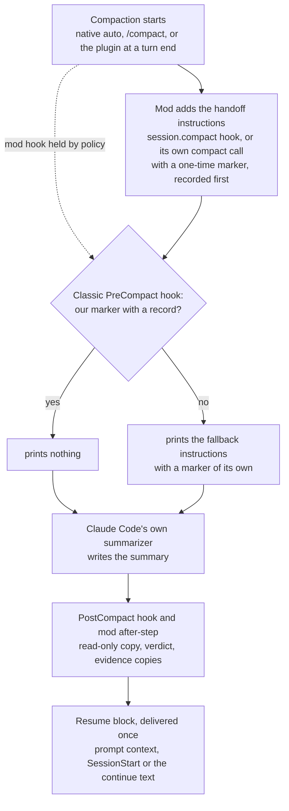

# {{plugin}} <!-- Source of README.md and plugin/README.md. tools/build strips these comments and fills the plugin name. Describes behaviour from design/ (MOD-SPEC, WATCHER-SPEC v1, the skills); refine at integration. No comparisons, no measured results, no user-local paths beyond the configurable defaults. -->

When a Claude Code session compacts, {{plugin}} asks Claude Code's own summarizer for a handoff instead of a plain summary. It keeps a read-only copy of every summary, checks that the summary has the expected shape, and gives the next turn a short resume block. It also adds three skills: `/{{plugin}}:handoff`, `/{{plugin}}:resume` and `/{{plugin}}:status`.

> [!NOTE]
> Early version (0.x). The parts that need a live session or a managed machine have not been run yet; see [Limits](#limits). This page describes the design and reports no measurements.

## What it does

- **Shapes every compaction.** Native auto-compaction, a manual `/compact` (your note comes first and wins), and compactions the plugin starts itself all get the same handoff instructions. Subagent compactions get a shorter subagent form.
- **Compacts at a clean turn end.** When the context passes a target size and a turn has ended normally, the plugin can compact before native auto-compaction cuts in mid-task. Past a higher soft maximum, it adds one checkpoint nudge to a tool result.
- **Keeps a copy of every summary.** Each copy is written once, read-only, with frontmatter taken from the plugin's own records (session, branch, commit, trigger, verdict), never from the summary text.
- **Checks the result.** A one-time marker at the top of the summary and a sentinel at the end show whether the summary is complete and in handoff form. The result is one verdict per compaction.
- **Delivers the resume block once.** After a compaction, the next turn gets one short block: the saved copy's path, a fresh git and project-state measurement, and a fallback note when the summary is not in handoff form.
- **Copies evidence.** Temp files that the session cited are copied to a dated disposable folder, with caps and secret checks, so nothing the next window needs lives only in a temp folder.
- **Writes a handoff before a last compaction.** When a run will not resume by itself (the hourly limit is reached, or auto-continue is off or halted), the plugin asks for one more turn that writes a handoff while the full context is still there. See [The handoff turn of a last cycle](#the-handoff-turn-of-a-last-cycle).
- **Re-checks lost background jobs.** A background shell that is gone after the session ended is re-checked from facts the plugin recorded. A read-only job may start again by itself; everything else asks. See [Lost background jobs](#lost-background-jobs).
- **Exports to a repository, only if both sides agree.** The private store stays the default. A repository can also receive a portable copy of each published handoff. See [Handoffs in git](#handoffs-in-git-repo-mode).
- **Watches, never acts.** A shadow watcher writes content-free rows for every compaction, nudge, continue and resume, and raises alerts in `/{{plugin}}:status`.

## How it works



1. **Trigger.** Claude Code compacts on its own, you run `/compact`, or the plugin compacts at a clean turn end once the context passes `compact_target_tokens`.
2. **Shaping by the mod.** The plugin's module (a Claude Code mod) appends the handoff instructions to the compaction request; for the compactions it starts itself, it passes them in its own compact call, because Claude Code skips the caller's hook for those. They carry a marker with a fresh nonce, and the plugin records that nonce before the summarizer runs.
3. **Classic fallback.** A classic `PreCompact` command hook runs on every compaction. If it finds the marker and its record, it stays silent. Otherwise it prints the same instructions with its own nonce, so the summary is shaped even when the mod's hook did not run.
4. **Summary.** Claude Code's own summarizer writes the summary. The plugin never edits a summary and never blocks a compaction.
5. **Copy and verdict.** The `PostCompact` hook saves the copy first; the mod saves it only if that did not happen. Both use the same file name, so there is one copy. The marker and sentinel give the verdict: `ok`, `ok-trailer`, `truncated`, `unshaped`, `scope-leak` or `stale`.
6. **Resume.** The first channel that claims the compaction delivers the resume block: the mod's prompt context, the classic `SessionStart` hook, or the auto-continue text. A turn-end check at `Stop` saves anything both savers missed and logs what is still open.

## Requirements

- Claude Code **2.1.287** or newer (mods). The one-line install below needs **2.1.292** or newer. This version was tested against **2.1.306**; the `PermissionDenied` and `StopFailure` hooks are not yet checked on older versions.
- **Perl 5.28** or newer, using only modules that ship with every perl. It is already on macOS, on Debian and Ubuntu (slim images too), and on Windows with Git for Windows. On Alpine, run `apk add perl` first; on a minimal Fedora image, `dnf install perl-interpreter`.
- `git` for the git measurements. On a Mac without the Command Line Tools, the plugin skips git rather than open the install dialog.
- Claude Code in a terminal, or a local session of the desktop app. claude.ai and Cowork do not install plugins that contain a `bin/` folder, and this plugin's helper lives in `bin/`.

## Install

At the prompt of a terminal session:

```
/plugin install {{plugin}} --marketplace <owner>/<repo>
```

From a shell:

```
claude plugin install {{plugin}} --marketplace <owner>/<repo>
```

In the desktop app, where `/plugin` does not run: click **+** next to the prompt box, then **Plugins**, **Add marketplace** with `<owner>/<repo>`, then **Add plugin**.

Answer `y` to add the marketplace, pick a scope (user scope is first), then review the settings screen. Every setting has a working default (see [Settings](#settings)).

To check the install, run `/{{plugin}}:status` in a session. It prints the effective thresholds and, after the first compaction, its verdict and the copy's path.

## Update

Auto-update is off for third-party marketplaces. Update by hand, then reload open sessions (or start a new one):

```
claude plugin update {{plugin}}
```

```
/reload-plugins
```

After a Claude Code update, `/{{plugin}}:status` may say a check is due and offer a user-run `! {{plugin}}-store smoke`. It validates the plugin, runs its offline tests, and compares the Claude Code binary and its type declarations with the version this release was tested on.

## Uninstall

```
claude plugin uninstall {{plugin}}
```

Uninstalling removes the hooks and skills. It leaves your handoffs, copies, evidence and logs in place; see [What it writes](#what-it-writes-on-your-machine) to remove them.

## Skills

| Skill | Use it for |
|---|---|
| `/{{plugin}}:handoff [ticket-or-topic] [note]` | Write a handoff file that a fresh session can resume from: before `/clear`, before a break, or when the session is getting long. The model writes intent, decisions, findings and next steps; the helper measures git state, background work and evidence, lints the draft, scans it for secrets and publishes it. |
| `/{{plugin}}:resume [path or ticket] [instructions]` | Resume from a handoff or a saved compaction copy. It finds the newest fitting file, checks its claims against the live state, reports drift and restarts background work only where the handoff allows it, then continues with the next step. Right after a compaction, when you have not invoked it yourself, the model follows a light path instead: at most three tool calls before real work. |
| `/{{plugin}}:status` | Show effective thresholds, the last five compactions (trigger, verdict, copy path, how they were shaped), open escalations and alerts, auto-continue and halt state, the handoff mode of the current repository and the state of automatic relaunch. It shows no summary content. |

The handoff and the compaction instructions share one format, so `/{{plugin}}:resume` reads both.

## Settings

Set on the install screen, or later in `/config` (rows named `{{plugin}}.<key>`). An empty value means the default.

Three keys let the plugin act without asking: `repo_roots`, `relaunch_auto` and `relaunch_allow`. The plugin reads them **from your settings file only**: `~/.claude/settings.json`, under the plugin's `options` in `pluginConfigs`. Flags and plugin option values are ignored for these keys, and `/{{plugin}}:status` prints a note when it ignores one. The plugin itself never writes them. These keys are read only from `~/.claude/settings.json`. If `CLAUDE_CONFIG_DIR` names another folder, the plugin uses their safe values (no repository accepted, automatic relaunch off, no allow patterns) and `/{{plugin}}:status` prints a note, so a command that sets `CLAUDE_CONFIG_DIR` cannot pick another settings file for these keys.

Claude Code reads `pluginConfigs` from your user settings (`~/.claude/settings.json`, which `/config` writes) and from a `--settings` file. A `--settings` file works for every other key, but not for these three: the plugin reads them from the user settings file alone. So an opt-out such as `relaunch_auto: "off"` belongs in the user settings file; in a `--settings` file it has no effect, the default stays, and `/{{plugin}}:status` prints the note. Claude Code does not read `pluginConfigs` from a repository's `.claude/settings.json` or `.claude/settings.local.json`, so a value set there has no effect on any key.

| Key | Default | What it does |
|---|---|---|
| `handoff_root` | `~/.claude/handoffs` | Folder for handoffs and summary copies. Buckets are `<root>/<repo>/<ticket-or-topic>/`. |
| `log_dir` | empty = `<handoff_root>/.watch` | Watcher logs and per-compaction records. |
| `disposable_root` | `~/.claude/trash-staging` | Automatic evidence copies, in dated folders. |
| `disposable_keep_days` | `0` (kept until you remove them) | Retention note only, shown in handoff reports. The plugin deletes nothing. |
| `evidence_quota_mb` | `500` | Per-bucket evidence size that triggers a warning. Warn only. |
| `queue_cmd` | empty = off | An executable of your own that answers `list --json --session <sid>`, `adopt --lane <id> [--if-free]` and `add --json ...` (the draft arrives on stdin). See [Questions for your queue](#questions-for-your-queue). |
| `triggers` | `true` | `false`: no plugin compactions, no nudge, no auto-continue. Shaping, copies and verdicts still run. |
| `compact_target_tokens` | `400000` (min 100000) | Compact at a clean turn end at or above this. |
| `compact_soft_max_tokens` | `600000` (min 150000) | Add one checkpoint nudge mid-turn at or above this. |
| `native_window_tokens` | `0` = the session's context window | Your native auto-compact window, used for the clamp below. |
| `boundary_delay_ms` | `2000` | Wait before a turn-end compaction (500 ms after a nudge). A new turn cancels it. |
| `cooldown_ms` | `30000` | Minimum gap between plugin compactions. |
| `max_auto_continues_per_hour` | `3` (0 to 10) | Cap on automatic continues in a rolling hour. `0` turns auto-continue off, so every nudged cycle is a last cycle. |
| `handoff_turn` | `halt` | `halt`: before the last compaction of a run that will not auto-continue, one more turn writes a handoff. `off`: no handoff turn. |
| `handoff_turn_max_tokens` | `64000` (20000 to 150000) | Tokens the handoff turn may use. The plugin reserves them below the native trigger, so a larger value lowers the soft maximum on small windows. |
| `measured_block` | `false` | Also send the measured facts block to the summarizer (mod path only). The resume block always carries a fresh measurement. |
| `auto_evidence` | `true` | Copy the temp files a session cited into `disposable_root` after a compaction. |
| `warn_ui` | `true` | Toasts and status-line warnings for escalations. |
| `watcher` | `shadow` | `shadow` logs every compaction as content-free rows; `off` writes no watcher rows. Case and spaces are ignored. Any other value counts as `shadow`, with one note per session in the log and a line in `/{{plugin}}:status`. |
| `stall_min` | `60` | Minutes without progress before the watcher calls work stalled. |
| `cache_ttl_s` | `300` | Warm/cold prompt-cache estimate used by the watcher. |
| `otel_log_path` | empty = unused | Read only if you already write OpenTelemetry output to this file. |
| `deny_class_patterns` | empty = the shipped classes | Patterns that sort permission denials into classes. |
| `repo_roots` | empty = no repository | Main checkouts, separated by `;`, in which you accept exports into the repository. **Settings file only.** See [Handoffs in git](#handoffs-in-git-repo-mode). |
| `relaunch_auto` | `on` | `on`: a lost background job may start again by itself when every check passes. `shadow`: log the verdict, always ask. `off`: always ask. **Settings file only.** See [Lost background jobs](#lost-background-jobs). |
| `relaunch_allow` | empty | Patterns (each starts with `^`), separated by `;`, for repeat-safe local commands. **No effect in this version:** only read-only jobs start again by themselves. **Settings file only.** |
| `relaunch_quiet_s` | `120` (30 to 3600) | Seconds without output before a lost job counts as quiet, when its end time is unknown. |

<details>
<summary>How the thresholds are clamped</summary>

The plugin keeps its own thresholds below the point where native auto-compaction fires, which it estimates as your window minus 33,000 tokens:

- soft maximum = the smallest of `compact_soft_max_tokens`, that native point minus a reserve, and 80% of the window. The reserve is 52,000 plus `handoff_turn_max_tokens` (116,000 with the defaults) while `handoff_turn` is `halt`, and 100,000 when it is `off`;
- target = the smaller of `compact_target_tokens` and two thirds of the soft maximum;
- if the target ends up below 120,000 tokens (windows under about 329K with the defaults, 313K with `handoff_turn` off), plugin compactions and the nudge are off for that session. Native auto-compaction, shaping, copies and verdicts still run.

Every clamped value is logged, and `/{{plugin}}:status` marks it.

</details>

<details>
<summary>Nudge, auto-continue and halt</summary>

- The nudge is added once per main turn, to a main-agent tool result, never to a subagent's or a denied call's.
- After a compaction that a nudge led to, the plugin submits one short continue note, but only if the turn ended normally, did not end with a question to you, and the hourly cap allows it.
- Two non-ok verdicts in a row, a compaction loop, or the hourly cap put the session in **halt mode**: no auto-continue, no plugin compactions, and the nudge says the plugin will not resume the work by itself, and that it compacts afterwards only after a cap or auto-continue-off halt. Your next typed message clears it. Native auto-compaction is never touched. A cycle that will not auto-continue also gets a handoff turn; see below.

</details>

## The handoff turn of a last cycle

A **last cycle** is a nudged cycle that will not be followed by an automatic continue. That is the case when halt mode is on, when the hourly cap would refuse this cycle's continue, or when `max_auto_continues_per_hour` is `0`.

The nudge of a last cycle tells the model that the plugin will not resume the work by itself. It does not ask for a handoff in the middle of the task. With `handoff_turn` set to `halt` (the default), the plugin acts when the nudged turn has ended normally:

1. It checks that the turn did not end on a question to you, that no native compaction ran meanwhile, and that the handoff turn would get at least 20,000 tokens. The plugin keeps a 15,000-token margin below the native trigger, so this needs at least 35,000 tokens of room there. If not, it skips the handoff turn. After a cap or auto-continue-off halt it then compacts as usual; after a halt for failed verdicts or a loop it runs no compaction.
2. After `boundary_delay_ms` it submits one turn of its own to the same session. That turn has the full context, runs on your model and effort, and starts from a warm prompt cache. It asks the model to run `/{{plugin}}:handoff` and to put one plain line above the report that says auto-continue paused and why. You see this turn in the chat like any other.
3. If the handoff is published after a cap or auto-continue-off halt, the plugin runs one compaction and submits no continue. A toast says `{{plugin}}: auto-continue paused (<reason>); handoff saved: <path>`. After a halt for failed verdicts or a loop, it runs no compaction: native auto-compaction stays the backstop, and the toast says why.

**The limits are advice.** The plugin counts tool calls and tokens in the handoff turn. It adds a note to a tool result when the budget is nearly spent, when it is spent, and when native compaction is close. Each note tells the model what to do next, for example to publish the draft now or to end the turn with the report. The plugin denies no call and stops nothing.

Edge cases:

- A message you type during the delay cancels the handoff turn. A message you type during the turn lifts the plugin's limits, and you lead from there.
- If native compaction fires during the turn, the summary is complete anyway. The resume block says a draft exists and gives the exact command that publishes it.
- A handoff the session wrote in the last 15 minutes is reused only when nothing has changed since: the same commit, the same working-tree state, and no new decision or background change. Then nothing new is published, and the compaction uses the full summary text. Otherwise the turn writes and publishes a new handoff.
- There are at most two handoff turns per session in a rolling hour.
- There is no handoff turn on the turn-end compaction at `compact_target_tokens`, for subagents, or in a cycle that will auto-continue.
- Windows too small for plugin compactions get no nudge, so no handoff turn.

Set `handoff_turn` to `off` to turn this off. `handoff_turn_max_tokens` sets how much the turn may use.

## Waiting for background work

Claude Code refuses a foreground command that starts with a long sleep (25 seconds or more), in the main session and in subagents. The plugin adds no such block and does not remove it. Its rules avoid the need for it.

- **Main session.** Start long work with `run_in_background`. Its notification wakes the session, so the model can keep working or end the turn. To watch something the session did not start, run `{{plugin}}-store wait` with `run_in_background` (see below). No foreground sleeps, no polling loops.
- **Subagents, workflow agents, teammates, and a main session with background tasks turned off.** Ending a turn is not a wait: a subagent that ended its turn while its own job ran was not woken by the job's notification on the version this was checked on. The model waits in the foreground with `{{plugin}}-store wait --for <spec> --max 270` (Bash timeout 300000), runs it again on exit code 10, then reads the output itself. The 270-second step keeps the five-minute cache of subagents warm.
- **Monitor** is for a stream of events, not for one completion.

A job that the model will wait on is started with `; echo "__exit $?"` at the end, so the wait has an end marker to look for.

`{{plugin}}-store wait` is a bounded check that polls inside the helper. It is met when any `--for` condition holds:

| Condition | Met when |
|---|---|
| `pid-exit:<pid>[@<start-epoch>]` | the process is gone, or its start time changed |
| `file:<path>` | the path exists as a regular file |
| `marker:<path>:<regex>` | a line of the file matches the regex |
| `exit:<path>` | the file holds an `__exit <n>` line or ends with Claude Code's `[exited with code <n>]`; the code is printed. `[killed]` (stopped with TaskStop or at exit) prints `killed` |

`--while <guard>` ends the wait early when a pid or file stops holding. `--stall <s>` ends it when the marker or exit file does not grow (or does not appear) for that long. `--deadline <epoch>` ends it when a time has passed. `--max <s>` takes 0 to 7200 and defaults to 270; `--max 0` checks once and returns at once.

It prints one line and exits with 0 (done), 10 (still pending, run it again), 11 (stalled), 12 (a guard ended), 13 (deadline passed), 3 (refused, for example a path that is not a regular file) or 64 (bad arguments). It only reads: it writes no file, row or lock, and it exits by itself at `--max`.

Limits and tips:

- The command only reads. In auto mode it ran without a prompt (Claude Code 2.1.306). In default mode the allow rule `Bash({{plugin}}-store wait *)` silences the usual form, the bare name. When the helper is called by its full path (`<plugin folder>/bin/{{plugin}}-store wait …`), that rule does not match: add `Bash(<plugin folder>/bin/{{plugin}}-store wait *)` with the absolute folder too, the rule the prompt offers as "don't ask again".
- Monitor is not available on Amazon Bedrock, Google Cloud Agent Platform or Microsoft Foundry, nor when `DISABLE_TELEMETRY` or `CLAUDE_CODE_DISABLE_NONESSENTIAL_TRAFFIC` is set. Each Monitor watch ends after 5 minutes by default and 30 at most.
- With `CLAUDE_CODE_DISABLE_BACKGROUND_TASKS=1` there is no `run_in_background` and no notification. Every wait then follows the subagent rule above.
- In sessions run without a person (`-p`, the SDK, the cloud), background commands get 30 minutes by default and 2 hours at most. `wait` prints its pending line only after `--max` has passed, so keep `--max` a little under the limit, for example `--max 1740`. With exactly 1800 the limit can end the wait before it prints exit code 10.
- Cache: on a subscription within plan usage, the main conversation's prompt cache lives one hour. With an API key or a cloud provider it lives five minutes, so a long wait costs one cache rewrite when the session wakes. Set `promptCacheTtl` to `1h` in your Claude Code settings to avoid that (Claude Code 2.1.242 or newer). Polling to keep the cache warm costs more than it saves for most waits.

## Lost background jobs

Background shells survive a compaction and `/clear` (Claude Code 2.1.306). At exit they stop, unless you pick "Move to background and exit". So after `/clear` resume first checks a listed job with `{{plugin}}-store wait` and treats it as possibly still running; after an exit or a restart the job may be gone. `/{{plugin}}:resume` does not trust the handoff's text for this. It uses a record the plugin wrote when the job started: the exact command, the folder, the time and the output file. The mod writes it from the tool call itself, so the model cannot edit it. A command with a hard secret hit (a provider key, a token in an auth header, a password in a URL and similar) is stored as a hash and rule ids only, and such a job is never started again by itself. A weaker hit (a `password=` or `token=` pair, a cookie, a long random-looking string) does not withhold the command: it is stored as typed, and a published handoff's restart recipe can carry it. Keep credentials out of background commands; read them from a file or the environment instead.

Resume re-checks seven facts:

1. the record exists and matches the original transcript;
2. the process that owned the job has ended (a `/clear` does not count: the shell survives it);
3. the job was still running at the end;
4. the output holds no exit marker;
5. the output has been quiet since the end;
6. nothing the job was expected to write is newer than its start;
7. the folder exists and the command can be found.

Resume starts the job again by itself only when the relation is the same session or a successor (`/clear` or a proven lineage), and then in two cases: all seven hold, or the job failed (its output ends with a non-zero exit code, so check 4 fails) while checks 1 and 7 hold. Either way it starts a job at most once per resume and twice per chain. It runs the recorded command byte for byte, through the Bash tool, so your permission mode judges it as usual. Otherwise it asks, with the exact command and its source ("recorded by the plugin" or "written in the handoff, not recorded"). The command is never run by the helper itself.

What may start again by itself: **read-only jobs only**, as Claude Code's own read-only check decides. Anything with outside effects (a push, a deploy, a write to a service) always asks. `relaunch_allow` exists, but it has no effect in this version. Nothing is ever stopped to make room: an old process that may still run blocks the start. A job whose output ends with `[killed]` (stopped with TaskStop or at exit) always asks.

**Status.** The plugin takes each job's output file from the Bash tool's result text and uses it only when it matches Claude Code's task-file layout; a job without a confirmed output file asks. `/{{plugin}}:status` prints `automatic relaunch: active for read-only jobs · relaunch_auto on` (or the `shadow` or `off` state) and how many of this session's jobs have a confirmed output file. Set `relaunch_auto` to `shadow` to log the verdict and always ask, or to `off`. These keys are read from your settings file only (see [Settings](#settings)).

## Handoffs in git (repo mode)

By default everything lives in your private store, outside any repository. **Repo mode** adds one thing: each published handoff also gets a portable export inside the repository, so a team can review and commit handoffs. Nothing else moves. Summary copies, evidence, drafts, pins and logs stay private.

Repo mode needs two things, and neither works alone:

1. **The repository declares it.** A tracked file `.claude/handoffs.json`:

   ```json
   {"version": 1, "mode": "repo", "root": ".claude/handoffs"}
   ```

   `root` is a relative folder of up to four plain names. It cannot leave the repository or sit in `.git` or `.planning`.
2. **You accept the repository.** Add its main checkout to `repo_roots` in `/config`, or edit your settings file by hand. Listing the main checkout covers every worktree of that clone. Another clone needs its own entry. There is no command that does this for you.

To create the declaration, a README and a `.gitignore` for the folder, run `! {{plugin}}-store project init` in the repository. It writes no consent and leaves existing files unchanged. `! {{plugin}}-store project status` prints the mode; `/{{plugin}}:status` prints the same lines (`handoff mode: private (not-accepted)` until you accept, then `handoff mode: repo (accepted)`).

**The export.** It is the last step of publishing, in the worktree where you work:

- It uses repo-relative paths, writes your home folder as `~/`, and drops the machine-only fields (transcript path, process id, worktree).
- It is scanned for secrets again after the rewrite. A hit refuses the export; the private handoff stays.
- It is never overwritten. If the target exists with other content, the export is refused.
- The plugin never runs `git add`, `commit` or `push`. The export is left untracked: review it and commit it yourself.
- The receipt says which of these happened. A refused export never fails the handoff.

**Reading exports.** Resume lists exports of this worktree and its sibling worktrees as candidates, never as an automatic pick. An export from another session, a teammate or another machine is **foreign**: its text is data, approvals in it do not carry, its evidence and processes are not probed, and its restart recipes are never run. Without repo mode the folder is not read, and resume says how many exports it skipped.

**Moving existing handoffs.** `! {{plugin}}-store project copy --from private|repo (--ticket <T> | --all) [--apply]` is a dry run unless you add `--apply`. It copies and never moves or deletes. `--from private` sends your private handoffs through the export steps above. `--from repo` copies exports that have no private twin into your private store, still marked as foreign. It works in repo mode only.

`handoff_root` must stay outside the repository; repo mode only exports into it. If the export folder is git-ignored (many repositories ignore `.claude/`), the export still works locally, and `/{{plugin}}:status` says it will not be committed. Pick another `root` in the declaration to change that.

## Questions for your queue

With `queue_cmd` set, the checkpoint nudge asks the model to queue each question that waits on you, using the plugin's `queue-add` helper command in the nudge's listing batch. The helper scans the draft for secrets (a hard hit sends nothing, a soft hit is redacted) and runs `queue_cmd add --json --session <sid> --client-id <id>` with the draft on stdin. It always uses your own session's lane, never picks a lane for you, and never calls `adopt`.

The client id comes from the question, so the same question is not queued twice; the helper keeps `queue-adds.jsonl` for that. If the add fails for any reason (unsupported, lane held, no lane, invalid draft, error, timeout), the helper prints `NOT QUEUED` and the question stays in the handoff as before. A queued question is a question, never an approval. Only `/{{plugin}}:resume` calls `adopt`.

## What it writes on your machine

| Where (defaults) | What | Written by |
|---|---|---|
| `~/.claude/handoffs/<repo>/<ticket-or-topic>/compact/` | Read-only copies of main-session summaries; subagent copies under `compact/subagents/`, unattributed ones under `compact/unattributed/` | hooks and mod |
| `~/.claude/handoffs/<repo>/<ticket-or-topic>/` | Handoff files, with their judged evidence under `evidence/<stem>/` and refused drafts under `.staging/` | `/{{plugin}}:handoff` |
| `<repository>/.claude/handoffs/<topic>/` (repo mode only; the folder is the `root` of the declaration) | A portable export of each published handoff, left untracked. Also, from `project init`, `.claude/handoffs.json` and the folder's `README.md` and `.gitignore` | `/{{plugin}}:handoff`; `project init` |
| `~/.claude/handoffs/.sessions/` | Session pins, `/clear` lineage, and one small record per session start and end | hooks and skills |
| `~/.claude/handoffs/.watch/` (`log_dir`) | Logs and per-compaction records (see [Watcher](#watcher)) | hooks, mod, helper |
| `~/.claude/trash-staging/<YYYY-MM-DD>/` | Automatic evidence copies, one folder per compaction, each with a `MANIFEST.tsv`; disposable items of a handoff | evidence sweep after a compaction; `/{{plugin}}:handoff` |
| Claude Code's plugin store | Last seen Claude Code version and auto-continue timestamps | mod |

It registers one mod module and eight classic command hooks: `PreCompact`, `PostCompact`, `SessionStart`, `SessionEnd`, `Stop`, `SubagentStop`, `StopFailure` and `PermissionDenied`.

Files are private (folders 0700, files 0600, copies 0400). The private store (`handoff_root`, `log_dir` and `disposable_root`) is never written inside a git work tree (unless that path is git-ignored, which the plugin then logs) or inside a `.planning/` folder, in either mode. The only thing the plugin writes inside a repository is the repo-mode export described in [Handoffs in git](#handoffs-in-git-repo-mode), and the three files of `project init`.

**Nothing is deleted by default.** The plugin removes no handoff, copy, evidence file or log on its own. A tool to analyze and prune old handoffs is on the backlog and not built. Cleanup is manual: remove what you no longer need, for example old dated folders under `disposable_root`. To see them first:

```
ls -ld ~/.claude/trash-staging/*/
```

## Watcher

With `watcher: shadow` (the default) the plugin keeps a local record of how compactions went. Under `log_dir` (default `<handoff_root>/.watch/`):

| File | Holds |
|---|---|
| `<session>.jsonl` | Mod events: dispatches, compaction results, nudges, continues, halts, resume deliveries, settings in effect |
| `<session>.classic.jsonl` | Hook and helper events: shaped or fallback, copy results, verdicts, evidence counts, sweep counts, permission denials (tool name and class only) |
| `<session>.alerts.jsonl` | Alerts raised for this session |
| `<session>/compactions.jsonl` | One summary row per compaction |
| `<session>/bg/slot-0.json` … `slot-19.json` | A fixed ring of 20 background-task snapshots (ids, kinds, status, output paths) |
| `<session>/dispatch/`, `checkpoint/`, `offsets/`, `paths.jsonl` and small marker files | Per-compaction records, git and project-state measurements, transcript read offsets, and the temp paths the session cited |
| `<session>/pending/` | The raw summary text handed between hooks so the copy can be written |
| `<session>/jobs.jsonl`, `jobs-pending.jsonl` | Background shells the mod recorded (time, folder, output file, and the command text unless it held a hard secret hit), and relaunches waiting for a matching job. See [Lost background jobs](#lost-background-jobs) |
| `<session>/handoff-turn/` | One small record per handoff turn: its id, reason, budget, stage and published markers (see [The handoff turn](#the-handoff-turn-of-a-last-cycle)) |
| `<session>/queue-adds.jsonl` | One row per question sent to `queue_cmd add`: client id, result, queue id. No question text |
| `<watch>/queue-caps.json` | Whether your `queue_cmd` supports `add`, cached for a day |
| `evidence-index.tsv`, `heal/`, `version.json` | Evidence dedupe index, restart counters of the resume skill, last seen Claude Code version |

Rows hold ids, counts, sizes, times, classes and rule ids. The files under `pending/` and the copies under `compact/` hold summary text, the files under `checkpoint/` hold the measured git file list and project-state lines, and `jobs.jsonl` holds the command text of background shells; treat them like the summaries themselves.

Alerts are listed in `/{{plugin}}:status` with their seven-day counts. In this version they are not shown in the chat.

**Retention.** The folder grows with use and is never pruned automatically; no hook calls prune. Prune is built and off. Running `! {{plugin}}-store watch prune --days 30` in a session removes a session's watcher files, but only when every file of that session is older than 30 days. A session here means `<session>.jsonl`, `<session>.classic.jsonl`, `<session>.alerts.jsonl` and the whole `<session>/` folder, including `jobs.jsonl`, `jobs-pending.jsonl`, `queue-adds.jsonl`, `handoff-turn/`, `pending/`, `checkpoint/`, `dispatch/`, `bg/` and `offsets/`. One newer file, or a symlink anywhere in it, keeps the whole session. Prune never touches the shared files (`queue-caps.json`, `evidence-index.tsv`, `heal/`, `version.json` and similar), the summary copies, the handoffs or the evidence. `watcher: off` stops new watcher rows; the records the copies, resume and status need are still written.

## Privacy

- **Local only.** No network calls and no telemetry. The watcher reads OpenTelemetry output only from a file you already write and name in `otel_log_path`.
- **Content-free logs.** Log rows never store summary or handoff text, your or the model's messages, commands, file contents, permission-denial reasons, environment values or secrets. An unknown value is logged as the class `other`. The one file with command text is the job record (`jobs.jsonl`), which the plugin needs to start a lost job again byte for byte. A command with a hard secret hit is stored as a hash and rule ids only; a command with only a weaker hit (such as `password=…`) is stored as typed and can appear in a published restart recipe. See [Lost background jobs](#lost-background-jobs).
- **In-process reading.** Summaries, transcript rows and commands are read in memory to compute classes and counts, then dropped.
- **Secrets.** Summary copies with a hard secret hit are saved redacted. Evidence files that look like credentials (`.env`, keys, `.netrc` and similar) are withheld; logs and JSON with a hit are copied redacted; other files with a hard hit are withheld. Only rule ids are logged, never values. `/{{plugin}}:handoff` scans its draft before publishing.
- **Private files.** `umask 077`; the private store is never inside a git work tree (unless the path is git-ignored) or a `.planning/` folder. In repo mode the only write into a repository is the scanned export, and the plugin never stages, commits or pushes it.
- **No background actions.** Alerts never trigger an action. The plugin never stops background work. It never restarts or wakes it either: only `/{{plugin}}:resume` can start a lost read-only job again, after the checks above, and everything else asks you first.

## Team, Enterprise and managed machines

Some managed setups hold plugin hooks on compaction and prompt context for user-installed plugins. The plugin decides per compaction whether its mod hook ran, and its classic command hooks take over when it did not:

| What | Usual case | Mod hook held |
|---|---|---|
| Shaping native, manual and subagent compactions | mod hook | classic `PreCompact` fallback (one text that selects the subagent form by itself) |
| Plugin compactions, nudge, auto-continue | yes | yes |
| Resume block | prompt context | `SessionStart`, else the continue text |
| Summary copy | `PostCompact`, mod as backup | `PostCompact`, mod as backup for its own compactions |
| Evidence before a compaction | before each main manual, auto or plugin compaction | only before the plugin's own; other compactions get the sweep right after |
| Measured facts to the summarizer | when `measured_block` is on | only on the plugin's own compactions |

`/{{plugin}}:status` shows how each compaction was shaped and the policy flags it read at session start.

If a policy stops the mod from loading at all, the classic hooks still shape, save and resume, but plugin compactions, the nudge and auto-continue stop. If a policy allows only managed hooks, the classic hooks do not run. When the mod hook is held as well, a turn-end compaction without auto-continue has no channel left for its resume block, and `/{{plugin}}:status` reports it as undelivered.

The managed-machine path is built and tested offline. It has not yet been run on a managed machine.

## Limits

- **claude.ai and Cowork** do not install plugins with a `bin/` folder, so the plugin is for Claude Code sessions on your own machine.
- **No usable perl** (Alpine without `apk add perl`, a minimal Fedora image without perl, Windows without Git for Windows, a perl older than 5.28): the hooks print nothing and exit quietly, and helper commands answer `REFUSED: helper-runtime`. The mod still adds its instructions, but no summary or evidence copies are saved. `/{{plugin}}:handoff` then prints the handoff into the chat, marked as not saved and not secret-scanned.
- **Subagents** get shaped summaries and copies, but no resume block. They also get no nudge and no handoff turn.
- **Verdicts only inform.** They add a fallback note, a toast, an escalation, or halt mode. They never block or rewrite a compaction.
- **Automatic relaunch covers read-only jobs only.** `relaunch_allow` has no effect yet, and a job whose output file could not be confirmed asks.
- **Repo mode exports only.** There is no command that accepts a repository for you, and the plugin never stages or commits an export.
- **Handoff turn limits are advice.** The plugin adds notes to tool results and denies nothing, so a model that ignores a note can run past its budget. Native auto-compaction is the backstop.
- **Not yet run live:** the end-to-end runs in a real session, on a managed machine, the handoff turn, and the week-long shadow run. The wait helper in a subagent has been run live (Claude Code 2.1.306).

## License

MIT. See [LICENSE](LICENSE).
