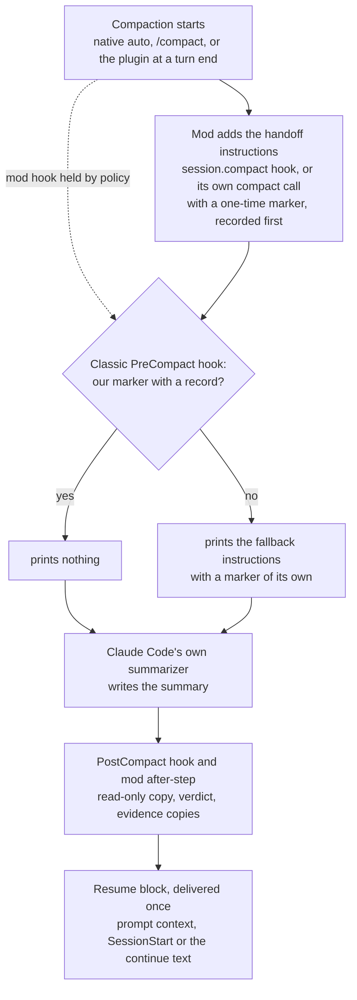

# {{plugin}} <!-- Source of README.md and plugin/README.md. tools/build strips these comments and fills the plugin name. Describes behaviour from design/ (MOD-SPEC, WATCHER-SPEC v1, the skills); refine at integration. No comparisons, no measured results, no user-local paths beyond the configurable defaults. -->

When a Claude Code session compacts, {{plugin}} asks Claude Code's own summarizer for a handoff instead of a plain summary. It keeps a read-only copy of every summary, checks that the summary has the expected shape, and gives the next turn a short resume block. It also adds four skills: `/{{plugin}}:handoff`, `/{{plugin}}:resume`, `/{{plugin}}:status` and `/{{plugin}}:report`.

> [!NOTE]
> Early version (0.x). The parts that need a live session or a managed machine have not been run yet; see [Limits](#limits). This page describes the design and reports no measurements.

## What it does

- **Shapes every compaction.** Native auto-compaction, a manual `/compact` (your note comes first and wins), and compactions the plugin starts itself all get the same handoff instructions. Subagent compactions get a shorter subagent form.
- **Compacts at a clean turn end.** When the context passes a target size and a turn has ended normally, the plugin can compact before native auto-compaction cuts in mid-task. Past a higher soft maximum, it adds one checkpoint nudge to a tool result.
- **Keeps a copy of every summary.** Each copy is written once, read-only, with frontmatter taken from the plugin's own records (session, branch, commit, trigger, verdict), never from the summary text.
- **Checks the result.** A one-time marker at the top of the summary and a sentinel at the end show whether the summary is complete and in handoff form. The result is one verdict per compaction.
- **Delivers the resume block once.** After a compaction, the next turn gets one short block: the saved copy's path, a fresh git and project-state measurement, and a fallback note when the summary is not in handoff form.
- **Copies evidence.** Temp files that the session cited are copied to a dated disposable folder, with caps and secret checks, so nothing the next window needs lives only in a temp folder.
- **Writes a handoff before a last compaction.** When a run will not resume by itself (the hourly limit is reached, or auto-continue is off or halted), the plugin asks for one more turn that writes a handoff while the full context is still there. See [The handoff turn of a last cycle](#the-handoff-turn-of-a-last-cycle). By default it does the same before each planned compaction; see [The handoff turn before a planned compaction](#the-handoff-turn-before-a-planned-compaction).
- **Handles idle compactions.** With `"idleCompaction": false` in your Claude Code settings, the plugin compacts a long idle session itself, about 54 minutes after its last request and before the prompt cache expires, so in sessions that read your `~/.claude/settings.json` idle compaction runs only where the plugin is enabled (terminal sessions; headless and Desktop: see [Limits](#limits)). When Claude Code compacts an idle session itself, the summary is shaped the same way. Either way the resume block is measured again when you come back. See [Idle compaction](#idle-compaction).
- **Re-checks lost background jobs.** A background shell that is gone after the session ended is re-checked from facts the plugin recorded. A read-only job, or one you allowlisted, may start again by itself; everything else asks. See [Lost background jobs](#lost-background-jobs).
- **Exports to a repository, only if both sides agree.** The private store stays the default. A repository can also receive a portable copy of each published handoff. See [Handoffs in git](#handoffs-in-git-repo-mode).
- **Watches, never acts.** A shadow watcher writes content-free rows for every compaction, nudge, continue and resume, and raises alerts in `/{{plugin}}:status`. The rows stay on your machine; `/{{plugin}}:report` bundles them into a zip that you can send yourself. See [Watcher](#watcher).

## How it works



1. **Trigger.** Claude Code compacts on its own, you run `/compact`, or the plugin compacts at a clean turn end once the context passes `compact_target_tokens`.
2. **Shaping by the mod.** The plugin's module (a Claude Code mod) appends the handoff instructions to the compaction request; for the compactions it starts itself, it passes them in its own compact call, because Claude Code skips the caller's hook for those. They carry a marker with a fresh nonce, and the plugin records that nonce before the summarizer runs.
3. **Classic fallback.** A classic `PreCompact` command hook runs on every compaction. If it finds the marker and its record, it stays silent. Otherwise it prints the same instructions with its own nonce, so the summary is shaped even when the mod's hook did not run.
4. **Summary.** Claude Code's own summarizer writes the summary. The plugin never edits a summary and never blocks a compaction.
5. **Copy and verdict.** The `PostCompact` hook saves the copy first; the mod saves it only if that did not happen. Both use the same file name, so there is one copy. The marker and sentinel give the verdict: `ok`, `ok-trailer`, `truncated`, `unshaped`, `scope-leak` or `stale`.
6. **Resume.** The first channel that claims the compaction delivers the resume block: the mod's prompt context, the classic `SessionStart` hook, or the auto-continue text. A turn-end check at `Stop` saves anything both savers missed and logs what is still open. If the session exits or restarts before its next turn, the block waits on disk and goes to the first turn after `claude --resume` of the same session, built again by the running version and measured again when it is more than 10 minutes old. Only that first turn gets it, and only once the earlier process has ended; a newer compaction replaces it, `/clear` drops it, and a forked session never gets it.

## Requirements

- Claude Code **2.1.287** or newer (mods). The one-line install below needs **2.1.292** or newer. This version was tested against **2.1.306**; the `PermissionDenied` and `StopFailure` hooks are not yet checked on older versions.
- **Perl 5.28** or newer, using only modules that ship with every perl. It is already on macOS and on Debian and Ubuntu (slim images too). On Alpine, run `apk add perl` first; on a minimal Fedora image, `dnf install perl-interpreter`.
- `git` for the git measurements. On a Mac without the Command Line Tools, the plugin skips git rather than open the install dialog.
- Claude Code in a terminal, or a local session of the desktop app (the desktop app runs Claude Code headless, where the plugin compacts by running `/compact`; not yet checked live there, see [Limits](#limits)). claude.ai and Cowork are not tested yet: whether they install the plugin and run its hooks, mod and helper has not been checked.

## Platforms

| Platform | This version |
|---|---|
| macOS 13 or newer | Supported. The full test suite runs on macOS (Apple silicon). |
| Linux with glibc | Supported, with perl 5.28 or newer. In containers, the helper compiles and its smoke checks pass on Debian 10 and 12, Ubuntu 20.04 and a current Ubuntu, and Fedora, with perl 5.28 to 5.42, on arm64 and emulated amd64. Perl 5.28 itself is checked on two images; with perl 5.26 or no perl, the plugin falls back as described in [Limits](#limits). Not yet done on Linux: a clean run of the full test suite and a real Claude Code session. |
| Alpine and other musl systems | Expected to work, not yet tested in a session. With `apk add perl`, the helper's smoke checks pass in an Alpine container; without perl, the fallback works there. |
| WSL 2 | Expected to work like Linux, not yet tested. |
| Windows, native | Not supported yet; planned for a later release. |

The plugin has never run on native Windows. What follows is expected from the way it is built, not something that has been seen:

- **Without Git for Windows**, Claude Code runs hook commands in PowerShell, which cannot start the plugin's launcher. Each plugin hook is then expected to fail with a visible hook error at its event. These errors do not block a tool call or a compaction, but compactions are not reliably shaped, no summary or evidence copies are saved, and the skills cannot call the helper.
- **With Git for Windows**, the hooks may reach the helper through Git Bash and its perl, but nothing on that path has been tested: process start times, file locks and paths may be wrong, and the mod's own helper calls are expected to fail.

On Windows, running Claude Code inside WSL 2 is the expected route until native support lands.

## Install

At the prompt of a terminal session:

```
/plugin install {{plugin}} --marketplace <owner>/<repo>
```

From a shell:

```
claude plugin install {{plugin}} --marketplace <owner>/<repo>
```

In the desktop app, where `/plugin` does not run: click **+** next to the prompt box, then **Plugins**, **Add marketplace** with `<owner>/<repo>`, then **Add plugin**.

Answer `y` to add the marketplace, pick a scope (user scope is first), then review the settings screen. Every setting has a working default (see [Settings](#settings)).

To check the install, run `/{{plugin}}:status` in a session. It prints the effective thresholds and, after the first compaction, its verdict and the copy's path.

## Update

Auto-update is off for third-party marketplaces. Update by hand, then reload open sessions (or start a new one):

```
claude plugin update {{plugin}}
```

```
/reload-plugins
```

After a Claude Code update, `/{{plugin}}:status` may say a check is due and offer a user-run `! "<plugin folder>/scripts/{{plugin}}-store" smoke`, printed with the real folder. It validates the plugin, runs its offline tests, and compares the Claude Code binary and its type declarations with the version this release was tested on.

## Uninstall

```
claude plugin uninstall {{plugin}}
```

Uninstalling removes the hooks and skills. It leaves your handoffs, copies, evidence and logs in place; see [What it writes](#what-it-writes-on-your-machine) to remove them.

## Skills

| Skill | Use it for |
|---|---|
| `/{{plugin}}:handoff [ticket-or-topic] [note]` | Write a handoff file that a fresh session can resume from: before `/clear`, before a break, or when the session is getting long. The model writes intent, decisions, findings and next steps; the helper measures git state, background work and evidence, lints the draft, scans it for secrets and publishes it. |
| `/{{plugin}}:resume [path or ticket] [instructions]` | Resume from a handoff or a saved compaction copy. It finds the newest fitting file, checks its claims against the live state, reports drift and restarts background work only where the handoff allows it, then continues with the next step. Right after a compaction, when you have not invoked it yourself, the model follows a light path instead: at most three tool calls before real work. |
| `/{{plugin}}:status` | Show the watcher state, effective thresholds, the last five compactions (trigger, verdict, copy path, how they were shaped), open escalations and alerts, auto-continue and halt state, the handoff mode of the current repository, the state of automatic relaunch and of the question queue, and the allow rule and user-run commands with the real plugin folder. It shows no summary content. |
| `/{{plugin}}:report [--since 7d]` | Bundle the plugin's content-free logs, version, settings and recorded probe results into a zip that you can send to the developer yourself. Nothing is uploaded. Use it only when you want to share; see [Sending a report](#sending-a-report). |

The handoff and the compaction instructions share one format, so `/{{plugin}}:resume` reads both.

**The helper.** The skills and the plugin call one helper, `scripts/{{plugin}}-store` in the plugin folder, always by its full path; nothing is added to your `PATH`. Where this page shows a command for you to run, it is written `! "<plugin folder>/scripts/{{plugin}}-store" …`, and `/{{plugin}}:status` prints it with the real folder.

**After `/clear`.** After `/clear` the plugin delivers no resume block, submits no prompt and runs no skill on its own; work resumes only when you ask for it. A continue or handoff turn that was about to start when you cleared is dropped.

## Settings

Set on the install screen, or later in `/config` (rows named `{{plugin}}.<key>`). An empty value means the default.

Four keys let the plugin act without asking: `repo_roots`, `relaunch_auto`, `relaunch_allow` and `unattended_prod_reads`. A fifth, `queue_cmd`, names a program the plugin runs, so it is treated the same way. The plugin reads these five **from your settings file only**: `~/.claude/settings.json`, under the plugin's `options` in `pluginConfigs`. Flags and plugin option values are ignored for these keys, and `/{{plugin}}:status` prints a note when it ignores one. The plugin itself never writes them. These keys are read only from `~/.claude/settings.json`. If `CLAUDE_CONFIG_DIR` names another folder, the plugin uses their safe values (no repository accepted, automatic relaunch off, no allow patterns, production reads asked, no queue) and `/{{plugin}}:status` prints a note, so a command that sets `CLAUDE_CONFIG_DIR` cannot pick another settings file for these keys.

`prod_patterns`, `secret_extra_rules` and `protected_branches` can only make the plugin ask or withhold more. Flags and plugin option values are ignored for them too, so a command cannot replace your list with a shorter one, but they are read from the settings file of the folder `CLAUDE_CONFIG_DIR` names, when one is set. <!-- 2026-10-23 owner xxxxxxxx-29 -->

Your own regular expressions (`secret_extra_rules`, `prod_patterns`, `ticket_pattern`, `relaunch_allow` and `deny_class_patterns`) run with a time limit. One that runs longer than a second on one text (less inside a hook or a quick plugin call, and a quarter second for `ticket_pattern`; a large file adds 0.3 seconds per MB) is stopped, and all your patterns together get a fixed share of each call's time, so a pattern that backtracks badly cannot hold a hook past its timeout. `ticket_pattern` has a small share of its own, so the folder a copy is filed under does not depend on what ran before it. A pattern that is stopped, or not run because that share is used up, takes the safe side. A stopped secret rule counts as a hit of its kind on the whole text: for a `HARD` rule the text is withheld, and for a `WARN` rule the plugin does what it does with any `WARN` hit (your rules after it still run). A production pattern counts as production, a ticket pattern gives no ticket, and a `relaunch_allow` or `deny_class_patterns` pattern does not match. A pattern stopped for being slow is skipped for the rest of the session on texts as long as the one it was stopped on (a text whose larger size gives it more time gets another try); shorter texts still run it. A pattern with a wildcard property such as `\p{name=/…/}` is refused when the settings are read, because Perl runs it while the pattern is compiled, before any time limit applies. `/{{plugin}}:status` then prints a warning with the setting and the pattern's position (never the pattern). `deny_class_patterns` takes up to 32 entries of up to 200 characters each, as `prod_patterns` does. Globs (`NAME:` rules and `protected_branches`) cannot run long; a `protected_branches` entry that mixes `*` and `**` gets the same limit and counts as protected when it is stopped. <!-- U-06, owner 2026-10-26 -->

Claude Code reads `pluginConfigs` from your user settings (`~/.claude/settings.json`, which `/config` writes) and from a `--settings` file. A `--settings` file works for every other key, but not for these eight: the plugin reads them from the settings file alone. So an opt-out such as `relaunch_auto: "off"` belongs in the user settings file; in a `--settings` file it has no effect, the default stays, and `/{{plugin}}:status` prints the note. Claude Code does not read `pluginConfigs` from a repository's `.claude/settings.json` or `.claude/settings.local.json`, so a value set there has no effect on any key.

| Key | Default | What it does |
|---|---|---|
| `handoff_root` | `~/.claude/handoffs` | Folder for handoffs and summary copies. Buckets are `<root>/<repo>/<ticket-or-topic>/`. |
| `log_dir` | empty = `<handoff_root>/.watch` | Watcher logs and per-compaction records. |
| `disposable_root` | `~/.claude/trash-staging` | Automatic evidence copies, in dated folders. |
| `disposable_keep_days` | `0` (kept until you remove them) | Retention note only, shown in handoff reports. The plugin deletes nothing. |
| `evidence_quota_mb` | `500` | Per-bucket evidence size that triggers a warning. Warn only. |
| `queue_cmd` | empty = off | An executable of your own for an optional question queue. It answers `list --json --session <sid>` with a `queue-stub/v1` object (the version tag is required), `adopt --lane <id> [--if-free] [--must-exist]` and `add --json ...` (the draft arrives on stdin). **Settings file only.** See [Questions for your queue](#questions-for-your-queue). |
| `triggers` | `true` | `false`: no plugin compactions, no nudge, no auto-continue. Shaping, copies and verdicts still run. |
| `compact_target_tokens` | `400000` (min 100000) | Compact at a clean turn end at or above this. |
| `compact_soft_max_tokens` | `600000` (min 150000) | Add one checkpoint nudge mid-turn at or above this. |
| `native_window_tokens` | `0` = the session's context window | Your native auto-compact window, used for the clamp below. |
| `boundary_delay_ms` | `2000` | Wait before a turn-end compaction (500 ms after a nudge). A new turn cancels it. |
| `cooldown_ms` | `30000` | Minimum gap between plugin compactions. |
| `max_auto_continues_per_hour` | `6` (0 to 10) | Cap on automatic continues in a rolling hour. `0` turns auto-continue off, so every nudged cycle is a last cycle. |
| `handoff_turn` | `halt` | `halt`: before the last compaction of a run that will not auto-continue, one more turn writes a handoff. `off`: no handoff turn. |
| `handoff_turn_max_tokens` | `64000` (20000 to 150000) | Tokens the handoff turn may use. The plugin reserves them below the native trigger, so a larger value lowers the soft maximum on small windows. |
| `precompact_turn` | `model` | `model`: before each planned compaction (the turn-end compaction at `compact_target_tokens`) the model gets one extra turn to write a handoff. `code`: code records the checkpoint alone, which saves usage. Case and spaces are ignored; any other value counts as `code`. See [The handoff turn before a planned compaction](#the-handoff-turn-before-a-planned-compaction). |
| `idle_handoff_turn` | `auto` | `auto`: while Claude Code's own idle compaction is off in your settings and the plugin does not compact the session either (it is below the plugin's minimum, `idle_compact` is `off`, `"autoCompactEnabled": false`, or the plugin's compaction failed twice), the model gets one turn to write a handoff about 49 minutes into an idle period, before the prompt cache expires. While your settings let Claude Code compact idle sessions, or cannot be read, the plugin checks about 55.5 minutes in and runs that turn only if Claude Code did not compact the session and no agents are running; while agents are running it compacts the session itself instead. `off`: never; while Claude Code's own idle compaction is on, this also turns off that compaction while agents run. `true`, `yes`, `1` and the old `on` count as `auto`; `false`, `no`, `none`, `disabled` and `0` count as `off`; any other value counts as `off`, and `/status` shows a note. Case and spaces are ignored. See [Idle compaction](#idle-compaction). |
| `idle_compact` | `auto` | `auto`: while Claude Code's own idle compaction is off in your settings (`"idleCompaction": false`) and automatic compaction is on, the plugin compacts a main conversation of 200,000 tokens or more itself, about 54 minutes after its last request, before the prompt cache expires (`CLAUDE_CODE_IDLE_COMPACT_MIN_TOKENS` changes the minimum, as it does for Claude Code). `off`: never; the pre-idle handoff turn runs in its place. `true`, `yes`, `1` and `on` count as `auto`; `false`, `no`, `none`, `disabled` and `0` count as `off`; any other value counts as `off`, and `/status` shows a note. Case and spaces are ignored. See [Idle compaction](#idle-compaction). |
| `idle_handoff_min_tokens` | `200000` (100000 to 1000000) | No pre-idle handoff turn below this context size. |
| `idle_digest` | `submit` | After an idle compaction whose work is finished or blocked on you, with nothing running (no agents, background shells or workflows): `submit` sends one turn right away that prints the away digest; `return` sends nothing, and your next message opens with a short pointer before its answer. Case and spaces are ignored; any other value counts as `return`. See [The away digest](#the-away-digest). |
| `resume_proceed` | `auto` | `auto`: a resume you start goes on with the handoff's next step after its report. `confirm`: it stops after the report and waits for your go. The resume after a compaction is not affected. The stricter value of your settings file, a flag or an environment value wins. |
| `handoff_reuse_window_min` | `15` (0 to 60) | A handoff the model starts on its own less than this many minutes after its last one, with nothing changed since, reuses that one instead of writing a new one. `0`: never reuse. |
| `ticket_pattern` | `[A-Z][A-Z0-9]+-[0-9]+` | Regular expression that finds the ticket id in a branch name, for the handoff folder (group 1 if it has one, else the whole match). The id must be letters, digits, `.`, `_` or `-`. An invalid pattern counts as the default, and folders made under the default are still found after a change. |
| `secret_extra_rules` | empty | Your own secret rules beside the shipped ones, separated by `;`: `HARD:<regex>` blocks a handoff and withholds a file, `WARN:<regex>` warns and redacts, `NAME:<glob>` withholds a file by its name. At most 32 rules, each regex at most 200 characters. They can only withhold more. **Settings file only** (see above). |
| `evidence_total_max_mb` | `50` (10 to 500) | The most evidence one sweep or handoff copies in full; a file beyond it is not copied (`withheld: over-total`, listed with its size and hash) and stays where it is. Nothing is deleted. |
| `watch_quota_mb` | `50` (0 to 10000) | Size of the local compaction logs that raises a storage warning. Warn only; nothing is deleted. `0`: no warning. |
| `measured_block` | `false` | Also send the measured facts block to the summarizer (mod path only). The resume block always carries a fresh measurement. |
| `auto_evidence` | `true` | Copy the temp files a session cited into `disposable_root` after a compaction. |
| `warn_ui` | `true` | Toasts and status-line warnings for escalations. |
| `watcher` | `shadow` | `shadow` keeps local, content-free logs of every compaction; `off` writes no watcher rows. Nothing is sent; share them with `/{{plugin}}:report`. Case and spaces are ignored. Any other value counts as `shadow`, with one note per session in the log and a line in `/{{plugin}}:status`. |
| `stall_min` | `60` | Minutes without progress before the watcher calls work stalled. |
| `cache_ttl_s` | `300` | Warm/cold prompt-cache estimate used by the watcher. |
| `otel_log_path` | empty = unused | Read only if you already write OpenTelemetry output to this file. |
| `deny_class_patterns` | empty = the shipped classes | Patterns that sort permission denials into classes. |
| `repo_roots` | empty = no repository | Main checkouts, separated by `;`, in which you accept exports into the repository. **Settings file only.** See [Handoffs in git](#handoffs-in-git-repo-mode). |
| `relaunch_auto` | `on` | `on`: a lost background job may start again by itself when every check passes. `shadow`: log the verdict, always ask. `off`: always ask. **Settings file only.** See [Lost background jobs](#lost-background-jobs). |
| `relaunch_allow` | empty | Patterns (each starts with `^`, at most 200 characters, at most 32), separated by `;`, for repeat-safe local commands that may start again by themselves after a lost-job check. A chained command, an outward step or a production command always asks. An invalid pattern is dropped and logged. **Settings file only.** See [Lost background jobs](#lost-background-jobs). |
| `relaunch_quiet_s` | `120` (30 to 3600) | Seconds without output before a lost job counts as quiet, when its end time is unknown. |
| `unattended_prod_reads` | `forbid` | `forbid`: a resumed session asks before any production step and offers a command for you to run, unless an approval of yours that carried over names that production read command and its targets (your explicit approval wins over the setting; see Approvals below). `allow`: a read-only production check that the session builds itself, or a lost read-only production job, may run without asking. Production writes always ask, and so do production commands copied from a handoff unless an approval of yours that carried over names that read command. Case and spaces are ignored; any other value counts as `forbid`. **Settings file only.** |
| `prod_patterns` | empty = the shipped class only | Extra patterns, separated by `;`, that mark a command as production, beside the shipped class (`prod`, `production` or `prd` between non-letters, as in `--context=prod-eu` or `db.prod.example.com`, but not `product`). At most 32, each at most 200 characters; an invalid one is dropped and logged. They can only make the plugin ask more. |
| `protected_branches` | empty = the shipped list only | Extra branch names or globs, separated by `;`, that count as protected beside the shipped list (the remote's default branch, `main`, `master`, `trunk`, `develop`, `development`, `stable`, `staging`, `gh-pages`, `prod`, `production` and their `-`, `_` or `/` children, `release`, `releases` and theirs, `hotfix/…`). A push to one, or a local merge into one, is an explicit gate: it always asks again, whatever you approved before (see Approvals below). `*` matches any characters within one part of the name, `**` any characters across `/`, `?` one character; a leading `refs/heads/` is ignored, and case does not matter. Example: `qa-env;uat/*`. They can only add: there is no exclusion, so no entry can unprotect `main` or any other shipped branch. At most 32 entries, each at most 200 characters. An entry that starts with `!`, `-` or `/`, holds a space, `..`, `:` or a regular-expression character (`^ $ ( ) [ ] { } \|` and `\`), or is otherwise no possible branch name is ignored: the rest of your list and the shipped list still apply, the entry is logged by its position, and `/{{plugin}}:status` prints a warning for it. **Settings file only** (see above). <!-- 2026-10-23 owner xxxxxxxx-29 --> |
| `driver_skills` | empty = the shipped list only | Skill names, separated by `;`, that drive a session as a loop, beside the shipped list (`gsd-autonomous`, `gsd-execute-phase`, `gsd-manager`, `superpowers:executing-plans`, `superpowers:subagent-driven-development`). When a session invoked one, its measured facts carry an `Active driver:` line with the exact command, and the resume after a compaction or a handoff runs that command again (with the session's GSD workstream for a GSD loop). A skill typed after a GSD command in one message (`/gsd-resume-work --ws <name> and /<skill>`) counts too. A skill the session never invoked is never run. <!-- 2026-10-26 owner (GSD re-entry per session) --> |

<details>
<summary>How the thresholds are clamped</summary>

The plugin keeps its own thresholds below the point where native auto-compaction fires, which it estimates as your window minus 33,000 tokens:

- soft maximum = the smallest of `compact_soft_max_tokens`, that native point minus a reserve, and 80% of the window. The reserve is 52,000 plus `handoff_turn_max_tokens` (116,000 with the defaults) while `handoff_turn` is `halt`, and 100,000 when it is `off`;
- target = the smaller of `compact_target_tokens` and two thirds of the soft maximum;
- if the target ends up below 120,000 tokens (windows under about 329K with the defaults, 313K with `handoff_turn` off), plugin compactions and the nudge are off for that session. Native auto-compaction, shaping, copies and verdicts still run.
- Claude Code treats windows below 100,000 as 100,000. `/{{plugin}}:status` ends its `thresholds:` line with `min_window <N>`, the smallest window that turns plugin compactions on with your settings (`min_window 329000` with the defaults), or `min_window never` when `compact_target_tokens` or `compact_soft_max_tokens` is set too low for any window. On a window below it, the next line reads `plugin compactions off: window <W> is below <N>, the smallest for these settings`.

Every clamped value is logged, and `/{{plugin}}:status` marks it with `(clamped from <configured>)`. It never shows a negative threshold: a window too small for plugin compactions is shown as off.

</details>

<details>
<summary>Nudge, auto-continue and halt</summary>

- The nudge is added once per main turn, to a main-agent tool result, never to a subagent's or a denied call's.
- After a compaction that a nudge led to, the plugin submits one short continue note, but only if the turn ended normally, did not end with a question to you, and the hourly cap allows it.
- Two non-ok verdicts in a row, a compaction loop, or the hourly cap put the session in **halt mode**: no auto-continue, no plugin compactions, and the nudge says the plugin will not resume the work by itself, and that it compacts afterwards only after a cap or auto-continue-off halt. Your next message clears it: one you type, or send yourself from another client or through the SDK. A background job's or agent's result, a scheduled prompt or another plugin's prompt does not clear it. Native auto-compaction is never touched. A cycle that will not auto-continue also gets a handoff turn; see below.

</details>

## The handoff turn of a last cycle

A **last cycle** is a nudged cycle that will not be followed by an automatic continue. That is the case when halt mode is on, when the hourly cap would refuse this cycle's continue, or when `max_auto_continues_per_hour` is `0`.

The nudge of a last cycle tells the model that the plugin will not resume the work by itself. It does not ask for a handoff in the middle of the task. With `handoff_turn` set to `halt` (the default), the plugin acts when the nudged turn has ended normally:

1. It checks that the turn did not end on a question to you, that no native compaction ran meanwhile, and that the handoff turn would get at least 20,000 tokens. The plugin keeps a 15,000-token margin below the native trigger, so this needs at least 35,000 tokens of room there. If not, it skips the handoff turn. After a cap or auto-continue-off halt it then compacts as usual; after a halt for failed verdicts or a loop it runs no compaction.
2. After `boundary_delay_ms` it submits one turn of its own to the same session. That turn has the full context, runs on your model and effort, and starts from a warm prompt cache. The plugin names no model, effort or agent in any turn or compaction it starts; the watcher warns in `/{{plugin}}:status` when a compaction or a handoff turn read its context cold from the cache, which is the sign that it ran on another model. It asks the model to run `/{{plugin}}:handoff` and to put one plain line above the report that says auto-continue paused and why; unless the task is done, the first thing the report says it needs from you is any message, to resume the work. You see this turn in the chat like any other.
3. If the handoff is published after a cap or auto-continue-off halt, the plugin runs one compaction and submits no continue. A toast says `{{plugin}}: auto-continue paused (<reason>); handoff saved: <path>`. After a halt for failed verdicts or a loop, it runs no compaction: native auto-compaction stays the backstop, and the toast says why.

**The limits are advice.** The plugin counts tool calls and tokens in the handoff turn. It adds a note to a tool result when the budget is nearly spent, when it is spent, and when native compaction is close. Each note tells the model what to do next, for example to publish the draft now or to end the turn with the report. The plugin denies no call and stops nothing.

Edge cases:

- A message you type during the delay cancels the handoff turn. If the plugin's prompt was already queued behind your message, the plugin ends that leftover turn as it starts, before anything runs in it. A message you type during the turn lifts the plugin's limits, and you lead from there.
- If native compaction fires during the turn, the summary is complete anyway. The resume block says a draft exists and gives the exact command that publishes it.
- A handoff the session wrote in the last 15 minutes is reused only when nothing has changed since: the same commit, the same working-tree state, and no new decision or background change. Then nothing new is published, and the compaction uses the full summary text. Otherwise the turn writes and publishes a new handoff.
- There are at most two handoff turns per session in a rolling hour. The turn before a planned compaction (below) and the optional pre-idle turn (see [Idle compaction](#idle-compaction)) only run when no handoff turn ran in the last hour, so the second one stays free for a last cycle.
- There is no last-cycle handoff turn on the turn-end compaction at `compact_target_tokens` (that compaction has its own turn, below), for subagents, or in a cycle that will auto-continue.
- Windows too small for plugin compactions get no nudge, so no handoff turn.

Set `handoff_turn` to `off` to turn this off. `handoff_turn_max_tokens` sets how much the turn may use.

## The handoff turn before a planned compaction

Before each planned compaction the model gets one extra turn to write a handoff (up to `handoff_turn_max_tokens`, 64K by default, and 34 tool calls). Set `precompact_turn` to `code` to save usage: code then records the checkpoint alone. The planned evaluation run measures this turn; if it shows no recall gain worth its cost, the default becomes `code` and this README says why.

A planned compaction is the one at a clean turn end once the context passes `compact_target_tokens`, in a turn that had no nudge (a nudged turn follows the rules of the last cycle above). With `precompact_turn` set to `model`, the plugin submits one turn of its own before it compacts. It uses the same machinery and limits as the last-cycle handoff turn, and asks for a handoff while the context is still there; the turn ends with the skill's report and does not continue the task.

- If the handoff is published, the plugin runs one compaction that points to the handoff, and submits no continue: your next message leads.
- If nothing is published, the plugin runs the usual compaction with the full summary.
- The turn is skipped, and the usual compaction runs as with `code`, when the turn ended on a question to you, when the turn would get less than 20,000 tokens, when any handoff turn ran in the last hour, or when this turn already ran since the session's last compaction. A message you type during the delay cancels both the turn and the compaction.

## Idle compaction

With `"idleCompaction": false` in your Claude Code settings, {{plugin}} now compacts long idle sessions itself; before this version that setting meant no idle compaction at all. Set the plugin option `idle_compact` to `off` to keep none.

Claude Code has an idle compaction of its own: about 54 minutes after the last request of a long main session (200,000 tokens or more), before the one-hour prompt cache expires, it compacts the conversation, so coming back does not mean reading the whole context again at full price. It is on by default and runs in every session, with or without this plugin; Claude Code decides per account whether it actually runs. `"idleCompaction": false` in your Claude Code settings turns it off. The plugin never changes that setting.

**Who compacts an idle session.**

| Your Claude Code settings | Sessions with {{plugin}} enabled | Sessions without it |
|---|---|---|
| `"idleCompaction": false` | {{plugin}}, in the terminal, about 54 minutes after the last request, with plan usage limits and 200,000 tokens or more (below); in headless and Desktop sessions see [Limits](#limits) | nobody |
| no `idleCompaction` key, or `true` (a default install) | Claude Code; in the terminal {{plugin}} shapes it and checks at 55.5 minutes; in headless and Desktop sessions it shapes it only | Claude Code, unshaped |
| `"autoCompactEnabled": false` | nobody (the pre-idle handoff turn may run) | nobody |

To have idle compaction only in sessions where {{plugin}} is enabled, set `"idleCompaction": false` in your user `settings.json` (`~/.claude/settings.json`, or the one under `CLAUDE_CONFIG_DIR`). A default install keeps Claude Code's own idle compaction in every session, plugin or not, and the plugin cannot stop that. A project's `.claude/settings.json` or `.claude/settings.local.json`, a `--settings` value or managed settings can turn Claude Code's own back on for one session; `/{{plugin}}:status` shows what your user settings say. Cowork and remote sessions read their own settings and do not load the plugin from your machine, so neither your setting nor the plugin reaches them (not tested). If your organization allows managed mods only, the plugin's idle compaction does not run either.

**The plugin's idle compaction (`idle_compact`, `auto` by default).** While Claude Code's own idle compaction is off in your settings and automatic compaction is on, the plugin compacts an idle main conversation itself: about 54 minutes after the last request of a turn that left it at 200,000 tokens or more (`CLAUDE_CODE_IDLE_COMPACT_MIN_TOKENS` sets another minimum, as it does for Claude Code, never below 100,000), with nothing new since. It is one compaction with the plugin's instructions, shaped, copied and given a verdict like the plugin's other compactions, and its resume block is an idle one (below). The plugin sends nothing after it. Agents and workflows keep running through it. In a headless session (`claude -p` with streamed input, the Agent SDK, the desktop app) it does not run yet; see [Limits](#limits).

It does not run when:

- the cache has probably expired: more than 58 minutes passed since the last request, or the plugin's timer came more than a minute late (for example after the computer slept);
- the conversation's prompt cache is the five-minute one: Claude Code is set to it (`"promptCacheTtl": "5m"` in your settings, or `CLAUDE_CODE_PROMPT_CACHE_TTL=5m`, `FORCE_PROMPT_CACHING_5M` or `CLAUDE_CODE_MESSAGES_PROMPT_CACHE_TTL=5m`), or no cache length is set and Claude Code reports no five-hour or seven-day plan usage window (an API key, Bedrock, Vertex, or a Claude gateway, which reports only a spend limit); or prompt caching is turned off (`DISABLE_PROMPT_CACHING`), or any reported limit is at 90% or more. A one-hour cache set the same way (`"1h"`, or `ENABLE_PROMPT_CACHING_1H`) counts without a plan window;
- a turn is running, a prompt is arriving, another compaction is running or ran since the turn ended, or you typed in or recalled into the prompt box in the last minute, or you started or resumed the session in the last minute (the plugin does not see scrolling or dialogs);
- the session changed (for example after `/clear`), or another Claude Code process took it over;
- the Claude Code version or the model is not the one that set the timer (a new Claude Code process picked up the session, or you switched the model with `/model` since the last request), so its cache would be cold;
- `triggers` is `false`, the window is too small for plugin compactions, or halt mode is on after a thrash or after bad summaries (halt for the auto-continue cap does not stop it);
- the conversation is below the minimum.

If it fails twice in a row in a session (a hook refused it, or Claude Code did not compact), it stays off until the plugin loads again, and the handoff turn below takes its place. `idle_compact: off` turns it off.

**Cost.** One summary call that reads the warm cache (about $0.15–0.35 on Opus at 240,000 tokens), plus a smaller first request when you come back: together about half of what coming back to the same session uncompacted costs once its cache has expired (about $1.95 at 240,000 tokens). The handoff turn below costs several times the summary call, so the plugin does not run it before its own compaction.

What the plugin does with an idle compaction, Claude Code's or its own:

- **Shaping and copy.** It shapes it like any other automatic compaction, saves the copy and gives the verdict. It tells it apart from a mid-turn compaction by the long gap since the last turn and by Claude Code's own notice after it; the watcher records which compactions ran while idle, and warns when one ran without the plugin's shaping. Should Claude Code start naming idle compactions with a trigger of their own, the plugin treats them like automatic ones.
- **Resume on return.** The resume block goes to the first turn after the compaction. If the block is more than 10 minutes old by then, the plugin measures git and background work again before it delivers the block. The block says the session was idle: the messages Claude Code keeps after the summary are checked first and what they show done is skipped (the summary is written without them, so its next step can be stale), and the message that opens the turn leads, so a new request of yours replaces the handoff's next step unless it asks to continue. The session tells you in at most three lines what ended, what is still running and what waits on you. A turn opened by a background result handles that result, then goes on with the next step unless that step needs you or is an explicit gate (a deploy, a change to an environment, its secrets or production data, infrastructure, or a push to a protected branch); when the next step waits on you or on such a gate, the session goes on with the other next steps that do not depend on it. While halt mode is on, it handles the result and then stops and waits for you. When such a turn took the block, your first message gets the whole block again, measured afresh, with a note of when it went out before.
- **Nothing on its own.** After a compaction the plugin did not start, it sends nothing on its own, except the digest turn of a finished or blocked lane (see [The away digest](#the-away-digest)); a background result can still open a turn, and that turn gets the resume block.
- **Background work.** Background shells, agents and workflows keep running through an idle compaction. Resume checks them as after any compaction, and a background result does not clear halt mode.
- Subagents are not compacted while idle; only the main conversation is.

**Handoff before idle (`idle_handoff_turn`, `auto` by default).** While Claude Code's own idle compaction is off in your settings and the plugin does not compact the session either (the conversation is below the plugin's minimum, `idle_compact` is `off`, `"autoCompactEnabled": false`, or the plugin's compaction failed twice), about 49 minutes after a turn ends with nothing new since, the plugin submits one turn of its own that writes a handoff while the context and the cache are still there. With the default minimums (`idle_handoff_min_tokens` is also 200,000) that means: only with `idle_compact: off`, automatic compaction off, or after two failures. While your settings let Claude Code compact idle sessions, or the plugin cannot read them, it goes by what actually happened: about 55.5 minutes after the turn ends (Claude Code compacts at about 54, and the cache lasts until 60) it looks in its own records for a compaction since that turn. If there was one, it does nothing; if there was none, for whatever reason (Claude Code can keep its idle compaction off for your account even when your settings allow it, or skip it), it submits the same turn then, while the cache is still warm. While agents or workflows are running it compacts the session instead (see [Compaction while agents run](#compaction-while-agents-run) below). It logs how often Claude Code stayed silent, with the idle mode Claude Code last cached as a hint it never decides on. `off` turns the plugin's turn off. That turn uses the machinery and the limits of [the handoff turn](#the-handoff-turn-of-a-last-cycle), launches no agents or workflows, and ends with the skill's report, whose `Needs you:` list repeats any question its previous reply asked you. No compaction and no auto-continue follow it. It runs at most once per absence: a background result does not start a new one, only a message you send does.

It is skipped when:

- at the 55.5-minute check: Claude Code compacted the session since the turn ended, or agents or workflows are running (the plugin compacts instead);
- `triggers` is `false`, or the window is too small for plugin compactions;
- the context is below `idle_handoff_min_tokens`;
- a turn is running, a prompt is arriving or a plugin compaction is in flight, or the last turn did not end normally;
- the cache lasts five minutes: Claude Code is set to the five-minute cache (as for the plugin's idle compaction above), or no cache length is set and it reports no five-hour or seven-day plan usage window (for example with an API key, Bedrock, Vertex or a Claude gateway, which reports only a spend limit); or prompt caching is turned off, or any reported limit is at 90% or more;
- a handoff was published since your last message, or any handoff turn ran in the last hour;
- the session changed (for example after `/clear`);
- the turn would start after minute 55.5 (for example after the computer slept).

**Cost.** Each tool call of that turn reads the context again from the cache. At 15 calls on a 250,000-token context that is about 3.75 million cached input tokens, roughly 15 times the input of the idle compaction alone. On a subscription it counts toward your usage limits. This is why it runs only as the fallback when Claude Code's own idle compaction is off or did not run; set `idle_handoff_turn` to `off` to save that usage.

**Compaction while agents run.** Claude Code does not compact a session while agents or workflows run, so a session that waits on them reaches minute 60 with its whole context and a cold cache. At the 55.5-minute check, when your settings let Claude Code compact idle sessions (or cannot be read), the plugin found no compaction since the turn ended, and agents or workflows of the session are running (subagents, teammates, workflow agents), the plugin compacts the main session itself instead of submitting the turn above: one compaction with the plugin's instructions, shaped, copied and given a verdict like its other compactions, while the cache is still warm. The agents keep running through it. Its resume block is an idle one, so the turn their result opens, or your return, gets it as described above; the plugin sends nothing after the compaction. It runs only for a conversation of 200,000 tokens or more (Claude Code's own idle floor), and not while `triggers` is `false`, the window is too small for plugin compactions, halt mode is on, a question is open, a turn is running, a prompt is arriving or another compaction is in flight. When Claude Code refuses it (a headless session such as `claude -p` or the SDK cannot compact between turns, or a turn started at that moment), the plugin logs the refusal and does not try again before another turn has ended and the next check comes round. While Claude Code's own idle compaction is off in your settings, the plugin's idle compaction above takes its place. It runs only while `idle_handoff_turn` is `auto`; `idle_handoff_turn: off` turns it off too.

### The away digest

Every compaction summary carries the work lane's state on its `Status:` line, which the model sets when it writes the summary, and marks each next step `todo` or `done`: `working` (a step can start, or a job runs whose result the work acts on), `finished` (every listed step done, nothing running), `hard-blocked` (all that is left waits on you, nothing running) or `soft-blocked` (all that is left waits on you, something still running). After an idle compaction the plugin reads that state and checks it against the summary's own steps and what code can see running: the session's agents, and the background shells and workflows that Claude Code listed at the end of the last turn (a Monitor or a scheduled task does not count; a background result's own turn counts its task as ended when its notification says it completed, failed or was stopped, or gives no status). After `claude --resume` only agents count: the background shells and workflows listed then ran in the process that ended.

- A finished lane counts as working while something runs, a step is still marked `todo` or has no mark, its first step is set or missing, its steps are only in a handoff file (`see handoff`), or the summary has no next steps section at all (a summary cut near its size limit can lose it; `## Next steps: none` is fine).
- A blocked lane counts as working while a step can still run: one marked `todo` that names no gate, question, wait (`waits for`, `waiting on`, `awaiting`, `blocked on`) or needed approval, or a first step whose gate is `none`. Work that does not depend on you goes on. A step that waits on CI or a reviewer counts as waiting too: the state the model wrote leads.
- A hard-blocked lane with something running counts as soft-blocked, and a soft-blocked lane with nothing running counts as hard-blocked.
- A working lane counts as finished once nothing runs, every listed step is marked `done` and the first step is `none`: the state was written while agents ran, as at the plugin's own idle compaction. A summary with no readable state counts the same way.
- A summary not in the handoff format, a mid-turn compaction, a half-done step or an active loop skill counts as working, whatever the state says. Anything else counts as working too, which is the behaviour described above.

- **Working:** the session continues as described above. When it then finds no step left, or only steps that wait on you, it prints the away digest below instead of continuing, and stops; after one digest, a later turn says what changed in one line.
- **Finished, hard-blocked or soft-blocked:** the turn after the compaction starts nothing and prints the away digest instead: the lane state and why, a `Basis:` line that code fills in when the block or note goes out (how many listed steps are marked done, how many units run, commits not pushed and files changed; on a branch with no upstream, such as a new local or worktree branch, the commits not pushed read unknown, and a later note gives the time of the git facts it shows), what is done, what is left (commits not pushed included) and what blocks each item, what still runs, what the session decided without you, and last what needs you (or `Nothing needed from you`). A blocked lane is not done: a new request of yours, or a background result that unblocks a step, makes the lane working again, and the session goes on with it. A cron or Monitor turn still runs its iteration first.
- **Later results.** Until you send a message, each later turn opened by a background result reads the lane again. When the last running task has ended and the lane now reads finished or hard-blocked, a short note goes with that turn's prompt asking for the digest (or to continue, if the result unblocks a step); when a digest already went out in this idle period, the note asks for one line on the new state instead of a second digest. Once the session starts new work after the resume block (an agent, a workflow or a background shell), the summary's state no longer describes the work: the lane counts as working until you return, and no note asks it to stop.
- **Nothing running (`idle_digest`, `submit` by default).** With nothing running, no result would open a turn before you return, so the plugin sends one turn of its own right away, about `boundary_delay_ms` after the compaction, carrying the resume block; that turn prints the digest. It counts against `max_auto_continues_per_hour` (`0` turns it off) and is skipped in halt mode, in a headless session, or when a turn or a prompt came first (that turn gets the block). With `return`, nothing is sent; your next message gets the block, and the reply opens with at most five lines of the digest before it answers you.

## Waiting for background work

Claude Code refuses a foreground command that starts with a long sleep (25 seconds or more), in the main session and in subagents. The plugin adds no such block and does not remove it. Its rules avoid the need for it.

- **Main session.** Start long work with `run_in_background`. Its notification wakes the session, so the model can keep working or end the turn. To watch something the session did not start, run `"<plugin folder>/scripts/{{plugin}}-store" wait` with `run_in_background` (see below; `<store>` below stands for `"<plugin folder>/scripts/{{plugin}}-store"`, the full path, since the helper is not on your `PATH`). No foreground sleeps, no polling loops.
- **Subagents, workflow agents, teammates, and a main session with background tasks turned off.** Ending a turn is not a wait: a subagent that ended its turn while its own job ran was not woken by the job's notification on the version this was checked on. The model waits in the foreground with `<store> wait --for <spec> --max 270` (Bash timeout 300000), runs it again on exit code 10, then reads the output itself. The 270-second step keeps the five-minute cache of subagents warm.
- **Monitor** is for a stream of events, not for one completion.

A job that the model will wait on is started with `; echo "__exit $?"` at the end, so the wait has an end marker to look for.

`<store> wait` is a bounded check that polls inside the helper. It is met when any `--for` condition holds:

| Condition | Met when |
|---|---|
| `pid-exit:<pid>[@<start-epoch>]` | the process is gone, or its start time changed |
| `file:<path>` | the path exists as a regular file |
| `marker:<path>:<regex>` | a line of the file matches the regex |
| `exit:<path>` | the file holds an `__exit <n>` line or ends with Claude Code's `[exited with code <n>]`; the code is printed. `[killed]` (stopped with TaskStop or at exit) prints `killed` |

`--while <guard>` ends the wait early when a pid or file stops holding. `--stall <s>` ends it when the marker or exit file does not grow (or does not appear) for that long. `--deadline <epoch>` ends it when a time has passed. `--max <s>` takes 0 to 7200 and defaults to 270; `--max 0` checks once and returns at once.

It prints one line and exits with 0 (done), 10 (still pending, run it again), 11 (stalled), 12 (a guard ended), 13 (deadline passed), 3 (refused, for example a path that is not a regular file) or 64 (bad arguments). It only reads: it writes no file, row or lock, and it exits by itself at `--max`.

Limits and tips:

- The command only reads. Auto mode: nothing to add; `wait` ran without a prompt (Claude Code 2.1.306).
- Default mode: each helper call prompts until you add the rule below. The plugin's own notes outside a skill call the helper by its full path, for example a subagent's wait after a compaction. To stop the prompt for that read-only wait, add the rule that `/{{plugin}}:status` prints, with the real folder, as `allow rule (default mode): Bash("<plugin folder>/scripts/{{plugin}}-store" wait *)`. The plugin folder name contains the version, so after an update the old rule stops matching. When your user or project settings still name an older folder, `/{{plugin}}:status` says so in a line `allow rule for an older plugin folder: <old folder>; current: <plugin folder>` and prints the new rule. It only reads your settings files; it never edits them.
- Commands you type yourself are listed in `/{{plugin}}:status` under `user-run commands (type them yourself, with the leading !):`, one `! "<plugin folder>/scripts/{{plugin}}-store" <command>` line each, with the real folder: `smoke`, `project init`, `project copy`, `watch prune`, `reconcile --sid <session> --orphans --full` (only with a session id) and `report`.
- Monitor is not available on Amazon Bedrock, Google Cloud Agent Platform or Microsoft Foundry, nor when `DISABLE_TELEMETRY` or `CLAUDE_CODE_DISABLE_NONESSENTIAL_TRAFFIC` is set. Each Monitor watch ends after 5 minutes by default and 30 at most.
- With `CLAUDE_CODE_DISABLE_BACKGROUND_TASKS=1` there is no `run_in_background` and no notification. Every wait then follows the subagent rule above.
- In sessions run without a person (`-p`, the SDK, the cloud), background commands get 30 minutes by default and 2 hours at most. `wait` prints its pending line only after `--max` has passed, so keep `--max` a little under the limit, for example `--max 1740`. With exactly 1800 the limit can end the wait before it prints exit code 10.
- Cache: on a subscription within plan usage, the main conversation's prompt cache lives one hour. With an API key or a cloud provider it lives five minutes, so a long wait costs one cache rewrite when the session wakes. Set `promptCacheTtl` to `1h` in your Claude Code settings to avoid that (Claude Code 2.1.242 or newer). Polling to keep the cache warm costs more than it saves for most waits.

## Lost background jobs

Background shells survive a compaction and `/clear` (Claude Code 2.1.306). At exit they stop, unless you pick "Move to background and exit". So after `/clear` resume first checks a listed job with `<store> wait` and treats it as possibly still running; after an exit or a restart the job may be gone. `/{{plugin}}:resume` does not trust the handoff's text for this. It uses a record the plugin wrote when the job started: the exact command, the folder, the time and the output file. The mod writes it from the tool call itself, so the model cannot edit it. A command with a hard secret hit (a provider key, a token in an auth header, a password in a URL and similar) is stored as a hash and rule ids only, and such a job is never started again by itself. A weaker hit (a `password=` or `token=` pair, a cookie, a long random-looking string) does not withhold the command: it is stored as typed, and a published handoff's restart recipe can carry it. Keep credentials out of background commands; read them from a file or the environment instead.

Resume re-checks seven facts:

1. the record exists and matches the original transcript;
2. the process that owned the job has ended (a `/clear` does not count: the shell survives it);
3. the job was still running at the end;
4. the output holds no exit marker;
5. the output has been quiet since the end;
6. nothing the job was expected to write is newer than its start;
7. the folder exists and the command can be found.

Resume starts the job again by itself only when the relation is the same session or a successor (`/clear` or a proven lineage), and then in two cases: all seven hold, or the job failed (its output ends with a non-zero exit code, so check 4 fails) while checks 1 and 7 hold. Either way it starts a job at most once per resume and twice per chain. It runs the recorded command byte for byte, through the Bash tool, so your permission mode judges it as usual. Otherwise it asks, with the exact command and its source ("recorded by the plugin" or "written in the handoff, not recorded"). A command written in your own handoff's restart recipe, with no record of the job, may start again by itself under the same checks; a teammate's or another session's never does. The command is never run by the helper itself.

What may start again by itself:

- **read-only jobs**, as Claude Code's own read-only check decides;
- **jobs you allowlisted**: the recorded command matches a `relaunch_allow` pattern, is a single command (no `;`, `&&`, `||`, `|`, `&`, newline, `$(` or backtick outside quotes), its restart recipe lists the files it is expected to write, and nothing in it reaches outside your machine.

A **production** command is one that matches the shipped production class or one of your `prod_patterns`. A production match always outranks an allowlist match. A read-only production job starts again by itself only with `unattended_prod_reads: allow`; otherwise it asks, and resume recommends that you run it yourself. A production write always asks, whatever any setting says. Anything with outside effects (a push, a deploy, a write to a service) always asks. Nothing is ever stopped to make room: an old process that may still run blocks the start. A job whose output ends with `[killed]` (stopped with TaskStop or at exit) always asks.

The same production rule holds for the checks resume runs itself: with `unattended_prod_reads: forbid` it runs a production read only when an approval of yours that carried over names that read command and its targets, and lists any other production command for you to run with `! <command>`; with `allow` a read-only production check it builds in this session may run. A production command copied from a handoff asks either way, unless an approval of yours that carried over names that read command.

**Commands written in a handoff.** Other commands a handoff holds (Step 1, a re-check, a probe) depend on who wrote it. From your own handoff (one this plugin wrote in your private store, in this session or in one it continued after `/clear` or a resume), resume first checks the facts the command rests on, rebuilds it only if they changed, and then runs it under your permission mode. From another session's or a teammate's handoff, it runs a command without asking only when the command carries no real risk: local and read-only inside the repository, byte for byte a command the plugin recorded, or the repository's own test, lint or build target (`test`, `check`, `spec`, `lint`, `typecheck` or `build`, also with `-fast`, `-unit`, `_unit`, `:unit` or `-quick` for make, npm, pnpm and yarn; `npm run test:e2e` and other suffixes ask). A test or build run, and a recorded command too, asks when the session did not start in that work tree, when a test or build file (a Makefile, `package.json`, a Rakefile and the like) changed since the session started, committed or not, or when git cannot tell. "Since the session started" reaches back through `/clear` and handoff-resume to the session they continued; a fork starts afresh. Stated limits: a test or build file that git ignores (an ignored `.bundle/config` or `.npmrc`) and git hooks are not checked, and a test file the handoff had the session write still runs with the test command. Anything else asks first, with the command and where it came from: outside effects, network calls, writes or reads outside the repository, credentials, production, an explicit gate, or a command it cannot judge. A command that came from someone else's handoff keeps that mark in every later handoff and summary, so it never turns into your own. A restart recipe written only in someone else's handoff, with no record of the job, always asks. <!-- REVIEW-NIGHT NR-13 (SR-10): the old "never run either way" became false with the 2026-10-23 rulings; HC-3: own recipes start again under heal-check (HC-1) -->

**Approvals.** When you approve an outward action (for example "push feat/x to origin"), a handoff or a summary records your words, the action, its targets and the state they rest on, and whether it is for once or standing. After a compaction or a resume along your own chain (this session, or one it continued after `/clear` or by resuming your newest handoff of a session that has ended; not a fork, and only one session per handoff), the approval still covers that action only when the plugin found your words in a message you typed in this session (a prompt sent with `claude -p` counts too) or in your answer to one of its question dialogs, every target still matches, a once approval was not used yet, and the action is not an explicit gate. The resume block and `measure` list the approvals that passed; anything not listed is asked again. Explicit gates always ask again, whatever was approved before: a deploy, a change to an environment, its secrets or production data (any production write), infrastructure, or a push to a protected branch (the remote's default branch, `main`, `master`, `trunk`, `develop`, `prod`, `release…` or `hotfix/…`, plus any branch you list in `protected_branches`). <!-- 2026-10-23 owner xxxxxxxx-29 --> A short reply such as "yes" counts when it is your whole message, or one line of a numbered reply. When a numbered question in Claude's message names the target, only the line numbered like that question counts, and only when Claude's message ends in that numbered list with exactly one question naming the target ("2. yes" to "1. Run the tests? 2. Push feat/x?"). Any line after the list (a closing sentence, a "Coming up" line) makes such a reply be asked again. When no numbered question names the target, a line counts when it names the action itself ("1. publish yourself.", "1. push it"); a word such as "retry", "commit" or "comments" is not the action. An unnumbered line of a longer reply, a line that says no, not, wait or tomorrow, a line that asks back ("1. push it?"), any reply with a "wait, don't" line, and a numbered "yes" when two questions name the same target do not count, so these are asked again. A push approval that names no branch ("yes, push it", "push 2 commits", "push this branch to origin", "push the follow-up fix", `git push origin HEAD`, a `git push` that fills in the branch with `$(…)`, a tag push, or a push whose only target is a file or a repository) is asked again: a branch counts as named only when its name has a slash (`feat/x`) or is a branch of the repository you work in; a local merge into a protected branch ("merge feat/x into main") and a push to a protected branch written after a remote's name ("push team/release") count as pushes to a protected branch, so they are asked again too. <!-- 2026-10-26 owner xxxxxxxx-06; owner xxxxxxxx-10 confirmed "Keep all four" push readings --> An approval that names one production read and its targets carries like any other, also with `unattended_prod_reads: forbid`: the setting is the default rule, and your explicit approval wins. It counts as a read only when its action is exactly one read-only command, such as `kubectl get pods -n prod`, `kubectl logs …`, `helm status …` or a local `git log …`; a read described in words ("check the prod error rate"), a second step, or anything else that names production is asked again. If you later reopen a session whose handoff another session resumed and took over, the approvals you gave it before the takeover no longer carry there (they are asked again): the session that took over holds them. Approvals you give the reopened session carry on its own line only, never to the session that took over. <!-- 2026-10-23 owner xxxxxxxx-27, review of slice A: both directions, and the reopened session's quote check starts at the takeover --> An approval in another session's or a teammate's handoff is context only and is asked again. Your own handoffs written before the plugin's rename still count as yours (read only; new files always carry the current name). <!-- AP-10 (D-2 replaced by scoped carry, owner 2026-10-23). Provisional readings: O-1 (own chain only), O-12 (fork and bg-copy predecessors carry none) --> <!-- 2026-10-26 owner xxxxxxxx-09 (O-3: quotes checked in code, all four quote-source rules kept) --> <!-- 2026-10-23 owner xxxxxxxx-28 (O-2: a named production read carries), owner xxxxxxxx-26 (read-only alias), review of bcdaca6 (handoff-resume link) --> <!-- 2026-10-23 owner xxxxxxxx-28, re-review of the PR-28 build: a production read is one read-only command (allow list); owner xxxxxxxx-27 revised, root reading to confirm: a claimed predecessor's earlier handoffs carry no approvals when it is reopened -->

**Status.** The plugin takes each job's output file from the Bash tool's result text and uses it only when it matches Claude Code's task-file layout; a job without a confirmed output file asks. `/{{plugin}}:status` prints, with the defaults and two allowlist patterns:

```
automatic relaunch: active (read-only jobs and allowlisted jobs) · relaunch_auto on
  relaunch_allow: 2 patterns, active
unattended_prod_reads: forbid (default) · production patterns: prod-token + 0 yours
protected branches: the shipped list + 0 yours (default)
```

With `relaunch_auto` set to `shadow` the first line says `shadow (reports would-relaunch, runs nothing)`, with `off` it says `off`, and the allowlist line says `not used while relaunch_auto is shadow` (or `off`). The `unattended_prod_reads` line names where the value came from (`settings file`, `default` or `safe value`) and how many `prod_patterns` of yours are in use. The `protected branches` line says how many `protected_branches` entries of yours are in use and where they came from (`settings file` or `default`); each ignored entry gets an indented `warning: protected_branches #<n> invalid, ignored (the shipped list still applies)` line, by its position in the list (the entry itself is never printed). <!-- 2026-10-23 owner xxxxxxxx-29 --> An indented `output path:` line says how many of this session's jobs have a confirmed output file. Set `relaunch_auto` to `shadow` to log the verdict and always ask, or to `off`. These keys are read from your settings file only (see [Settings](#settings)).

## Handoffs in git (repo mode)

By default everything lives in your private store, outside any repository. **Repo mode** adds one thing: each published handoff also gets a portable export inside the repository, so a team can review and commit handoffs. Nothing else moves. Summary copies, evidence, drafts, pins and logs stay private.

Repo mode needs two things, and neither works alone:

1. **The repository declares it.** A tracked file `.claude/handoffs.json`:

   ```json
   {"version": 1, "mode": "repo", "root": ".claude/handoffs"}
   ```

   `root` is a relative folder of up to four plain names. It cannot leave the repository or sit in `.git` or `.planning`.
2. **You accept the repository.** Add its main checkout to `repo_roots` in `/config`, or edit your settings file by hand. Listing the main checkout covers every worktree of that clone. A worktree counts only when git created it for that clone (`git worktree add`); a folder whose `.git` file merely points at the clone's git folder needs its own entry. Another clone needs its own entry. There is no command that does this for you.

To create the declaration, a README and a `.gitignore` for the folder, run `! "<plugin folder>/scripts/{{plugin}}-store" project init` in the repository. It writes no consent and leaves existing files unchanged. `! "<plugin folder>/scripts/{{plugin}}-store" project status` prints the mode; `/{{plugin}}:status` prints the same lines (`handoff mode: private (not-accepted)` until you accept, then `handoff mode: repo (accepted)`).

**The export.** It is the last step of publishing, in the worktree where you work:

- It uses repo-relative paths, writes your home folder as `~/`, and drops the machine-only fields (transcript path, process id, worktree).
- It is scanned for secrets again after the rewrite. A hit refuses the export; the private handoff stays.
- It is never overwritten. If the target exists with other content, the export is refused.
- The plugin never runs `git add`, `commit` or `push`. The export is left untracked: review it and commit it yourself.
- The receipt says which of these happened. A refused export never fails the handoff.

**Reading exports.** Resume lists exports of this worktree and its sibling worktrees as candidates, never as an automatic pick. An export from another session, a teammate or another machine is **foreign**: its text is data, approvals in it do not carry, a command from it runs without asking only when it carries no real risk (see [Lost background jobs](#lost-background-jobs)), its evidence and processes are not probed, and its restart recipes are never run. Without repo mode the folder is not read, and resume says how many exports it skipped.

**Moving existing handoffs.** `! "<plugin folder>/scripts/{{plugin}}-store" project copy --from private|repo (--ticket <T> | --all) [--apply]` is a dry run unless you add `--apply`. It copies and never moves or deletes. `--from private` sends your private handoffs through the export steps above. `--from repo` copies exports that have no private twin into your private store, still marked as foreign. It works in repo mode only.

`handoff_root` must stay outside the repository; repo mode only exports into it. If the export folder is git-ignored (many repositories ignore `.claude/`), the export still works locally, and `/{{plugin}}:status` says it will not be committed. Pick another `root` in the declaration to change that.

## Questions for your queue

With `queue_cmd` set, the checkpoint nudge asks the model to queue each question that waits on you, using the plugin's `queue-add` helper command in the nudge's listing batch. The helper scans the draft for secrets (a hard hit sends nothing, a soft hit is redacted) and runs `queue_cmd add --json --session <sid> --client-id <id>` with the draft on stdin. It always uses your own session's lane, never picks a lane for you, and never calls `adopt`.

The client id comes from the question, so the same question is not queued twice; the helper keeps `queue-adds.jsonl` for that. If the add fails for any reason (unsupported, lane held, no lane, invalid draft, error, timeout), the helper prints `NOT QUEUED` and the question stays in the handoff as before. A queued question is a question, never an approval. Only `/{{plugin}}:resume` calls `adopt`.

**Off, on and degraded.** With `queue_cmd` empty the queue is off: the plugin makes no queue call, and `/{{plugin}}:status` says `queue: off`. With it set, the queue is on (`queue: on`) only while your tool keeps the contract below. If the path is not an executable file, or a `list` reply is not one JSON object with `"schema": "queue-stub/v1"`, the queue counts as degraded: the plugin uses nothing from the reply, the handoff gets no `Queued:` line, and `/{{plugin}}:status` names the reason (for example `queue: degraded (untagged)`). `queue_cmd` is read from your settings file only (see [Settings](#settings)).

**The contract your tool keeps.**

- `list --json --session <sid>`: exit 0 and one JSON object with `schema` (`"queue-stub/v1"`, required), `session`, `lane` (or null), `label`, `open`, `pending`, `preview`, `held_by` and optionally `commands` (the subcommands it supports, for example `add` and `adopt:must-exist`). Unknown keys are ignored.
- `adopt --lane <id> [--if-free] [--must-exist]`: exit 0 and a first line that holds the bound lane id. A refusal prints one line `REFUSED: <kind>: <reason>` without any command text: exit 3 the lane is held (`holder=<sid> kind=<process|heartbeat>`), exit 4 no such lane (only with `--must-exist`), exit 6 the queue is damaged or untrusted and nothing was written, exit 2 a usage error.
- `add --json --session <sid> --client-id <id> [--lane-name <slug>]`, draft on stdin:

| Exit | Meaning | The helper prints |
|---|---|---|
| 0 | queued, or already present for this client id | `QUEUED <id>` / `EXISTS <id>` |
| 2 | usage error or unknown subcommand (an older tool without `add`) | `NOT QUEUED (unsupported)`, remembered for a day |
| 3 | your session's lane is held by another live session; nothing written | `NOT QUEUED (held)` |
| 4 | no lane could be named | `NOT QUEUED (no-lane)` |
| 5 | the tool refused the draft (`REFUSED: draft: <rule>`) | `NOT QUEUED (invalid)` |
| 6 | the queue store is damaged, locked or unreadable, or any other failure | `NOT QUEUED (error)` |

The helper waits 5 seconds at most (`NOT QUEUED (timeout)`); every non-zero exit means "not queued".

## What it writes on your machine

| Where (defaults) | What | Written by |
|---|---|---|
| `~/.claude/handoffs/<repo>/<ticket-or-topic>/compact/` | Read-only copies of main-session summaries; subagent copies under `compact/subagents/`, unattributed ones under `compact/unattributed/` | hooks and mod |
| `~/.claude/handoffs/<repo>/<ticket-or-topic>/` | Handoff files, with their judged evidence under `evidence/<stem>/`, and under `.staging/` one work folder per handoff run: its draft (kept when refused) and `begin-full.json`, every entry `begin` measured, which a handoff points to when begin's reply left entries out | `/{{plugin}}:handoff` |
| `<repository>/.claude/handoffs/<topic>/` (repo mode only; the folder is the `root` of the declaration) | A portable export of each published handoff, left untracked. Also, from `project init`, `.claude/handoffs.json` and the folder's `README.md` and `.gitignore` | `/{{plugin}}:handoff`; `project init` |
| `~/.claude/handoffs/.sessions/` | Session pins, `/clear` lineage, and one small record per session start and end | hooks and skills |
| `~/.claude/handoffs/.watch/` (`log_dir`) | Logs and per-compaction records (see [Watcher](#watcher)) | hooks, mod, helper |
| `~/.claude/trash-staging/<YYYY-MM-DD>/` | Automatic evidence copies, one folder per compaction, each with a `MANIFEST.tsv`; disposable items of a handoff | evidence sweep after a compaction; `/{{plugin}}:handoff` |
| `~/Downloads/` (else `<log_dir>/reports/`) | `{{plugin}}-report-<date>_<time>-<install>.zip`, only when you ask for a report | `/{{plugin}}:report` |
| Claude Code's plugin store | Last seen Claude Code version and auto-continue timestamps | mod |

**Subagent copies may be renamed.** When the agent of a subagent copy is not known at save time, the copy is saved as `sub-unknown`. Once a later turn-end check finds the agent in its transcript, the copy gets a new name with `-a<agent id>` (its first 8 characters) in the same folder: the text stays byte for byte the same, the frontmatter gains the agent id and the old name (`renamed_from`), and the old name is removed only after the new file has been checked. A path you noted before the rename still resolves, because both names end in the same id.

**Kept mismatches.** The raw summary text handed between hooks (under `pending/`) is removed once a copy holds it. If it differs from the saved copy, and the difference is more than Claude Code's own trailer after the end marker, it is kept as `pending/<id>.post.mismatch.md` or `pending/<id>.mod.mismatch.md`, redacted like a copy, with a `.mismatch.json` beside it that holds only hashes and counts. The plugin deletes none of these. `/{{plugin}}:status` counts them in every session folder, `kept mismatch stashes: <n> (redacted; the plugin never deletes them)`, and lists up to 10 paths. A raw summary that is still unsaved when its session ends is saved at that session's end (under `compact/unattributed/` when its scope cannot be proven), or later by another session's hooks, which take that session's lock first.

It registers one mod module and eight classic command hooks: `PreCompact`, `PostCompact`, `SessionStart`, `SessionEnd`, `Stop`, `SubagentStop`, `StopFailure` and `PermissionDenied`.

Files are private (folders 0700, files 0600, copies 0400). The private store (`handoff_root`, `log_dir` and `disposable_root`) is never written inside a git work tree (unless that path is git-ignored, which the plugin then logs) or inside a `.planning/` folder, in either mode. The only thing the plugin writes inside a repository is the repo-mode export described in [Handoffs in git](#handoffs-in-git-repo-mode), and the three files of `project init`.

**Nothing is deleted by default.** The plugin removes no handoff, copy, evidence file or log on its own. A tool to analyze and prune old handoffs is on the backlog and not built. Cleanup is manual: remove what you no longer need, for example old dated folders under `disposable_root`. To see them first:

```
ls -ld ~/.claude/trash-staging/*/
```

## Watcher

With `watcher: shadow` (the default) the plugin keeps a local record of how compactions went. Nothing is sent anywhere. The first session after the install shows one notice:

```
{{plugin}}: local compaction logs are on (content-free; nothing is sent). To share them: /{{plugin}}:report. To turn them off: set watcher to off in /config.
```

It shows again only after an update that changes what is logged in a way you would care about. When the mod does not run (for example under a managed policy), the notice cannot show, and `/{{plugin}}:status` carries it instead, as a line `notice: ` followed by the same text, until a session has shown it.

The first line of `/{{plugin}}:status` is the watcher's own: `watcher: shadow · logs <size> in <n> sessions · share: /{{plugin}}:report · off: watcher = off in /config`.

Under `log_dir` (default `<handoff_root>/.watch/`):

| File | Holds |
|---|---|
| `<session>.jsonl` | Mod events: dispatches, compaction results, nudges, continues, halts, resume deliveries, settings in effect |
| `<session>.classic.jsonl` | Hook and helper events: shaped or fallback, copy results, verdicts, evidence counts, sweep counts, permission denials (tool name and class only) |
| `<session>.alerts.jsonl` | Alerts raised for this session |
| `<session>/compactions.jsonl` | One summary row per compaction. On the plugin's own path, the sizes Claude Code reported (tokens before and after, duration) come in a separate `compaction_boundary` row that readers join by the compaction's nonce; the copy's frontmatter keeps what was known when it was saved |
| `<session>/bg/slot-0.json` … `slot-19.json` | A fixed ring of 20 background-task snapshots (ids, kinds, status, output paths) |
| `<session>/dispatch/`, `checkpoint/`, `offsets/`, `paths.jsonl` and small marker files | Per-compaction records, git and project-state measurements, transcript read offsets, and the temp paths the session cited |
| `<session>/resume-pending.json`, `resume-armed.json` | The facts a resume block still waiting for its turn is built from, so a resumed session gets it; rewritten without them once it is delivered, replaced or dropped |
| `<session>/pending/` | The raw summary text handed between hooks so the copy can be written, and kept mismatches (`*.mismatch.md`, redacted, with a `*.mismatch.json` of hashes) |
| `<session>/jobs.jsonl`, `jobs-pending.jsonl` | Background shells the mod recorded (time, folder, output file, and the command text unless it held a hard secret hit), and relaunches waiting for a matching job. See [Lost background jobs](#lost-background-jobs) |
| `<session>/handoff-turn/` | One small record per handoff turn: its id, reason, budget, stage and published markers (see [The handoff turn](#the-handoff-turn-of-a-last-cycle)) |
| `<session>/queue-adds.jsonl` | One row per question sent to `queue_cmd add`: client id, result, queue id. No question text |
| `<watch>/queue-caps.json` | Whether your `queue_cmd` supports `add`, cached for a day |
| `evidence-index.tsv`, `heal/`, `version.json` | Evidence dedupe index, restart counters of the resume skill, last seen Claude Code version |
| `.orphans/` | Empty markers for sessions that still have raw summary text under `pending/` |
| `notice/` | One marker per notice already shown |
| `export-salt`, `install-id` | Written the first time you make a report: a random salt for the hashed ids in reports, which never leaves your machine, and a random install id |
| `reports/` | Report zips, when `~/Downloads` is missing, not writable or inside a git work tree |

Rows hold ids, counts, sizes, times, classes and rule ids. The files under `pending/` and the copies under `compact/` hold summary text, the files under `checkpoint/` hold the measured git file list and project-state lines, a waiting resume block (`resume-pending.json`, `resume-armed.json`) holds its measured lines and the saved copy's path, and `jobs.jsonl` holds the command text of background shells; treat them like the summaries themselves.

Alerts are listed in `/{{plugin}}:status` with their seven-day counts. In this version they are not shown in the chat.

**Retention.** The folder grows with use and is never pruned automatically; no hook calls prune. Prune is built and off. Running `! "<plugin folder>/scripts/{{plugin}}-store" watch prune --days 30` in a session removes a session's watcher files, but only when every file of that session is older than 30 days. A session here means `<session>.jsonl`, `<session>.classic.jsonl`, `<session>.alerts.jsonl` and the whole `<session>/` folder, including `jobs.jsonl`, `jobs-pending.jsonl`, `queue-adds.jsonl`, `handoff-turn/`, `pending/` (kept mismatches too), `checkpoint/`, `dispatch/`, `bg/` and `offsets/`. One newer file, or a symlink anywhere in it, keeps the whole session. Prune never touches the shared files (`queue-caps.json`, `evidence-index.tsv`, `heal/`, `version.json`, `.orphans/`, `notice/`, `export-salt`, `install-id`, `reports/` and similar), the summary copies, the handoffs or the evidence.

**Turning it off.** `watcher: off` stops new watcher rows, including the permission-denial and stop-failure rows. Logs already written are kept: nothing is deleted. The records that the copies, resume and status need are still written (copy checks, the background list, restart counters, rollups and liveness), and the first line of `/{{plugin}}:status` says so: `watcher: off · existing logs kept (nothing deleted) · core files still written: …`.

## Sending a report

`/{{plugin}}:report` bundles the watcher's content-free rows into one zip on your disk and prints its path. You send the file yourself, for example as an attachment to a message; the plugin uploads nothing. The skill first runs a dry run, which writes nothing, then the report itself, and reads no log itself. The same command works without the model: `! "<plugin folder>/scripts/{{plugin}}-store" report`, which `/{{plugin}}:status` prints with the real folder.

- **Inside:** `README.txt` (what is in the zip and how to look inside), `manifest.json` (plugin and Claude Code versions, operating system, helper runtime, the time window, file hashes, and what was withheld or dropped), `config.json` (your effective settings: numbers and on/off values as they are, paths only as `default`, `custom` or `unset`, pattern lists only as a count), `probes.json` (capability facts the plugin already recorded; the report runs no probe), `sizes.json` (folder sizes and file counts, no names) and `rows/`, one file per session. Timestamps are included as they are. A row names a handoff section by its fixed id, such as `main:next-steps` (the manifest's `spec_version` 2), never by its position. <!-- 2026-10-23 owner xxxxxxxx-34 -->
- **Never inside:** conversation text, summaries and handoffs (unless you add them, below), commands, file paths, repository and branch names, settings paths.
- **Summaries and handoffs, only when you say yes.** When saved compaction copies or handoffs the plugin published exist in the report's time window, the skill asks once per report, one question for each of the two, whether to add them; each needs its own yes, no answer means no, and no setting adds them. With a yes, each copy goes under `summaries/` and each handoff under `handoffs/` with a hashed name, after the same two scans as the rows; any file with a hit is left out and listed as `WITHHELD`. The output lists each added file. Summaries and handoffs hold your sessions' text: your names, paths, hosts and secrets are scanned for, but business content is not masked. The manifest says `with_summaries` and `with_handoffs`, and `report verify` fails a zip whose summaries or handoffs the manifest does not declare. <!-- RS-4 (owner xxxxxxxx-19, 2026-10-23); RS-5 (owner xxxxxxxx-33, also handoffs) -->
- **How it stays content-free.** Rows go through an allowlist per event and field; anything not on it is dropped and counted. Session, agent and task ids and repository and bucket names become salted hashes, and paths become their kind. Then each file is searched for your home folder, account name, host name, accepted repositories, repository and bucket folder names and git remote hosts, and scanned for secrets. A file with any hit is withheld and listed as `WITHHELD <file> (<reason>)`; the strings searched for are written nowhere.
- **Where.** `~/Downloads` when it exists, is writable and is outside a git work tree, else `<log_dir>/reports/`. The file is private (0600). The output ends with a `REVEAL` line (show the file in the Finder) and a `COPY` line (put the file on the clipboard, on macOS). They are shown for you to run; the skill does not run them, because the copy line replaces your clipboard.
- **Options.** `--since 7d` or `--since <YYYY-MM-DD>`; `--out <folder>`; `--max-mb N` (default 20; over it the newest rows are kept and the manifest says so); `--dry-run` lists what would go in, with `summaries: <n> available (<size>)` and `handoffs: <n> available (<size>)`, and writes no file; `--with-summaries` adds the summaries and `--with-handoffs` the handoffs (the skill passes each only after your yes to it). `report verify --zip <file>` checks a bundle's hashes, names and scans.

Making a report deletes nothing and leaves the existing logs as they are.

## A local comparison trial (off by default)

The plugin can run a local comparison trial: at each handoff (and, when the file also turns them on, at each compaction) it asks Claude Code for up to two extra replies over the same conversation, one written to an older handoff instruction set and one to a compaction prompt, and saves both for a later side-by-side comparison with what the plugin wrote. It is off unless the file `~/.cache/{{plugin}}-trial/trial.json` exists and turns it on; there is no setting for it in `/config`. Without the file the plugin only checks, at each turn end, that it is still absent.

While it is on:

- **Up to two model calls at each moment**, through the session's own client and credentials, so they use the same allowance as the session; a call whose instruction text is missing locally is not made. Each call sends the conversation plus the facts the older instructions ask for: git branch, HEAD, recent log and diff stat, `.remember/now.md`, the queue list, the previous handoff in the same bucket in full, and the last reply. They do not show in the chat, no turn waits for them, and every tool is denied to them. The plugin's own handoff turn starts up to 3 seconds later while the facts for the first call are measured.
- **Your texts, checked.** Both instruction texts are read from the paths the file names and checked against the sha256 sums it lists; the plugin ships neither.
- **Local, redacted, content-free records.** The replies are secret-scanned and redacted, then saved under `~/.cache/{{plugin}}-trial/` (files 0600), with one record per moment. A record holds ids, times, hashes, sizes, statuses, token counts, the model and Claude Code version, the worktree path, branch, HEAD and dirty count, the repository and ticket bucket names, and the paths of the two saved replies; never their text. Nothing is written under the handoff root, and nothing leaves your machine except the two calls above.
- **Skips.** A moment is skipped, with one record, when a rate-limit window is at 90% or more, when no window is known, when the conversation's last request is more than 58 minutes old (its prompt cache would be cold), on a Claude Code version the file does not list, in a repository the file's skip-list names, at a compaction while the file leaves compactions off, and in a session that runs with another `CLAUDE_CONFIG_DIR` or other handoff and log folders than the file pins.

To turn it off, delete the file or set `"on": false` in it; a change takes effect from the end of the current turn. The trial also ends by itself after its `trial_until` date.

## Privacy

- **Local only.** No network calls and no telemetry. The watcher reads OpenTelemetry output only from a file you already write and name in `otel_log_path`. A report is a zip on your disk; whether you send it is up to you (see [Sending a report](#sending-a-report)). The comparison trial, off by default, makes its model calls through Claude Code (see [A local comparison trial](#a-local-comparison-trial-off-by-default)).
- **Content-free logs.** Log rows never store summary or handoff text, your or the model's messages, commands, file contents, permission-denial reasons, environment values or secrets. An unknown value is logged as the class `other`. The one file with command text is the job record (`jobs.jsonl`), which the plugin needs to start a lost job again byte for byte. A command with a hard secret hit is stored as a hash and rule ids only; a command with only a weaker hit (such as `password=…`) is stored as typed and can appear in a published restart recipe. See [Lost background jobs](#lost-background-jobs).
- **In-process reading.** Summaries, transcript rows and commands are read in memory to compute classes and counts, then dropped.
- **Secrets.** Summary copies with a hard secret hit are saved redacted. Evidence files that look like credentials (`.env`, keys, `.netrc` and similar) are withheld; logs and JSON with a hit are copied redacted; other files with a hard hit are withheld. Only rule ids are logged, never values. `/{{plugin}}:handoff` scans its draft before publishing.
- **Private files.** `umask 077`; the private store is never inside a git work tree (unless the path is git-ignored) or a `.planning/` folder. In repo mode the only write into a repository is the scanned export, and the plugin never stages, commits or pushes it.
- **No background actions.** Alerts never trigger an action. The plugin never stops background work. It never restarts or wakes it either: only `/{{plugin}}:resume` can start a lost read-only or allowlisted job again, after the checks above, and everything else asks you first.

## Team, Enterprise and managed machines

Some managed setups hold plugin hooks on compaction and prompt context for user-installed plugins. The plugin decides per compaction whether its mod hook ran, and its classic command hooks take over when it did not:

| What | Usual case | Mod hook held |
|---|---|---|
| Shaping native, manual and subagent compactions | mod hook | classic `PreCompact` fallback (one text that selects the subagent form by itself) |
| Plugin compactions, nudge, auto-continue | yes | yes |
| Resume block | prompt context | `SessionStart`, else the continue text |
| Summary copy | `PostCompact`, mod as backup | `PostCompact`, mod as backup for its own compactions |
| Evidence before a compaction | before each main manual, auto or plugin compaction | only before the plugin's own; other compactions get the sweep right after |
| Measured facts to the summarizer | when `measured_block` is on | only on the plugin's own compactions |

`/{{plugin}}:status` shows how each compaction was shaped and the policy flags it read at session start.

If a policy stops the mod from loading at all, the classic hooks still shape, save and resume, but plugin compactions, the nudge and auto-continue stop. If a policy allows only managed hooks, the classic hooks do not run. When the mod hook is held as well, a turn-end compaction without auto-continue has no channel left for its resume block, and `/{{plugin}}:status` reports it as undelivered.

Under a Team organization that seats Claude Code's security plugin first, Claude Code may show the model a note that this plugin's compaction hook was skipped, sometimes after a subagent compacted. That note comes from Claude Code. The plugin's classic hooks shaped and saved that compaction, and `/{{plugin}}:status` shows it as `classic-only`.

The seated path has been run live under a Team organization (Claude Code 2.1.306 and 2.1.307, Haiku, one background subagent), but not yet on a machine with managed settings.

## Limits

- **Native Windows** is not supported yet. Without Git for Windows, the plugin's hooks are expected to fail with visible hook errors rather than stay quiet; see [Platforms](#platforms).
- **claude.ai and Cowork** are not tested yet, so for now the plugin is for Claude Code sessions on your own machine.
- **No usable perl** (Alpine without `apk add perl`, a minimal Fedora image without perl, a perl older than 5.28): the hooks print nothing and exit quietly, and helper commands answer `REFUSED: helper-runtime`. The mod still adds its instructions, but no summary or evidence copies are saved. `/{{plugin}}:handoff` then prints the handoff into the chat, marked as not saved and not secret-scanned.
- **Subagents** get shaped summaries and copies, but no resume block. They also get no nudge and no handoff turn.
- **Headless sessions** (`claude -p`, the Agent SDK, and apps or editors that run Claude Code through it, such as the desktop app): Claude Code rejects a plugin's compaction call there (seen under `claude -p` and the SDK). Instead, at a turn end at or above the target, the plugin runs `/compact` with no arguments and shapes that compaction through its own hook, so the same instructions, saved copy and resume block apply; the resume block goes with your next prompt. It gives no nudge, handoff turn, pre-idle turn or continue there. This path is not yet checked in a live session. When `/compact` cannot run (compaction turned off, or a one-prompt `claude -p` whose input has ended) or fails twice in a row, the plugin stops compacting on its own for the rest of that session. The plugin's idle compaction does not run in headless sessions yet. A `/compact` that was skipped (for example by a PreCompact hook) or compacted without the plugin's instructions counts as a failure too: the next try waits for the cooldown and the end of a later turn, never the end of the turn that ran the `/compact`. The transcript shows the plugin's run as a plain `/compact`. Claude Code's own automatic compaction is not affected. `/{{plugin}}:status` says `automatic compaction: by /compact`, or `not available here` once that path is off.
- **Verdicts only inform.** They add a fallback note, a toast, an escalation, or halt mode. They never block or rewrite a compaction.
- **Automatic relaunch covers read-only and allowlisted jobs only.** A production job asks unless `unattended_prod_reads` allows a read-only one, and a job whose output file could not be confirmed asks.
- **Repo mode exports only.** There is no command that accepts a repository for you, and the plugin never stages or commits an export.
- **Handoff turn limits are advice.** The plugin adds notes to tool results and denies nothing, so a model that ignores a note can run past its budget. Native auto-compaction is the backstop.
- **Idle compaction outside the plugin's reach.** Claude Code's own idle compaction cannot be limited to plugin sessions (Claude Code 2.1.311 has no such setting). Only `"idleCompaction": false` plus this plugin keeps it to them, and only in sessions that read your user `settings.json`: not Cowork, remote or SSH-remote sessions.
- **Five-minute cache the plugin cannot see.** Claude Code can give a subscription session the five-minute cache by a server-side setting the plugin cannot read. In such a session the plugin's idle compaction reads a cold cache (about the price of coming back to it uncompacted). A cache length you set yourself (`promptCacheTtl`, or Claude Code's cache variables) the plugin does follow.
- **Not yet run live:** the end-to-end runs in a real session, on a machine with managed settings, the handoff turn, the idle-compaction path, the pre-idle handoff turn, the plugin's own idle compaction and its compaction while agents run, the report skill, and the week-long shadow run. The wait helper in a subagent and the seated path under a Team organization have been run live.

## License

Apache License 2.0. See [LICENSE](LICENSE) and [NOTICE](NOTICE).
