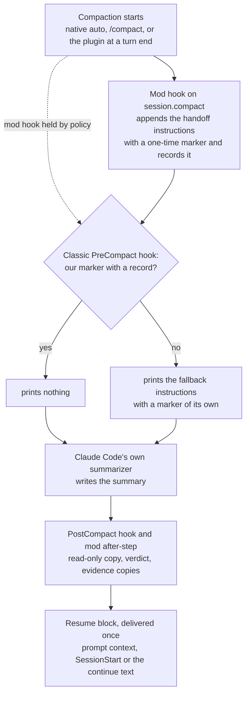

# {{plugin}} <!-- Source of README.md and plugin/README.md. tools/build strips these comments and fills the plugin name. Describes behaviour from design/ (MOD-SPEC, WATCHER-SPEC v1, the skills); refine at integration. No comparisons, no measured results, no user-local paths beyond the configurable defaults. -->

When a Claude Code session compacts, {{plugin}} asks Claude Code's own summarizer for a handoff instead of a plain summary. It keeps a read-only copy of every summary, checks that the summary has the expected shape, and gives the next turn a short resume block. It also adds three skills: `/{{plugin}}:handoff`, `/{{plugin}}:resume` and `/{{plugin}}:status`.

> [!NOTE]
> Early version (0.x). The parts that need a live session or a managed machine have not been run yet; see [Limits](#limits). This page describes the design and reports no measurements.

## What it does

- **Shapes every compaction.** Native auto-compaction, a manual `/compact` (your note comes first and wins), and compactions the plugin starts itself all get the same handoff instructions. Subagent compactions get a shorter subagent form.
- **Compacts at a clean turn end.** When the context passes a target size and a turn has ended normally, the plugin can compact before native auto-compaction cuts in mid-task. Past a higher soft maximum, it adds one checkpoint nudge to a tool result.
- **Keeps a copy of every summary.** Each copy is written once, read-only, with frontmatter taken from the plugin's own records (session, branch, commit, trigger, verdict), never from the summary text.
- **Checks the result.** A one-time marker at the top of the summary and a sentinel at the end show whether the summary is complete and in handoff form. The result is one verdict per compaction.
- **Delivers the resume block once.** After a compaction, the next turn gets one short block: the saved copy's path, a fresh git and project-state measurement, and a fallback note when the summary is not in handoff form.
- **Copies evidence.** Temp files that the session cited are copied to a dated disposable folder, with caps and secret checks, so they outlive the compaction.
- **Watches, never acts.** A shadow watcher writes content-free rows for every compaction, nudge, continue and resume, and raises alerts in `/{{plugin}}:status`.

## How it works



1. **Trigger.** Claude Code compacts on its own, you run `/compact`, or the plugin compacts at a clean turn end once the context passes `compact_target_tokens`.
2. **Shaping by the mod.** The plugin's module (a Claude Code mod) appends the handoff instructions to the compaction request. They carry a marker with a fresh nonce, and the plugin records that nonce before the summarizer runs.
3. **Classic fallback.** A classic `PreCompact` command hook runs on every compaction. If it finds the marker and its record, it stays silent. Otherwise it prints the same instructions with its own nonce, so the summary is shaped even when the mod's hook did not run.
4. **Summary.** Claude Code's own summarizer writes the summary. The plugin never edits a summary and never blocks a compaction.
5. **Copy and verdict.** The `PostCompact` hook saves the copy first; the mod saves it only if that did not happen. Both use the same file name, so there is one copy. The marker and sentinel give the verdict: `ok`, `ok-trailer`, `truncated`, `unshaped`, `scope-leak` or `stale`.
6. **Resume.** The first channel that claims the compaction delivers the resume block: the mod's prompt context, the classic `SessionStart` hook, or the auto-continue text. A turn-end check at `Stop` saves anything both savers missed and logs what is still open.

## Requirements

- Claude Code **2.1.287** or newer (mods). The one-line install below needs **2.1.292** or newer. This version was tested against **2.1.306**; the `PermissionDenied` and `StopFailure` hooks are not yet checked on older versions.
- **Perl 5.28** or newer, using only modules that ship with every perl. It is already on macOS, on Debian and Ubuntu (slim images too), and on Windows with Git for Windows. On Alpine, run `apk add perl` first.
- `git` for the git measurements. On a Mac without the Command Line Tools, the plugin skips git rather than open the install dialog.
- Claude Code in a terminal, or a local session of the desktop app. claude.ai and Cowork do not install plugins that contain a `bin/` folder, and this plugin's helper lives in `bin/`.

## Install

At the prompt of a terminal session:

```
/plugin install {{plugin}} --marketplace <owner>/<repo>
```

From a shell:

```
claude plugin install {{plugin}} --marketplace <owner>/<repo>
```

In the desktop app, where `/plugin` does not run: click **+** next to the prompt box, then **Plugins**, **Add marketplace** with `<owner>/<repo>`, then **Add plugin**.

Answer `y` to add the marketplace, pick a scope (user scope is first), then review the settings screen. Every setting has a working default (see [Settings](#settings)).

To check the install, run `/{{plugin}}:status` in a session. It prints the effective thresholds and, after the first compaction, its verdict and the copy's path.

## Update

Auto-update is off for third-party marketplaces. Update by hand, then reload open sessions (or start a new one):

```
claude plugin update {{plugin}}
```

```
/reload-plugins
```

After a Claude Code update, `/{{plugin}}:status` may say a check is due and offer a user-run `! {{plugin}}-store smoke`. It validates the plugin, runs its offline tests, and compares the Claude Code binary and its type declarations with the version this release was tested on.

## Uninstall

```
claude plugin uninstall {{plugin}}
```

Uninstalling removes the hooks and skills. It leaves your handoffs, copies, evidence and logs in place; see [What it writes](#what-it-writes-on-your-machine) to remove them.

## Skills

| Skill | Use it for |
|---|---|
| `/{{plugin}}:handoff [ticket-or-topic] [note]` | Write a handoff file that a fresh session can resume from: before `/clear`, before a break, or when the session is getting long. The model writes intent, decisions, findings and next steps; the helper measures git state, background work and evidence, lints the draft, scans it for secrets and publishes it. |
| `/{{plugin}}:resume [path or ticket] [instructions]` | Resume from a handoff or a saved compaction copy. It finds the newest fitting file, checks its claims against the live state, reports drift and restarts background work only where the handoff allows it, then continues with the next step. Right after a compaction it takes a light path of at most three checks. |
| `/{{plugin}}:status` | Show effective thresholds, the last five compactions (trigger, verdict, copy path, how they were shaped), open escalations and alerts, auto-continue and halt state. It shows no summary content. |

The handoff and the compaction instructions share one format, so `/{{plugin}}:resume` reads both.

## Settings

Set on the install screen, or later in `/config` (rows named `{{plugin}}.<key>`). An empty value means the default.

| Key | Default | What it does |
|---|---|---|
| `handoff_root` | `~/.claude/handoffs` | Folder for handoffs and summary copies. Buckets are `<root>/<repo>/<ticket-or-topic>/`. |
| `log_dir` | empty = `<handoff_root>/.watch` | Watcher logs and per-compaction records. |
| `disposable_root` | `~/.claude/trash-staging` | Automatic evidence copies, in dated folders. |
| `disposable_keep_days` | `0` (kept until you remove them) | Retention note only, shown in handoff reports. The plugin deletes nothing. |
| `evidence_quota_mb` | `500` | Per-bucket evidence size that triggers a warning. Warn only. |
| `queue_cmd` | empty = off | An executable of your own that answers `list --json --session <sid>` and `adopt --lane <id> [--if-free]`. Nothing is ever added to a queue; only `/{{plugin}}:resume` calls `adopt`. |
| `triggers` | `true` | `false`: no plugin compactions, no nudge, no auto-continue. Shaping, copies and verdicts still run. |
| `compact_target_tokens` | `400000` (min 100000) | Compact at a clean turn end at or above this. |
| `compact_soft_max_tokens` | `600000` (min 150000) | Add one checkpoint nudge mid-turn at or above this. |
| `native_window_tokens` | `0` = the session's context window | Your native auto-compact window, used for the clamp below. |
| `boundary_delay_ms` | `2000` | Wait before a turn-end compaction (500 ms after a nudge). A new turn cancels it. |
| `cooldown_ms` | `30000` | Minimum gap between plugin compactions. |
| `max_auto_continues_per_hour` | `3` (0 to 10) | Cap on automatic continues in a rolling hour. `0` turns auto-continue off. |
| `measured_block` | `false` | Also send the measured facts block to the summarizer (mod path only). The resume block always carries a fresh measurement. |
| `auto_evidence` | `true` | Copy the temp files a session cited into `disposable_root` after a compaction. |
| `warn_ui` | `true` | Toasts and status-line warnings for escalations. |
| `watcher` | `shadow` | `shadow` logs every compaction as content-free rows; `off` writes no watcher rows. |
| `stall_min` | `60` | Minutes without progress before the watcher calls work stalled. |
| `cache_ttl_s` | `300` | Warm/cold prompt-cache estimate used by the watcher. |
| `otel_log_path` | empty = unused | Read only if you already write OpenTelemetry output to this file. |
| `deny_class_patterns` | empty = the shipped classes | Patterns that sort permission denials into classes. |

<details>
<summary>How the thresholds are clamped</summary>

The plugin keeps its own thresholds below the point where native auto-compaction fires, which it estimates as your window minus 33,000 tokens:

- soft maximum = the smallest of `compact_soft_max_tokens`, that native point minus 100,000, and 80% of the window;
- target = the smaller of `compact_target_tokens` and two thirds of the soft maximum;
- if the target ends up below 120,000 tokens (windows under about 313K), plugin compactions and the nudge are off for that session. Native auto-compaction, shaping, copies and verdicts still run.

Every clamped value is logged, and `/{{plugin}}:status` marks it.

</details>

<details>
<summary>Nudge, auto-continue and halt</summary>

- The nudge is added once per main turn, to a main-agent tool result, never to a subagent's or a denied call's.
- After a compaction that a nudge led to, the plugin submits one short continue note, but only if the turn ended normally, did not end with a question to you, and the hourly cap allows it.
- Two non-ok verdicts in a row, a compaction loop, or the hourly cap put the session in **halt mode**: no auto-continue, no plugin compactions, and the nudge asks for a handoff instead. Your next typed message clears it. Native auto-compaction is never touched.

</details>

## What it writes on your machine

| Where (defaults) | What | Written by |
|---|---|---|
| `~/.claude/handoffs/<repo>/<bucket>/compact/` | Read-only copies of main-session summaries; subagent copies under `compact/subagents/`, unattributed ones under `compact/unattributed/` | hooks and mod |
| `~/.claude/handoffs/<repo>/<bucket>/` | Handoff files, with their judged evidence under `evidence/<stem>/` and refused drafts under `.staging/` | `/{{plugin}}:handoff` |
| `~/.claude/handoffs/.sessions/` | Session pins, `/clear` lineage, and one small record per session start and end | hooks and skills |
| `~/.claude/handoffs/.watch/` (`log_dir`) | Logs and per-compaction records (see [Watcher](#watcher)) | hooks, mod, helper |
| `~/.claude/trash-staging/<YYYY-MM-DD>/` | Automatic evidence copies, one folder per compaction, each with a `MANIFEST.tsv`; disposable items of a handoff | evidence sweep after a compaction; `/{{plugin}}:handoff` |
| Claude Code's plugin store | Last seen Claude Code version and auto-continue timestamps | mod |

It registers one mod module and eight classic command hooks: `PreCompact`, `PostCompact`, `SessionStart`, `SessionEnd`, `Stop`, `SubagentStop`, `StopFailure` and `PermissionDenied`.

Files are private (folders 0700, files 0600, copies 0400). The plugin refuses to write copies or evidence into a git work tree (unless that path is git-ignored, which it then logs) or into a `.planning/` folder.

**Cleanup is manual.** The plugin deletes nothing: not copies, not evidence, not logs. Remove what you no longer need, for example old dated folders under `disposable_root`. To see them first:

```
ls -ld ~/.claude/trash-staging/*/
```

## Watcher

With `watcher: shadow` (the default) the plugin keeps a local record of how compactions went. Under `log_dir` (default `<handoff_root>/.watch/`):

| File | Holds |
|---|---|
| `<session>.jsonl` | Mod events: dispatches, compactions started, nudges, continues, halts, resume deliveries, settings in effect |
| `<session>.classic.jsonl` | Hook and helper events: shaped or fallback, copy results, verdicts, evidence counts, sweep counts, permission denials (tool name and class only) |
| `<session>.alerts.jsonl` | Alerts raised for this session |
| `<session>/compactions.jsonl` | One summary row per compaction |
| `<session>/bg/slot-0.json` … `slot-19.json` | A fixed ring of 20 background-task snapshots (ids, kinds, status, output paths) |
| `<session>/dispatch/`, `checkpoint/`, `offsets/`, `paths.jsonl` and small marker files | Per-compaction records, git and project-state measurements, transcript read offsets, and the temp paths the session cited |
| `<session>/pending/` | The raw summary text handed between hooks so the copy can be written |
| `evidence-index.tsv`, `heal/`, `version.json` | Evidence dedupe index, restart counters of the resume skill, last seen Claude Code version |

Rows hold ids, counts, sizes, times, classes and rule ids. The files under `pending/` and the copies under `compact/` hold summary text; treat them like the summaries themselves.

Alerts are listed in `/{{plugin}}:status` with their seven-day counts. In this version they are not shown in the chat.

**Retention.** Nothing under `.watch/` is pruned automatically. `{{plugin}}-store watch prune --days 30` removes the watcher's own per-session files older than 30 days when you run it. `watcher: off` stops new watcher rows; the records the copies, resume and status need are still written.

## Privacy

- **Local only.** No network calls and no telemetry. The watcher reads OpenTelemetry output only from a file you already write and name in `otel_log_path`.
- **Content-free logs.** Log rows never store summary or handoff text, your or the model's messages, commands, file contents, permission-denial reasons, environment values or secrets. An unknown value is logged as the class `other`.
- **In-process reading.** Summaries, transcript rows and commands are read in memory to compute classes and counts, then dropped.
- **Secrets.** Summary copies with a hard secret hit are saved redacted. Evidence files that look like credentials (`.env`, keys, `.netrc` and similar) are withheld; logs and JSON with a hit are copied redacted; other files with a hard hit are withheld. Only rule ids are logged, never values. `/{{plugin}}:handoff` scans its draft before publishing.
- **Private files.** `umask 077`; never inside a git work tree (unless the path is git-ignored) or a `.planning/` folder.
- **No background actions.** Alerts never trigger an action. The plugin never restarts, wakes or stops background work; only `/{{plugin}}:resume` does, within the limits the handoff sets.

## Team, Enterprise and managed machines

Some managed setups hold plugin hooks on compaction and prompt context for user-installed plugins. The plugin decides per compaction whether its mod hook ran, and its classic command hooks take over when it did not:

| What | Usual case | Mod hook held |
|---|---|---|
| Shaping native, manual and subagent compactions | mod hook | classic `PreCompact` fallback (one text that selects the subagent form by itself) |
| Plugin compactions, nudge, auto-continue | yes | yes |
| Resume block | prompt context | `SessionStart`, else the continue text |
| Summary copy | `PostCompact`, mod as backup | `PostCompact`, mod as backup for its own compactions |
| Evidence before a compaction | at every main compaction | only before the plugin's own; other compactions get the sweep right after |
| Measured facts to the summarizer | when `measured_block` is on | only on the plugin's own compactions |

`/{{plugin}}:status` shows how each compaction was shaped and the policy flags it read at session start.

If a policy stops the mod from loading at all, the classic hooks still shape, save and resume, but plugin compactions, the nudge and auto-continue stop. If a policy also allows only managed hooks, the classic hooks do not run. With the mod hook held as well, a turn-end compaction without auto-continue then has no channel for its resume block, and `/{{plugin}}:status` reports it as undelivered.

The managed-machine path is built and tested offline. It has not yet been run on a managed machine.

## Limits

- **claude.ai and Cowork** do not install plugins with a `bin/` folder, so the plugin is for Claude Code sessions on your own machine.
- **No usable perl** (Alpine without `apk add perl`, Windows without Git for Windows, a perl older than 5.28): the hooks print nothing and exit quietly, and helper commands answer `REFUSED: helper-runtime`. The mod still adds its instructions, but no summary or evidence copies are saved. `/{{plugin}}:handoff` then prints the handoff into the chat, marked as not saved and not secret-scanned.
- **Subagents** get shaped summaries and copies, but no resume block.
- **Verdicts only inform.** They add a fallback note, a toast, an escalation, or halt mode. They never block or rewrite a compaction.
- **Not yet run live:** the end-to-end runs in a real session, on a managed machine, and the week-long shadow run.

## License

MIT. See [LICENSE](LICENSE).
