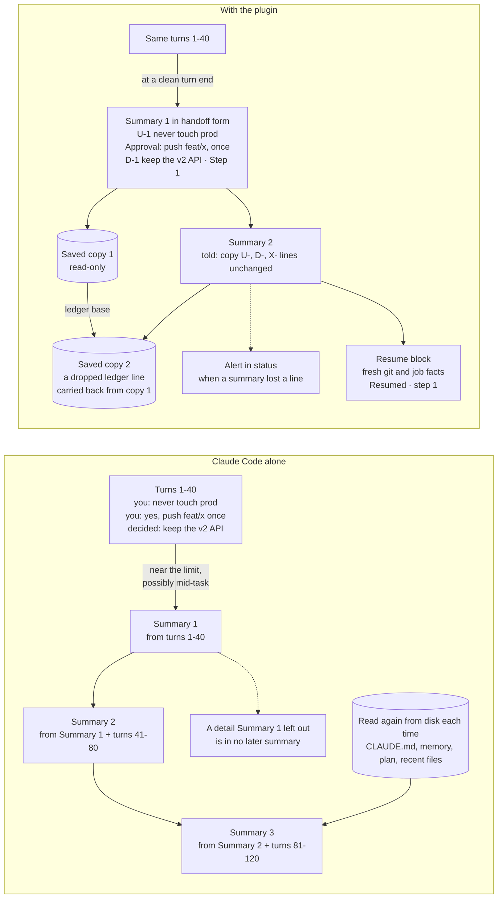

# Claude Code's compaction with and without {{plugin}} <!-- Source of docs/comparison.md, a GitHub-only page (not in plugin/README.md). Compare only with Claude Code's own behaviour, never name another plugin or tool. No recall, retention, speed or cost-saving number until the benchmark publishes one. No user-local paths. Cross-page links: page.md#anchor. -->

{{plugin}} runs inside Claude Code. It uses Claude Code's own hooks and its own summarizer, and it changes what the summary is asked to keep and what happens around each compaction. This page compares the two: Claude Code on its own, and Claude Code with the plugin.

Every "Claude Code alone" cell links to the Claude Code documentation it rests on (checked on 2026-11-12). Where the documentation says nothing, the cell says "not documented". Every "with {{plugin}}" cell links to the page of these docs that describes it. These are design properties, not measurements.

## Side by side

| | Claude Code alone | With {{plugin}} |
|---|---|---|
| **When it compacts** | When the conversation reaches the auto-compact window: the model's limit by default, about 967K tokens on models with a native 1M window ([docs](https://code.claude.com/docs/en/model-config#default-auto-compact-thresholds)). `/autocompact` sets an earlier point, and the pass then runs whenever that point is reached ([docs](https://code.claude.com/docs/en/context-window#when-your-context-fills-up)), which can be mid-task ([docs](https://code.claude.com/docs/en/prompt-caching#compacting-the-conversation)). | Claude Code's auto-compaction is unchanged and stays the backstop. The plugin also compacts at a clean turn end once the context passes `compact_target_tokens` (400K by default), and nudges a long turn once past `compact_soft_max_tokens`. Both are off on windows under about 329K tokens with the defaults ([details](configuration.md#how-the-thresholds-are-clamped)). |
| **Steering the summary** | `/compact <focus>` and a "Compact Instructions" section in CLAUDE.md ([docs](https://code.claude.com/docs/en/how-claude-code-works#when-context-fills-up)); PreCompact hook output used as instructions ([docs](https://code.claude.com/docs/en/hooks#precompact-output)); SessionStart hooks that match `compact` add context after it ([docs](https://code.claude.com/docs/en/context-window#what-survives-compaction)); `/rewind` can summarize part of the conversation ([docs](https://code.claude.com/docs/en/context-window#when-your-context-fills-up)). | Uses the same hooks. Every main compaction (automatic, `/compact`, idle, and its own) gets the same handoff instructions. A `/compact` note you type comes first and wins ([details](how-it-works.md#what-it-does)). |
| **What the summary is asked to keep** | "The summary keeps your requests and key code snippets, but detailed instructions from early in the conversation may be lost" ([docs](https://code.claude.com/docs/en/how-claude-code-works#when-context-fills-up)). | A fixed handoff form: status and one exact next step (Step 1) with its gate, your constraints in your words (`U-` lines), approvals with your exact words and targets, decisions (`D-`) and rejected options (`X-`), work in flight (`B-`) with a probe and a restart command, open questions, and next steps marked todo or done ([details](handoffs-and-resume.md)). |
| **The second and later compactions** | Each compaction replaces the message history with a summary ([docs](https://code.claude.com/docs/en/prompt-caching#compacting-the-conversation)), so the next one starts from that summary plus the newer turns. A rule for carrying earlier items forward is not documented. | Every summary is told to copy the earlier `U-`, `D-` and `X-` lines unchanged; ids are never renumbered. A line a summary drops is carried back into its saved copy, listed there, and raises an alert in `/{{plugin}}:status` ([details](usage.md), [alerts](privacy-and-logs.md#watcher)). |
| **A record of each summary** | The session transcript, with the summary in it, stays on disk until `cleanupPeriodDays`, 30 days by default ([docs](https://code.claude.com/docs/en/claude-directory#application-data)). A PostCompact hook receives the summary text ([docs](https://code.claude.com/docs/en/hooks#postcompact)). | The same transcript, plus a separate read-only copy of every summary with its session, branch, commit, trigger, verdict and plugin version, kept until you delete it ([details](files-and-storage.md#what-it-writes-on-your-machine)). |
| **Checking the summary** | A completeness check is not documented. | One verdict per compaction (`ok`, `truncated`, `unshaped`, ...). A bad verdict adds a fallback note; two in a row stop the plugin's own automation. A verdict never blocks or rewrites a compaction ([details](how-it-works.md#the-path-of-one-compaction)). |
| **What comes back after a compaction** | CLAUDE.md, auto memory, the plan, skill descriptions and invoked skills (capped), a fresh git status snapshot and up to five recent files; background commands and subagents keep running and Claude is reminded of them ([docs](https://code.claude.com/docs/en/context-window#what-survives-compaction)). The task list persists ([docs](https://code.claude.com/docs/en/interactive-mode#task-list)). | All of that, plus one resume block: the saved copy's path, freshly measured git and background-work facts, and a fallback note when the summary is not in handoff form ([details](handoffs-and-resume.md)). |
| **The next step** | A structured next step is not documented. A one-line recap shows when you come back to the terminal ([docs](https://code.claude.com/docs/en/interactive-mode#session-recap)). | The first reply opens with `Resumed · step 1: <the next step>`, after checking the step's condition again ([details](handoffs-and-resume.md)). |
| **A question you had not answered** | Not documented. | The resume block quotes it, so it is in front of you when you return ([details](how-it-works.md#what-it-does)). |
| **Approvals you gave in chat** | In auto mode, the classifier reads the approvals and boundaries you state from the transcript, and "a boundary can be lost if context compaction removes the message that stated it" ([docs](https://code.claude.com/docs/en/permission-modes#boundaries-you-state-in-conversation)). Carrying an approval across a compaction is not documented. | Recorded with your words, the action, its targets and once or standing. After a compaction an approval covers its action only when your words are found in a message you typed, every target still matches, a once approval is unused, and the action is not an explicit gate (a deploy, a production write, a push to a protected branch, ...). In auto mode Claude Code's classifier still refuses some actions; those are asked again ([details](safety-and-approvals.md)). |
| **Constraints you stated in chat** | The docs advise putting persistent rules in CLAUDE.md, because an instruction given only in conversation can be gone after a compaction ([docs](https://code.claude.com/docs/en/memory#instructions-seem-lost-after-compact)). | Recorded as `U-` lines in your words and carried as above. They are text the model reads, not enforcement: a hard stop still needs a deny rule, as without the plugin ([docs](https://code.claude.com/docs/en/permission-modes#boundaries-you-state-in-conversation)). |
| **Background work after Claude Code exits** | Background tasks are cleaned up when Claude Code exits, unless you background the session ([docs](https://code.claude.com/docs/en/interactive-mode#background-bash-commands)). | When you run `/{{plugin}}:resume`, a lost job is checked again from what the plugin recorded. Only a read-only or allowlisted job starts again by itself; production writes and outward steps always ask ([details](background-jobs.md#lost-background-jobs)). |
| **Native idle compaction** | On by default: an interactive session on the one-hour prompt cache, 200,000 tokens or more, about an hour idle. `"idleCompaction": false` turns it off ([docs](https://code.claude.com/docs/en/settings-reference#idlecompaction)). | Shaped like any other compaction, with a saved copy and an idle resume block on your return ([details](idle-compaction.md#idle-compaction)). |
| **Idle, when native idle compaction did not run** | Not documented. | Plugin idle compaction at a check at 55.5 minutes, while the cache is still warm, also while agents run; with `"idleCompaction": false` at about 54 minutes. Terminal sessions only. Not yet run live ([details](idle-compaction.md#idle-compaction)). |
| **A background job that outlives the cache** | "Your first message after a break longer than the cache lifetime misses the cache and reprocesses your full context" ([docs](https://code.claude.com/docs/en/costs#why-usage-climbs-in-a-long-session)). | Keep-warm: a hidden one-word request about every 50 minutes while the job runs, for up to `keep_warm_hours` (6). Each one counts as a cached read of the conversation ([details](keep-warm.md#keeping-the-cache-warm-while-jobs-run)). |
| **Near a usage limit** | Not documented for idle compaction. | Plugin idle compaction and keep-warm stop at 90% of a reported limit; the idle handoff turn follows its own setting ([details](usage-limits.md#near-a-usage-limit)). |
| **Seeing the cache state** | A `Prompt cache (main)` line in `/usage` ([docs](https://code.claude.com/docs/en/costs#prompt-cache-statistics)) and a `prompt_cache` object for your status line ([docs](https://code.claude.com/docs/en/statusline#prompt-cache-fields)). | A ready-made status-line command, `cache 1h warm 42m left ↻3/7`, that adds keep-warm request counts and states such as `cold (compacted)` ([details](status-line.md#the-cache-state-in-your-status-line)). |
| **`/clear`** | Starts a new conversation with empty context; the previous one is saved, and `/resume` returns to it ([docs](https://code.claude.com/docs/en/sessions#manage-context-within-a-session)). | No resume block after `/clear`, and nothing starts on its own. Write a handoff first with `/{{plugin}}:handoff` and pick it up later with `/{{plugin}}:resume` ([details](usage.md)). |
| **A handoff while the full context is there** | No equivalent documented. | A handoff turn before each planned compaction (on by default) and before the last compaction of a run that will not continue, with the full context and a warm cache. Off on windows under about 329K tokens; not yet run live ([details](handoffs-and-resume.md)). |
| **Temp files the session cited** | No equivalent documented. | Copied to a dated folder after each compaction, with size limits and secret checks ([details](files-and-storage.md#what-it-writes-on-your-machine)). |
| **Subagents** | A subagent compacts its own context as it fills ([docs](https://code.claude.com/docs/en/sub-agents#auto-compaction)). | Shaped summaries and saved copies; no resume block, nudge or handoff turn ([details](limitations.md#limits)). |
| **Headless (`claude -p`, the Agent SDK)** | Idle compaction runs only in interactive sessions: the terminal, the VS Code chat panel and the desktop app's Code tab ([docs](https://code.claude.com/docs/en/settings-reference#idlecompaction)). | Its own compactions run as a plain `/compact` at a turn end; no nudge, handoff turn or plugin idle compaction. Not yet checked live ([details](compatibility.md#surfaces)). |
| **What it costs** | One summary request per compaction. It reads the cached prefix while the cache is warm; after the cache lifetime it reprocesses the history as uncached input ([docs](https://code.claude.com/docs/en/prompt-caching#compacting-the-conversation)). | The same summary request per compaction, and on top: on 1M windows, earlier and possibly more compactions; handoff turns that read the context from the cache on each tool call; keep-warm requests; plugin idle compaction; and the idle handoff turn, which by default also runs near a usage limit. Each has an off-switch ([costs](configuration.md#what-the-settings-cost)). |

## Why context fades over repeated compactions

A compaction replaces the conversation with one summary ([docs](https://code.claude.com/docs/en/prompt-caching#compacting-the-conversation)). From then on, the summary is the only place the model can see the earlier turns, so the next compaction is written from that summary plus the newer turns. Anything one summary left out or paraphrased is not there for any later summary to keep. This is an explanation of the documented mechanism, not a quote; the docs say it for the first step: "detailed instructions from early in the conversation may be lost" ([docs](https://code.claude.com/docs/en/how-claude-code-works#when-context-fills-up)).

Two kinds of content come back without help: what Claude Code reads again from disk (CLAUDE.md, auto memory, the plan, recent files) and running background work, which Claude is reminded of ([docs](https://code.claude.com/docs/en/context-window#what-survives-compaction)). What you said only in chat (constraints, approvals, decisions, rejected options, the next step) has no such route.

What the plugin changes:

1. It gives those chat-only items numbered ids (`U-`, `D-`, `X-`), the ledger.
2. It tells every summary to copy them unchanged.
3. It saves each summary as a read-only copy, and puts back into that copy any ledger line the summary dropped.
4. It raises an alert in `/{{plugin}}:status` when a summary lost a line.
5. It compacts at a clean turn end where the window allows it, and the first turn after picks up from the summary's Step 1.

*Illustrative, not measured; turn numbers are illustrative (on 1M windows the plugin compacts earlier and can compact more often, so the two sides do not compact at the same turns). Without the plugin, each summary is written from the one before it, so an early detail that one summary leaves out is gone from the conversation from then on; only what is read again from disk comes back. With the plugin, your constraints and decisions travel as numbered ledger lines that every summary is told to copy unchanged. Each summary is also saved read-only, and a line a summary drops is carried back into its saved copy and flagged. The live conversation still holds only what the summarizer wrote. What {{plugin}} adds is a chain of saved copies, kept until you delete them, that the resume block points to, plus fresh measurements in that block. Claude Code's own transcript also stays on disk, 30 days by default.*

## Five situations

**A constraint you gave three compactions ago.** Early on you said "don't touch `db/migrate`".
- *Claude Code alone:* the instruction lives only in chat. The docs warn that such instructions can be gone after a compaction and advise moving them to CLAUDE.md ([docs](https://code.claude.com/docs/en/memory#instructions-seem-lost-after-compact)).
- *With {{plugin}}:* the summary holds `U-1 "don't touch db/migrate"`, and every later summary is told to copy it unchanged. If one summary drops it, the saved copy gets it back and `/{{plugin}}:status` raises an alert. It is still text: for a hard stop, add a deny rule.

**An approval you gave before a compaction.** You wrote "yes, push feat/x to origin", and a compaction ran before the push.
- *Claude Code alone:* how an approval carries across a compaction is not documented; it depends on what the summary kept.
- *With {{plugin}}:* the summary records your exact words, the action, the target `feat/x` and "once". After the compaction the push goes ahead only if your words are found in a message you typed and the target still matches; otherwise you are asked again. A push to `main`, a deploy or a production write always asks again, whatever you approved ([details](safety-and-approvals.md)). The plugin can ask more often than Claude Code alone, not less.

**A test suite running in the background.** A 40-minute suite runs when the compaction comes, and later you close the terminal.
- *Claude Code alone:* the suite keeps running through the compaction, and Claude is reminded of it ([docs](https://code.claude.com/docs/en/context-window#what-survives-compaction)). When Claude Code exits, background tasks are cleaned up ([docs](https://code.claude.com/docs/en/interactive-mode#background-bash-commands)).
- *With {{plugin}}:* the summary carries the suite as a `B-` line with a probe command and a restart command, and the resume block measures background work again. After an exit, `/{{plugin}}:resume` starts the suite again by itself only if it is read-only or allowlisted and its checks pass; otherwise it asks ([details](background-jobs.md#lost-background-jobs)).

**"Where was I?" after a compaction.** You come back to a session that compacted mid-task.
- *Claude Code alone:* the summary keeps your requests and key code snippets ([docs](https://code.claude.com/docs/en/how-claude-code-works#when-context-fills-up)), and a one-line recap may show when you return ([docs](https://code.claude.com/docs/en/interactive-mode#session-recap)).
- *With {{plugin}}:* the reply opens with `Resumed · step 1: <the exact command or edit>`. A question you had not answered is quoted back, and the Gate line says what blocks the step.

**Back from lunch with an agent still running.** The session is past 200K tokens, you were away for 70 minutes, and a background agent is still working.
- *Claude Code alone:* native idle compaction compacts an idle conversation of 200,000 tokens or more on the one-hour cache, about an hour after the last request ([docs](https://code.claude.com/docs/en/settings-reference#idlecompaction)). Whether it runs while an agent works is not documented. If no compaction runs, your return reads the context again uncached ([docs](https://code.claude.com/docs/en/costs#why-usage-climbs-in-a-long-session)).
- *With {{plugin}}:* native idle compaction, when it runs, is shaped and saved like any other. If no compaction ran by minute 55.5, the plugin compacts while the cache is warm, agent or not. Terminal sessions only; not yet run live ([details](idle-compaction.md#idle-compaction)).

## What this comparison does not claim

- That nothing is lost. The live summary is still written by Claude Code's own summarizer, and the plugin never edits it. What the plugin keeps on disk is the chain of saved copies and handoffs, not the live context.
- That Claude Code forgets everything. CLAUDE.md, memory, the plan, skills, recent files and a git snapshot come back, running jobs are announced again, and the task list persists.
- That Claude Code's compaction cannot be steered. `/compact <focus>`, Compact Instructions and PreCompact hooks exist; the plugin uses the same hook.
- That Claude Code wastes the cache when you go idle. Native idle compaction exists; the plugin adds coverage only where it did not run.
- That approvals carry over automatically, that constraints are enforced, or that background jobs survive an exit. Each holds only under the conditions in the table above.
- That the saved copy is the only record. Claude Code keeps the transcript too, 30 days by default.
- That the plugin prevents mid-task compaction. It compacts earlier at a clean turn end where the window allows it, and Claude Code's auto-compaction remains.
- Support beyond [Compatibility](compatibility.md#platforms): native Windows is not supported, and claude.ai and Cowork are not tested.
- Any measured gain. No number on this page is a measurement.

## Measured results

Measured results: the benchmark method is fixed in advance ([bench/METHOD.md](../bench/METHOD.md)); results will be published there.
