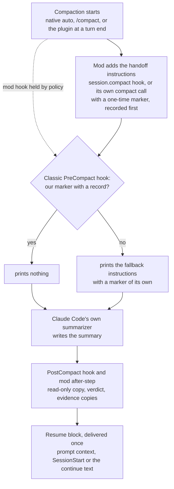

# How it works <!-- Source of docs/how-it-works.md and part of plugin/README.md. Compare only with Claude Code's own behaviour, never name another plugin or tool. No recall, retention, speed or cost-saving number until the benchmark publishes one. No user-local paths beyond the configurable defaults. Cross-page links: page.md#anchor. -->

## What it does

- **Shapes every compaction.** Native auto-compaction, a manual `/compact` (your note comes first and wins), and compactions the plugin starts itself all get the same handoff instructions. Subagent compactions get a shorter subagent form.
- **Compacts at a clean turn end.** When the context passes a target size and a turn has ended normally, the plugin can compact before native auto-compaction cuts in mid-task. Past a higher soft maximum, it adds one checkpoint nudge to a tool result.
- **Keeps a copy of every summary.** Each copy is written once, read-only, with frontmatter taken from the plugin's own records (session, branch, commit, trigger, verdict, the plugin version and folder that saved it), never from the summary text.
- **Checks the result.** A one-time marker at the top of the summary and a sentinel at the end show whether the summary is complete and in handoff form. The result is one verdict per compaction.
- **Delivers the resume block once.** After a compaction, the next turn gets one short block: the saved copy's path, a fresh git and project-state measurement, and a fallback note when the summary is not in handoff form. When the last turn ended on a question you have not answered (in its text, or in a question dialog that timed out), the block quotes that question, so it is in front of you when you return. <!-- 0.1.2 question carry: at most 240 characters on one line; a message of yours, or your answer in a question dialog, closes it -->
- **Copies evidence.** Temp files that the session cited are copied to a dated disposable folder, with caps and secret checks, so nothing the next window needs lives only in a temp folder.
- **Writes a handoff before a last compaction.** When a run will not resume by itself (the hourly limit is reached, or auto-continue is off or halted), the plugin asks for one more turn that writes a handoff while the full context is still there. See [The handoff turn of a last cycle](handoffs-and-resume.md#the-handoff-turn-of-a-last-cycle). By default it does the same before each planned compaction; see [The handoff turn before a planned compaction](handoffs-and-resume.md#the-handoff-turn-before-a-planned-compaction).
- **Handles idle compactions.** With `"idleCompaction": false` in your Claude Code settings, the plugin compacts a long idle session itself (plugin idle compaction), about 54 minutes after its last request and before the prompt cache expires, so in sessions that read your `~/.claude/settings.json` idle compaction runs only where the plugin is enabled (terminal sessions; headless and Desktop: see [Limits](limitations.md#limits)). When Claude Code compacts an idle session itself (native idle compaction), the summary is shaped the same way. Either way the resume block is measured again when you come back. See [Idle compaction](idle-compaction.md#idle-compaction).
- **Re-checks lost background jobs.** A background shell that is gone after the session ended is re-checked from facts the plugin recorded. A read-only job, or one you allowlisted, may start again by itself; everything else asks. See [Lost background jobs](background-jobs.md#lost-background-jobs).
- **Exports to a repository, only if both sides agree.** The private store stays the default. A repository can also receive a portable copy of each published handoff. See [Handoffs in git](repo-mode.md#handoffs-in-git-repo-mode).
- **Watches, never acts.** A shadow watcher writes content-free rows for every compaction, nudge, continue and resume, and raises alerts in `/{{plugin}}:status`. The rows stay on your machine; `/{{plugin}}:report` bundles them into a zip that you can send yourself. See [Watcher](privacy-and-logs.md#watcher).

## The path of one compaction

1. **Trigger.** Claude Code compacts on its own, you run `/compact`, or the plugin compacts at a clean turn end once the context passes `compact_target_tokens`.
2. **Shaping by the mod.** The plugin's module (a Claude Code mod) appends the handoff instructions to the compaction request; for the compactions it starts itself, it passes them in its own compact call, because Claude Code skips the caller's hook for those. They carry a marker with a fresh nonce, and the plugin records that nonce before the summarizer runs.
3. **Classic fallback.** A classic `PreCompact` command hook runs on every compaction. If it finds the marker and its record, it stays silent. Otherwise it prints the same instructions with its own nonce, so the summary is shaped even when the mod's hook did not run.
4. **Summary.** Claude Code's own summarizer writes the summary. The plugin never edits a summary and never blocks a compaction.
5. **Copy and verdict.** The `PostCompact` hook saves the copy first; the mod saves it only if that did not happen. Both use the same file name, so there is one copy. The marker and sentinel give the verdict: `ok`, `ok-trailer`, `ok-unclosed`, `truncated`, `unshaped`, `scope-leak` or `stale`. `ok-unclosed` is a summary with every required section through its last one (Next steps) but no closing line. It counts as ok: no fallback note, and it never counts toward halt mode. The copy, the log and `/{{plugin}}:status` show the word. A summary cut off inside its body is still `truncated`.
6. **Resume.** The first channel that claims the compaction delivers the resume block: the mod's prompt context, the classic `SessionStart` hook, or the auto-continue text. A turn-end check at `Stop` saves anything both savers missed and logs what is still open.

Nudge, auto-continue and halt

- The nudge is added once per main turn, to a main-agent tool result, never to a subagent's or a denied call's.
- After a compaction that a nudge led to, the plugin submits one short continue note, but only if the turn ended normally, did not end with a question to you, and the hourly cap allows it. A question dialog you answered does not count as a question to you; one still open when the turn ends, or one that closed unanswered (it timed out while you were away, or you dismissed it), does, here and for the handoff turn and restart below.
- Two non-ok verdicts in a row, a compaction loop, or the hourly cap put the session in **halt mode**: no auto-continue, no plugin compactions, and the nudge says the plugin will not resume the work by itself, and that it compacts afterwards only after a cap or auto-continue-off halt. Your next message clears it: one you type, or send yourself from another client or through the SDK. A background job's or agent's result, a scheduled prompt or another plugin's prompt does not clear it. Native auto-compaction is never touched. A cycle that will not auto-continue also gets a handoff turn; see below.

