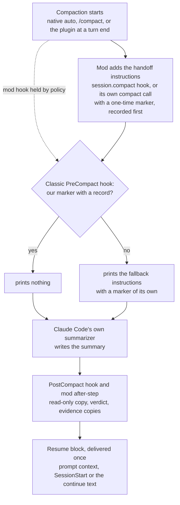

# How it works <!-- Source of docs/how-it-works.md and part of plugin/README.md. Compare only with Claude Code's own behaviour, never name another plugin or tool. No recall, retention, speed or cost-saving number until the benchmark publishes one. No user-local paths beyond the configurable defaults. Cross-page links: page.md#anchor. -->

## Terms

The names these pages use. Each links to the page that explains it in full.

| Term | Meaning |
|---|---|
| **Native auto-compaction** | Claude Code's own compaction when the context nears its limit. The plugin never turns it off; it is the backstop. |
| **Native idle compaction** | Claude Code's own idle compaction of a long conversation you stepped away from. See [Idle compaction](idle-compaction.md#idle-compaction). |
| **Plugin idle compaction** | {{plugin}}'s own idle compaction (`idle_compact`), where native idle compaction is off in your settings or did not run. See [Idle compaction](idle-compaction.md#idle-compaction). |
| **Idle handoff turn** | One turn the plugin gives the model to write a handoff before the cache of an idle session expires. It does not compact. See [Idle compaction](idle-compaction.md#idle-compaction). |
| **Plugin compaction** | A compaction the plugin starts itself: at a clean turn end once the context passes `compact_target_tokens` (the **planned compaction**), or one of its idle compactions. |
| **Mod** | The plugin's module that Claude Code loads. It adds the handoff instructions to each compaction, starts plugin compactions, and usually delivers the resume block. |
| **Hooks** | The plugin's classic command hooks (`PreCompact`, `PostCompact`, `SessionStart` and five more). They save the copies and take over when the mod's hook does not run. See [What it writes on your machine](files-and-storage.md#what-it-writes-on-your-machine). |
| **Helper** | One program in the plugin folder, `scripts/{{plugin}}-store`, that the hooks, the mod and the skills call. It needs perl 5.28 or newer. |
| **Handoff** | A note a fresh session can pick the work up from: your constraints in your words, approvals, decisions, work in flight, open questions and one exact next step (Step 1). Every compaction summary is asked for in this form, and `/{{plugin}}:handoff` writes one as a file. See [Handoffs and resume](handoffs-and-resume.md). |
| **Saved copy** | A read-only copy of one compaction summary, with the session, branch, commit, trigger and verdict, written once and never edited. |
| **Resume block** | The short block the first turn after a compaction gets: the saved copy's path, fresh git and background-work facts, and an unanswered question if there was one. |
| **Ledger** | Numbered lines that every summary and handoff is told to copy unchanged: `U-` your constraints and asks, `D-` decisions, `X-` rejected options. `B-` lines list the work in flight. See [Usage](usage.md). |
| **Verdict** | One word per compaction that says whether the summary came back complete and in handoff form: `ok`, `ok-trailer`, `ok-unclosed`, `truncated`, `unshaped`, `scope-leak` or `stale`. |
| **Marker and sentinel** | A one-time marker at the top of the summary and an end line at its bottom. The verdict is read from them. |
| **Nudge** | One note added to a tool result in a long turn, past `compact_soft_max_tokens`, asking the model to reach a stopping point. See [Nudge, auto-continue and halt](#nudge-auto-continue-and-halt). |
| **Last cycle** | A nudged cycle that will not be followed by an automatic continue: halt mode, the hourly cap, or auto-continue off. With `handoff_turn` on, the model writes a handoff first. See [Handoffs and resume](handoffs-and-resume.md). |
| **Halt mode** | After two bad verdicts in a row, a compaction loop or the hourly cap: no auto-continue and no plugin compactions until your next message. See [Nudge, auto-continue and halt](#nudge-auto-continue-and-halt). |
| **Keep-warm** | While one of the session's own background jobs runs, a hidden one-word request about every 50 minutes keeps the one-hour prompt cache warm. See [Keeping the cache warm while jobs run](keep-warm.md#keeping-the-cache-warm-while-jobs-run). |
| **Consent key** | One of the six settings that let the plugin act without asking. They are read from your user settings file only. See [Consent keys](configuration.md#consent-keys). |
| **Protective list** | `prod_patterns`, `secret_extra_rules` and `protected_branches`: lists that can only make the plugin ask or withhold more. See [Protective lists](configuration.md#protective-lists). |
| **Explicit gate** | A deploy, a change to an environment, its secrets or production data, infrastructure, or a push to a protected branch. It always asks again after a compaction. See [Safety and approvals](safety-and-approvals.md). |
| **Repo mode** | An opt-in export of each published handoff into a repository, when both your settings and the repository agree. See [Handoffs in git](repo-mode.md#handoffs-in-git-repo-mode). |
| **Bucket** | The folder for one repository and one ticket or topic: `<repo>/<ticket-or-topic>` under the handoff folder. |
| **Evidence** | Copies of temp files a session cited, kept so a later session can still read them. Automatic copies go to dated folders under the disposable folder (`disposable_root`); a handoff's own go beside it. See [Pruning old evidence](files-and-storage.md#pruning-old-evidence). |

## What it does

- **Shapes every compaction.** Native auto-compaction, a manual `/compact` (your note comes first and wins), and compactions the plugin starts itself all get the same handoff instructions. Subagent compactions get a shorter subagent form.
- **Compacts at a clean turn end.** When the context passes a target size and a turn has ended normally, the plugin can compact before native auto-compaction cuts in mid-task. Past a higher soft maximum, it adds one checkpoint nudge to a tool result.
- **Keeps a copy of every summary.** Each copy is written once, read-only, with frontmatter taken from the plugin's own records (session, branch, commit, trigger, verdict, the plugin version and folder that saved it), never from the summary text.
- **Checks the result.** A one-time marker at the top of the summary and a sentinel at the end show whether the summary is complete and in handoff form. The result is one verdict per compaction.
- **Delivers the resume block once.** After a compaction, the next turn gets one short block: the saved copy's path, a fresh git and project-state measurement, and a fallback note when the summary is not in handoff form. When the last turn ended on a question you have not answered (in its text, or in a question dialog that timed out), the block quotes that question, so it is in front of you when you return. See [Handoffs and resume](handoffs-and-resume.md). <!-- 0.1.2 question carry: at most 240 characters on one line; a message of yours, or your answer in a question dialog, closes it -->
- **Copies evidence.** Temp files that the session cited are copied to a dated disposable folder, with caps and secret checks, so nothing the next window needs lives only in a temp folder.
- **Writes a handoff before a last compaction.** When a run will not resume by itself (the hourly limit is reached, or auto-continue is off or halted), the plugin asks for one more turn that writes a handoff while the full context is still there. See [The handoff turn of a last cycle](handoffs-and-resume.md#the-handoff-turn-of-a-last-cycle). By default it does the same before each planned compaction; see [The handoff turn before a planned compaction](handoffs-and-resume.md#the-handoff-turn-before-a-planned-compaction).
- **Handles idle compactions.** With `"idleCompaction": false` in your Claude Code settings, the plugin compacts a long idle session itself (plugin idle compaction), about 54 minutes after its last request and before the prompt cache expires, so in sessions that read your `~/.claude/settings.json` idle compaction runs only where the plugin is enabled (terminal sessions; headless and Desktop: see [Limits](limitations.md#limits)). When Claude Code compacts an idle session itself (native idle compaction), the summary is shaped the same way. Either way the resume block is measured again when you come back. See [Idle compaction](idle-compaction.md#idle-compaction).
- **Re-checks lost background jobs.** A background shell that is gone after the session ended is re-checked from facts the plugin recorded. A read-only job, or one you allowlisted, may start again by itself; everything else asks. See [Lost background jobs](background-jobs.md#lost-background-jobs).
- **Exports to a repository, only if both sides agree.** The private store stays the default. A repository can also receive a portable copy of each published handoff. See [Handoffs in git](repo-mode.md#handoffs-in-git-repo-mode).
- **Watches, never acts.** A shadow watcher writes content-free rows for every compaction, nudge, continue and resume, and raises alerts in `/{{plugin}}:status`. The rows stay on your machine; `/{{plugin}}:report` bundles them into a zip that you can send yourself. See [Watcher](privacy-and-logs.md#watcher).

## The path of one compaction



1. **Trigger.** Claude Code compacts on its own, you run `/compact`, or the plugin compacts at a clean turn end once the context passes `compact_target_tokens`.
2. **Shaping by the mod.** The plugin's module (a Claude Code mod) appends the handoff instructions to the compaction request; for the compactions it starts itself, it passes them in its own compact call, because Claude Code skips the caller's hook for those. They carry a marker with a fresh nonce, and the plugin records that nonce before the summarizer runs.
3. **Classic fallback.** A classic `PreCompact` command hook runs on every compaction. If it finds the marker and its record, it stays silent. Otherwise it prints the same instructions with its own nonce, so the summary is shaped even when the mod's hook did not run.
4. **Summary.** Claude Code's own summarizer writes the summary. The plugin never edits a summary and never blocks a compaction.
5. **Copy and verdict.** The `PostCompact` hook saves the copy first; the mod saves it only if that did not happen. Both use the same file name, so there is one copy. The marker and sentinel give the verdict: `ok`, `ok-trailer`, `ok-unclosed`, `truncated`, `unshaped`, `scope-leak` or `stale`. `ok-unclosed` is a summary with every required section through its last one (Next steps) but no closing line. It counts as ok: no fallback note, and it never counts toward halt mode. The copy, the log and `/{{plugin}}:status` show the word. A summary cut off inside its body is still `truncated`.
6. **Resume.** The first channel that claims the compaction delivers the resume block: the mod's prompt context, the classic `SessionStart` hook, or the auto-continue text. A turn-end check at `Stop` saves anything both savers missed and logs what is still open.

## When the plugin acts beside Claude Code's compaction

The plugin adds its own steps around Claude Code's compaction; it does not replace it. On a model with a 1M-token window and the default settings:

```
Size of one main conversation (1M-token window, default settings)

0 ─────────────── 400K ───────────── 600K ──────────────────── ~967K ──── 1M
                    │                  │                          │
                    │                  │                          └─ Claude Code's own auto-compaction:
                    │                  │                             unchanged, the backstop
                    │                  └─ a turn still running here gets one nudge
                    │                     to reach a stopping point (compact_soft_max_tokens)
                    └─ the plugin compacts at the next clean turn end (compact_target_tokens);
                       by default the model first writes a handoff (precompact_turn)
```

- Every compaction on this line, the plugin's and Claude Code's, gets the same handoff instructions, a saved copy, a verdict and a resume block.
- Claude Code compacts at about 967K tokens on models with a native 1M window ([Claude Code docs](https://code.claude.com/docs/en/model-config#default-auto-compact-thresholds)). The plugin keeps its own points below that; [How the thresholds are clamped](configuration.md#how-the-thresholds-are-clamped) has the rules.
- On windows under about 329K tokens with the defaults (200K models, for example), plugin compactions and the nudge are off. Claude Code compacts as usual, and the plugin still shapes, saves, checks and resumes each compaction it runs.

## The idle timeline

What happens to a long main conversation that sits idle on the one-hour prompt cache, counted from its last request. The sizes are the defaults (200,000 tokens, the idle-compaction minimum).

```
Minutes after the last request (one-hour prompt cache)

Nothing running:
0 ───────────────────── ~49 ────────── ~54 ──────── 55.5 ───────── 60
                          │              │            │             │
                          │              │            │             └─ the cache expires
                          │              │            └─ the plugin checks: no compaction since
                          │              │               the turn ended? Plugin idle compaction now
                          │              └─ native idle compaction (Claude Code's own), shaped;
                          │                 with "idleCompaction": false, plugin idle compaction
                          └─ the idle handoff turn, only where neither compaction runs

A background job of the session still running (keep-warm):
0 ─────────────────────── ~50 ──────────── ~100 ─────────── ... up to keep_warm_hours (6 h)
                            │                │
                            └─ hidden request └─ again: the cache stays warm for the job's result
```

- **Nothing running.** With a default install, native idle compaction runs and the plugin shapes it. When it did not run by minute 55.5, plugin idle compaction compacts while the cache is still warm, also while agents run. With `"idleCompaction": false` in your Claude Code settings, the plugin compacts at about 54 minutes instead, so idle compaction runs only in terminal sessions where it is enabled. The idle handoff turn runs only where neither compaction does (for example below the idle-compaction minimum when you lower `idle_handoff_min_tokens`, or with `idle_compact: false`): about 49 minutes in with `"idleCompaction": false`, else at the 55.5-minute check.
- **A background job running.** While one of the session's own agents, workflows or background shells runs, keep-warm sends a hidden one-word request about every 50 minutes, and plugin idle compaction and the idle handoff turn wait. The turn the job's result opens then reads the conversation from a warm cache. When `keep_warm_hours` runs out with an agent, a workflow or a working teammate still open, plugin idle compaction runs while the cache is warm.
- **On your return.** The first turn gets an idle resume block, measured again when it is more than 10 minutes old.
- The native idle compaction path, plugin idle compaction and the idle handoff turn have not been run live yet; see [Limits](limitations.md#limits). The details, every skip rule and the cost are in [Idle compaction](idle-compaction.md#idle-compaction), [Keeping the cache warm while jobs run](keep-warm.md#keeping-the-cache-warm-while-jobs-run) and [Near a usage limit](usage-limits.md#near-a-usage-limit).

## Nudge, auto-continue and halt

- The nudge is added once per main turn, to a main-agent tool result, never to a subagent's or a denied call's.
- After a compaction that a nudge led to, the plugin submits one short continue note, but only if the turn ended normally, did not end with a question to you, and the hourly cap allows it. A question dialog you answered does not count as a question to you; one still open when the turn ends, or one that closed unanswered (it timed out while you were away, or you dismissed it), does, here and for the handoff turn and restart below.
- Two non-ok verdicts in a row, a compaction loop, or the hourly cap put the session in **halt mode**: no auto-continue, no plugin compactions, and the nudge says the plugin will not resume the work by itself, and that it compacts afterwards only after a cap or auto-continue-off halt. Your next message clears it: one you type, or send yourself from another client or through the SDK. A background job's or agent's result, a scheduled prompt or another plugin's prompt does not clear it. Native auto-compaction is never touched. A cycle that will not auto-continue also gets a handoff turn; see [Handoffs and resume](handoffs-and-resume.md).
