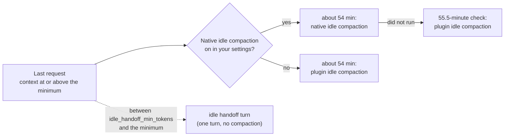

# Idle compaction <!-- Source of docs/idle-compaction.md and part of plugin/README.md. Compare only with Claude Code's own behaviour, never name another plugin or tool. No recall, retention, speed or cost-saving number until the benchmark publishes one. No user-local paths beyond the configurable defaults. Cross-page links: page.md#anchor. -->

With `"idleCompaction": false` in your Claude Code settings, {{plugin}} now compacts long idle sessions itself; before this version that setting meant no idle compaction at all. Set the plugin option `idle_compact` to `false` to keep none.

Illustrative: the default minimum is 200,000 tokens, and the idle handoff turn runs only where neither compaction does.

Three things can happen to a long session that sits idle, and this page keeps their names apart:

- **Native idle compaction** is Claude Code's own: about 54 minutes after the last request of a main conversation at or above the idle-compaction minimum. That minimum is `CLAUDE_CODE_IDLE_COMPACT_MIN_TOKENS`: 200,000 tokens by default, never below 100,000.
- **Plugin idle compaction** is {{plugin}}'s (`idle_compact`): it compacts the session itself: about 54 minutes after the last request when native idle compaction is off in your settings, or at a check at 55.5 minutes when native idle compaction did not run. It uses the same minimum, read from the same variable, except when keep-warm stops at its cutoff, at the last moment the waiting compaction or turn can run, or in the band near a usage limit, with an agent, a workflow or a working teammate still open: from `idle_handoff_min_tokens` up then (see [Keeping the cache warm while jobs run](keep-warm.md#keeping-the-cache-warm-while-jobs-run)).
- **The idle handoff turn** (`idle_handoff_turn`) does not compact. It gives the model one turn to write a handoff, and it runs only where neither compaction does: from `idle_handoff_min_tokens` up to the idle-compaction minimum. With `idle_compact: false`, automatic compaction off, or after plugin idle compaction failed twice, it also runs above the minimum. `idle_handoff_min_tokens` is not a compaction threshold, except when keep-warm stops at its cutoff, at the last moment the waiting compaction or turn can run, or in the band near a usage limit, with an agent, a workflow or a working teammate still open. At the default minimum a 265,000-token session goes to idle compaction, whatever that setting holds.

With `idle_handoff_min_tokens` at 100,000, the default minimum and a default install, an idle session gets this: 200,000 tokens or more, native idle compaction (Claude Code), else plugin idle compaction at the 55.5-minute check; 100,000 to 200,000, the idle handoff turn; below that, nothing (a work lane that reads finished gets the turn at any known size). At the default 200,000 there is no handoff band. `/{{plugin}}:status` prints these bands from the values your session uses.

Native idle compaction compacts the conversation before the one-hour prompt cache expires, so coming back does not mean reading the whole context again at full price. It is on by default and runs in every session of a long main conversation, with or without this plugin; Claude Code decides per account whether it actually runs. `"idleCompaction": false` in your Claude Code settings turns it off. The plugin never changes that setting.

**Who compacts an idle session.**

| Your Claude Code settings | Sessions with {{plugin}} enabled | Sessions without it |
|---|---|---|
| `"idleCompaction": false` | plugin idle compaction, in the terminal, about 54 minutes after the last request, with plan usage limits and 200,000 tokens or more (below); in headless and Desktop sessions see [Limits](limitations.md#limits) | nobody |
| no `idleCompaction` key, or `true` (a default install) | native idle compaction; in the terminal {{plugin}} shapes it, checks at 55.5 minutes and runs plugin idle compaction when native idle compaction did not run; in headless and Desktop sessions it shapes it only | native idle compaction, unshaped |
| `"autoCompactEnabled": false` | nobody (the idle handoff turn may run) | nobody |

To have idle compaction only in sessions where {{plugin}} is enabled, set `"idleCompaction": false` in your user `settings.json` (`~/.claude/settings.json`, or the one under `CLAUDE_CONFIG_DIR`). A default install keeps native idle compaction in every session, plugin or not, and the plugin cannot stop that. A project's `.claude/settings.json` or `.claude/settings.local.json`, a `--settings` value or managed settings can turn native idle compaction back on for one session; `/{{plugin}}:status` shows what the current session uses and notes when native idle compaction is on. Cowork and remote sessions read their own settings and do not load the plugin from your machine, so neither your setting nor the plugin reaches them (not tested). If your organization allows managed mods only, plugin idle compaction does not run either.

**Plugin idle compaction (`idle_compact`, `true` by default).** While native idle compaction is off in your settings and automatic compaction is on, the plugin compacts an idle main conversation itself: about 54 minutes after the last request of a turn that left it at 200,000 tokens or more (`CLAUDE_CODE_IDLE_COMPACT_MIN_TOKENS` sets another minimum, as it does for Claude Code, never below 100,000), with nothing new since. It is one compaction with the plugin's instructions, shaped, copied and given a verdict like the plugin's other compactions, and its resume block is an idle one (below). The plugin sends nothing after it, except, with `idle_digest: submit`, the away digest turn when the work reads finished or blocked and nothing is running (see [The away digest](#the-away-digest)). Agents and workflows keep running through it. In a headless session (`claude -p` with streamed input, the Agent SDK, the desktop app) it does not run yet; see [Limits](limitations.md#limits).

It does not run when:

- the cache has probably expired: more than 58 minutes passed since the last request, or the plugin's timer came more than a minute late (for example after the computer slept);
- the conversation's prompt cache is the five-minute one: Claude Code is set to it (`"promptCacheTtl": "5m"` in your settings, or `CLAUDE_CODE_PROMPT_CACHE_TTL=5m`, `FORCE_PROMPT_CACHING_5M` or `CLAUDE_CODE_MESSAGES_PROMPT_CACHE_TTL=5m`), or no cache length is set and Claude Code reports no five-hour or seven-day plan usage window (an API key, Bedrock, Vertex, or a Claude gateway, which reports only a spend limit); or prompt caching is turned off (`DISABLE_PROMPT_CACHING`). A one-hour cache set the same way (`"1h"`, or `ENABLE_PROMPT_CACHING_1H`) counts without a plan window;
- a turn is running, a prompt is arriving, another compaction is running or ran since the turn ended, or you typed in or recalled into the prompt box in the last minute, or you started or resumed the session in the last minute (the plugin does not see scrolling or dialogs);
- the session changed (for example after `/clear`), or another Claude Code process took it over;
- the Claude Code version or the model is not the one that set the timer (a new Claude Code process picked up the session, or you switched the model with `/model` since the last request), so its cache would be cold;
- `triggers` is `false`, the window is too small for plugin compactions, or halt mode is on after a thrash or after bad summaries (halt for the auto-continue cap does not stop it);
- a usage limit is near (see [Near a usage limit](usage-limits.md#near-a-usage-limit));
- a keep-warm request found the conversation's cache cold, until the session's next request (`fork-miss`, see [Keeping the cache warm while jobs run](keep-warm.md#keeping-the-cache-warm-while-jobs-run));
- the conversation is below the minimum (from `idle_handoff_min_tokens` up when keep-warm stops at its cutoff, at the last moment the waiting compaction or turn can run, or in the band near a usage limit, with an agent, a workflow or a working teammate still open, see [Keeping the cache warm while jobs run](keep-warm.md#keeping-the-cache-warm-while-jobs-run)).

If it fails twice in a row in a session (a hook refused it, or Claude Code did not compact), it stays off until the plugin loads again, and the idle handoff turn below takes its place. `idle_compact: false` turns it off.

**Cost.** One summary call that reads the warm cache (an estimate: about $0.15–0.35 on Opus at 240,000 tokens at list prices, not measured), plus a smaller first request when you come back. Coming back to the same session uncompacted once its cache has expired reads the whole context again (an estimate: about $1.95 at 240,000 tokens). The idle handoff turn below costs several times the summary call, so the plugin does not run it before plugin idle compaction.

What the plugin does with an idle compaction, native or plugin:

- **Shaping and copy.** It shapes it like any other automatic compaction, saves the copy and gives the verdict. It tells it apart from a mid-turn compaction by the long gap since the last turn and by Claude Code's own notice after it; the watcher records which compactions ran while idle, and warns when one ran without the plugin's shaping. Should Claude Code start naming idle compactions with a trigger of their own, the plugin treats them like automatic ones.
- **Resume on return.** The resume block goes to the first turn after the compaction. While a background agent runs, Claude Code's own side requests, such as the summary it writes of that agent, do not take it. If the block is more than 10 minutes old by then, the plugin measures git and background work again before it delivers the block. Its list of background work shows a task as ended once a notification reported it ended (the one that opens the turn, or an earlier one while the session sat idle); the list itself is written only when a turn ends. The block says the session was idle: the messages Claude Code keeps after the summary are checked first and what they show done is skipped (the summary is written without them, so its next step can be stale), and the message that opens the turn leads, so a new request of yours replaces the handoff's next step unless it asks to continue. The session tells you in at most three lines what ended, what is still running and what waits on you. A turn opened by a background result handles that result, then goes on with the next step unless that step needs you or is an explicit gate (a deploy, a change to an environment, its secrets or production data, infrastructure, or a push to a protected branch); when the next step waits on you or on such a gate, the session goes on with the other next steps that do not depend on it. While halt mode is on, it handles the result and then stops and waits for you. When such a turn took the block, your first message gets the whole block again, measured afresh, with a note of when it went out before.
- **Nothing on its own.** After a compaction the plugin did not start, it sends nothing on its own, except, with `idle_digest: submit`, the digest turn of a finished or blocked lane, right after the compaction or after a background result's turn did the step that result unblocked (see [The away digest](#the-away-digest)); a background result can still open a turn, and that turn gets the resume block.
- **Background work.** Background shells, agents and workflows keep running through an idle compaction. Resume checks them as after any compaction, and a background result does not clear halt mode.
- Subagents are not compacted while idle; only the main conversation is.

**The idle handoff turn (`idle_handoff_turn`, `true` by default).** It writes a handoff and does not compact; it runs only where neither idle compaction does, from `idle_handoff_min_tokens` up. While native idle compaction is off in your settings and the plugin does not compact the session either (the conversation is below the idle-compaction minimum, `idle_compact` is `false`, `"autoCompactEnabled": false`, or plugin idle compaction failed twice), about 49 minutes after a turn ends with nothing new since, the plugin submits one turn of its own that writes a handoff while the context and the cache are still there. With the default minimums (`idle_handoff_min_tokens` is also 200,000) that means: only with `idle_compact: false`, automatic compaction off, or after plugin idle compaction failed twice. While your settings let Claude Code compact idle sessions, or the plugin cannot read them, it goes by what actually happened: about 55.5 minutes after the turn ends (Claude Code compacts at about 54, and the cache lasts until 60) it looks in its own records for a compaction since that turn. If there was one, it does nothing; if there was none, for whatever reason (Claude Code can keep native idle compaction off for your account even when your settings allow it, or skip it, and it never compacts while agents or workflows run), the plugin compacts the session itself while the cache is still warm (see **Plugin idle compaction at the 55.5-minute check** below), and submits the idle handoff turn then only when it does not compact: below the idle-compaction minimum, with `idle_compact: false`, or after plugin idle compaction failed twice. It logs how often Claude Code stayed silent, with the idle mode Claude Code last cached as a hint it never decides on. `false` turns it off. That turn uses the machinery and the limits of [the handoff turn](handoffs-and-resume.md#the-handoff-turn-of-a-last-cycle), launches no agents or workflows, and ends with the skill's report, whose `Needs you:` list repeats any question its previous reply asked you. No compaction and no auto-continue follow it. It runs at most once per absence: a background result does not start a new one, only a message you send does.

It is skipped when:

- at the 55.5-minute check: Claude Code compacted the session since the turn ended, the plugin compacts instead (at its minimum or more), its compaction there was skipped (see below for the two skips that still run this turn), or agents or workflows are running;
- `triggers` is `false`, or the window is too small for plugin compactions;
- the context size is unknown, or below `idle_handoff_min_tokens` while the work lane does not read finished (it can read finished only after an idle compaction, until your next message: see [The away digest](#the-away-digest)); the other limits here still apply;
- a turn is running, a prompt is arriving or a plugin compaction is in flight, or the last turn did not end normally;
- the cache lasts five minutes: Claude Code is set to the five-minute cache (as for plugin idle compaction above), or no cache length is set and it reports no five-hour or seven-day plan usage window (for example with an API key, Bedrock, Vertex or a Claude gateway, which reports only a spend limit); or prompt caching is turned off;
- with `idle_handoff_near_limit: skip`, any reported limit is at 90% or more; with `skip-spend`, a spend limit is at 90% or more (each by every reading that counts: see [Near a usage limit](usage-limits.md#near-a-usage-limit));
- a handoff was published since your last message, or any handoff turn ran in the last hour;
- the session changed (for example after `/clear`);
- a keep-warm request found the conversation's cache cold, until the session's next request (`fork-miss`);
- the turn would start after minute 55.5 (for example after the computer slept).

**Cost.** Each tool call of that turn reads the context again from the cache. At 15 calls on a 250,000-token context that is about 3.75 million cached input tokens (an estimate), roughly 15 times the input of the idle compaction alone. On a subscription it counts toward your usage limits. This is why it runs only as the fallback when native idle compaction is off or did not run; set `idle_handoff_turn` to `false` to save that usage. By default (`idle_handoff_near_limit: run`) it also runs when a limit is at 90% or more, so it counts toward an allowance that is nearly used up and can take you past it; if your plan has extra usage turned on, usage past a plan limit may be billed as extra usage. Set `idle_handoff_near_limit` to `skip` to keep it out near any limit, or to `skip-spend` to keep it out near a spend limit (a money cap) while it still runs near a plan limit.

**Plugin idle compaction at the 55.5-minute check.** When your settings let Claude Code compact idle sessions (or cannot be read) and, at the 55.5-minute check, the plugin finds no compaction since the turn ended, it compacts the main session itself instead of submitting the turn above, while the cache is still warm: a conversation of 200,000 tokens or more (the idle-compaction minimum, as above), also while agents or workflows run (subagents, teammates, workflow agents), since Claude Code does not compact a session while they run. It is one compaction with the plugin's instructions, shaped, copied and given a verdict like its other compactions. The agents keep running through it. Its resume block is an idle one, so the turn their result opens, or your return, gets it as described above; the plugin sends nothing after the compaction, except, with `idle_digest: submit`, the away digest turn when the work reads finished or blocked and nothing is running. It is skipped for the same reasons as plugin idle compaction above, also when automatic compaction was turned off since the turn ended (`"autoCompactEnabled": false`), and it counts toward the same two failures in a row. A skipped compaction is not followed by the idle handoff turn, except in two cases with no agents or workflows running: halt mode after a thrash or bad summaries, which stops the plugin's compactions but not that turn (with `idle_handoff_near_limit: run` also when a limit is at 90% or more, and with `skip-spend` when that limit is not a spend limit), and automatic compaction turned off; then the check runs the idle handoff turn, as it did before it could compact. Below the minimum it runs the idle handoff turn instead, unless agents or workflows are running (it compacts from `idle_handoff_min_tokens` up when keep-warm stops at its cutoff, at the last moment the waiting compaction or turn can run, or in the band near a usage limit, with an agent, a workflow or a working teammate still open). When Claude Code refuses it (a turn started at that moment, or a headless session such as `claude -p` or the SDK, which cannot compact between turns), the plugin logs the refusal and does not try again before another turn has ended and the next check comes round. With `idle_compact: false` it does not run: the check runs the idle handoff turn, and does nothing while agents or workflows run. While native idle compaction is off in your settings, plugin idle compaction above takes its place.

## The away digest

In this version the digest is off by default (`idle_digest: off`): the lane is read as described below, but wherever the away digest would be printed, the turn starts nothing and says in one line where the lane stands, with the `Basis:` line, then last what needs you (numbered, each with what it blocks) or `Nothing needed from you`, and the plugin sends no turn of its own. Set `idle_digest` to `submit` or `return` for the full digest.

Every compaction summary carries the work lane's state on its `Status:` line, which the model sets when it writes the summary, and marks each next step `todo` or `done` (`· done`; a mark after a dash, a bullet or a colon, or in brackets of its own (`(done)`), reads the same, also with a note in brackets after it (`— done (commit 1a2b3c)`); a mark inside brackets is a note's and never counts: `— todo (review: done)` and `· todo (build · done)` stay todo): `working` (a step can start, or a job runs whose result the work acts on), `finished` (every listed step done, nothing running), `hard-blocked` (all that is left waits on you, nothing running) or `soft-blocked` (all that is left waits on you, something still running). A step still to do that waits is also marked `waits: job` (on a running job's result) or `waits: you` (on you), after a dash, a bullet or a colon too (`- waits: you - todo`); unlike a step mark, a wait mark inside brackets counts, so it only ever holds a step. After an idle compaction the plugin reads that state and checks it against the summary's own steps and what code can see running: the session's agents, and the background shells and workflows that Claude Code listed at the end of the last turn (a Monitor or a scheduled task does not count; a background result's own turn counts its task as ended when its notification says it completed, failed or was stopped, or gives no status). After `claude --resume` only agents count: the background shells and workflows listed then ran in the process that ended.

- A finished lane counts as working while something runs, a step is still marked `todo` or has no mark, its first step is set or missing, its steps are only in a handoff file (`see handoff`), or the summary has no next steps section at all (a summary cut near its size limit can lose it; `## Next steps: none` is fine).
- A blocked lane counts as working while a step can still run: one marked `todo` that names no gate, question, wait (`waits for`, `waiting on`, `awaiting`, `blocked on`) or needed approval, or a first step whose gate is `none` and that has no `waits:` mark (the first of the next steps still to do is the first step, so its mark is the first step's). Work that does not depend on you goes on. A step that waits on CI or a reviewer counts as waiting too: the state the model wrote leads. A step that names none of these but starts with a running job's result as its trigger (`On the timer notification, reply …`, `When CI finishes, report …`, `After the tests pass, …`, `After the run, …`, `Once the results arrive, …`), waits on that job: the blocked state stands while the job runs, and the turn that job's result opens counts as working, so the session does that step. You win over a job: when such a step names, anywhere, a person or a pronoun (you, I, we, the user, a reviewer, the team, a manager, them) or a person's say in any form (approval, permission, go-ahead, sign-off, OK, a nod, an ack, a vote, a verdict, feedback, an answer, input, a decision, a question, an ask, something pending or needed, a manual step, a gate), it reads as before: it can still run. A reply or an answer with no object that opens the step or a clause after a comma, a dash or `then` is the session's own (`On the timer notification, reply …` waits on the timer). Every other step reads exactly as before: no step waits on a job where it waited on you before, and none can run where it waited before. A step's `waits:` mark leads all of this: `waits: you` waits on you, and `waits: job` waits on the job (unless the step is gated, or, for that first step's own item, the first step is gated or marked `waits: you` itself), whatever the step's words; the reading by words is for a step with no mark, such as one in an older summary. Without a mark, a step that waits for a job in so many words (`Wait for the timer, then reply`, `Wait for CI, then merge`) still waits on you, as every wait did before, so its result does not unblock it; the turn that result opens reads blocked and gives the digest (with `off`, the one line). A step that only mentions a job or its end (`log a message when the build is done`) can still run.
- A hard-blocked lane with something running counts as soft-blocked, and a soft-blocked lane with nothing running counts as hard-blocked.
- A working lane counts as finished once nothing runs, every listed step is marked `done` and the first step is `none`: the state was written while agents ran, as at plugin idle compaction. A summary with no readable state counts the same way.
- A summary not in the handoff format, a mid-turn compaction, a half-done step or an active loop skill counts as working, whatever the state says. Anything else counts as working too, which is the behaviour described above.

- **Working:** the session continues as described above. When it then finds no step left, or only steps that wait on you, it prints the away digest below instead of continuing (with `off`, the one line), with the same `Basis:` line, which code fills in when the resume block goes out, and stops; after one digest, a later turn says what changed in one line.
- **Finished, hard-blocked or soft-blocked:** the turn after the compaction starts nothing and prints the away digest instead: first, as is, a `Basis:` line that code fills in when the block or note goes out (how many listed steps are marked done, how many units run, commits not pushed and files changed; on a branch with no upstream, such as a new local or worktree branch, the commits not pushed read unknown, and a later note gives the time of the git facts it shows), then the lane state and why, what is done, what is left (commits not pushed included) and what blocks each item, what still runs, what the session decided without you, and last what needs you (or `Nothing needed from you`). With `off` (this version's default) it prints one line instead: the lane state with the `Basis:` line, then what needs you or `Nothing needed from you`. A blocked lane is not done: a new request of yours, or a background result that unblocks a step, makes the lane working again, and the session goes on with it. A cron or Monitor turn still runs its iteration first.
- **Later results.** Until you send a message, each later turn opened by a background result reads the lane again. When the last running task has ended and the lane now reads finished or hard-blocked, a short note goes with that turn's prompt asking for the digest (with `off`, for the one line; or to continue, if the result unblocks a step); when a digest already went out in this idle period, the note asks for one line on the new state instead of a second digest. A turn whose result unblocked a step held on its job reads the lane again when it ends: when only work that waits on you is left and nothing runs (hard-blocked) or all is done (finished), and that turn did not end with the digest itself, the plugin sends one digest turn of its own with `idle_digest: submit` (about `boundary_delay_ms` later, with the same limits as the digest turn below), or your next message gets the digest with `return`; with `off`, neither (your next message gets the block read again, which asks for the one line). When a digest already went out in this idle period, no turn is sent: the next turn opened by a background result says what changed in one line, and your next message gets the block read again. Once the session starts new work after the resume block (an agent, a workflow or a background shell), the summary's state no longer describes the work: the lane counts as working until you return, and no note asks it to stop.
- **Nothing running (`idle_digest: submit`; `off` is the default in this version).** With nothing running, no result would open a turn before you return, so the plugin sends one turn of its own right away, about `boundary_delay_ms` after the compaction, carrying the resume block; that turn prints the digest. It counts against `max_auto_continues_per_hour` (`0` turns it off) and is skipped in halt mode, in a headless session, or when a turn or a prompt came first (that turn gets the block). With `return`, nothing is sent; your next message gets the block, and the reply opens with at most five lines of the digest before it answers you. With `off`, nothing is sent either, and the turn that gets the block gives the one line instead of the digest.
