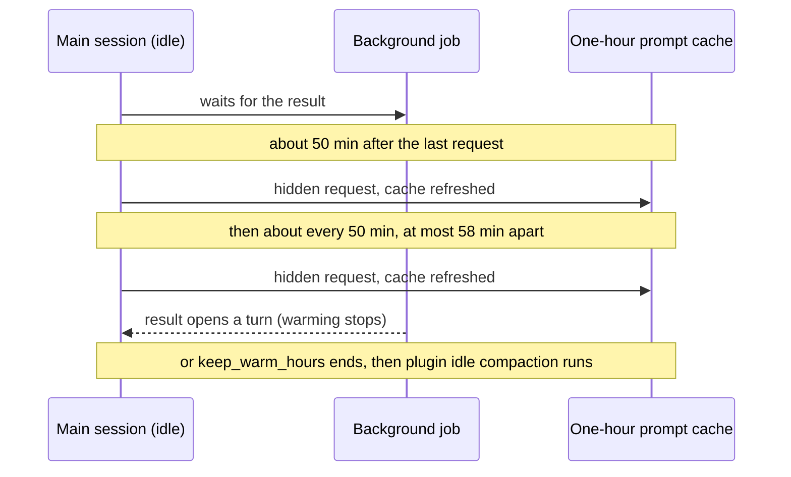

# Keeping the cache warm while jobs run <!-- Source of docs/keep-warm.md and part of plugin/README.md. Compare only with Claude Code's own behaviour, never name another plugin or tool. No recall, retention, speed or cost-saving number until the benchmark publishes one. No user-local paths beyond the configurable defaults. Cross-page links: page.md#anchor. -->

An agent, a workflow or a background shell that runs for more than an hour while the session waits for it outlives the one-hour prompt cache: the turn its result opens then reads the whole conversation again at full price. With `keep_warm_hours` (6 by default) the plugin keeps that cache warm while the job runs: about 50 minutes after the last request of the main session, and then about every 50 minutes, it sends one hidden request on the session's own conversation ("reply with one word"), which reads the conversation from the cache and refreshes it. The request adds nothing to the conversation, runs no tools, and starts no turn of its own (no Stop or prompt hook runs for it).

Illustrative timeline; the times are the defaults.

It runs only:

- in the main session, while it is idle, and while at least one of that session's own background jobs is open (an agent, a workflow or a background shell; a Monitor or a scheduled task does not count). A teammate counts only while it works: one that waits idle for a message (Claude Code lists it as running all the same) sends no result, so it is no job here, nor for plugin idle compaction's running agents or the digest's `Basis:` count. It never runs because you are simply away with nothing running;
- on the one-hour cache, as plugin idle compaction reads it (with the five-minute cache, warming would cost more than it saves);
- while no usage limit Claude Code reports is near (see [Near a usage limit](usage-limits.md#near-a-usage-limit); when Claude Code reports no limit, the log's `keep_warm_start` row says `windows: 0`, and this check reads the session's own readings in the shared usage file, with the other sessions' beside them; with no own reading there, for example with an API key and the one-hour cache set, it is skipped);
- at most 58 minutes after the last request that refreshed the cache: a request that would start later is not sent, since the cache may have expired and the request would write it all again;
- while each request comes back in time: one that reads the cache but takes over about 2 minutes, or comes back more than 58 minutes after the last request that refreshed the cache, counts for nothing (the log's `keep_warm_ping` row says `late`), and keeping warm stops for the gap (`missed`). A slow request that did not read the conversation from the cache, or that failed, keeps its own result and is handled as below;
- while plugin idle compaction or its idle handoff turn waits to take the gap over once warming stops: not with `idle_handoff_turn` and `idle_compact` both off (or with no idle path for the conversation's size), nor with `triggers` off, since nothing would compact the session after the requests (the log has one `keep_warm_stop` row with `why: no-idle-path` for such a gap, and `/{{plugin}}:status` shows it).

When one of these does not hold by the first request (about 50 minutes into the gap, or earlier when the idle path's own timer comes first), keep-warm stays off for that idle gap and says why: the log has one `keep_warm_stop` row with `refused: true` and the reason (`no-jobs`, `ttl-5m`, `near-limit`, `no-idle-path`, `cutoff`, …), and `/{{plugin}}:status` and the [status line](status-line.md#the-cache-state-in-your-status-line) show `keep-warm off (<why>)`. While a request is out, the status line shows `ping pending`.

It stops when a turn starts (the job's result, your message), the session ends or is compacted, no job is open any more, the cache is not the one-hour one any more, the main model or the Claude Code version changed (`/model` sends no request, and a request on the new model would write the whole conversation again), a usage limit is near, one of its requests does not read the conversation from the cache (then the session's own cache has expired too, as its next request shows: that request reads the whole conversation again; until it comes, the plugin runs neither plugin idle compaction nor the idle handoff turn on that cold cache, and keeps no idle gap warm), finds nothing to fork, or is refused, no idle path is left to take the gap over, or after `keep_warm_hours` hours of the idle gap. While it keeps the cache warm, plugin idle compaction and the idle handoff turn above wait; when it stops for one of these reasons but a turn start, the session's end, a compaction or a request that missed the cache, they run then, while the cache is warm (the idle path's own checks still apply: near a usage limit, for example, the compaction does not run). When it stops after `keep_warm_hours`, or at the last moment the waiting compaction or turn can still run, with an agent, a workflow or a working teammate still open, plugin idle compaction runs then from `idle_handoff_min_tokens` up, below the idle-compaction minimum too: the idle handoff turn does not compact, and the result turn that job opens would read the whole conversation again. With `idle_compact: false`, automatic compaction off, or after plugin idle compaction failed twice, the idle handoff turn runs there as before. With only a background shell open (it may never end), plugin idle compaction or the idle handoff turn takes the gap over as at the other stops. A request that fails (the API overloaded, say) is tried again a minute later, but never past the time the waiting compaction or turn can still run: it runs then instead. After an idle handoff turn it starts, the plugin does not keep the next gap warm until a turn of someone else's starts (a job's result, your message). If the plugin is reloaded while it keeps the cache warm (a plugin update, `claude respawn`, a restart that resumes the session), the new process stops keeping it warm and runs plugin idle compaction or the idle handoff turn at the time of the next request, while the cache is still warm.

**Cost.** Each request reads the conversation from the cache and writes a few tokens; on a subscription it counts toward your usage limits. A request that finds nothing to fork costs nothing: while a request of the session is running it is tried again a minute later; with none running there is nothing to fork at all (after `/clear`, for example), so keeping warm stops there. `/{{plugin}}:status` shows whether keep-warm is on and, for the last idle gap that warmed, how many requests kept the cache warm and why it stopped. For a gap it did not start in, it shows `keep-warm off (<why>)`, or `the last gap: keep-warm off (<why>)` once a later request of the session came. Running it starts a turn, which itself ends the gap's warming (it then shows `stopped: turn`); to see a gap that is still warming, type `! <store> status --sid <session id>` yourself (the session id `/{{plugin}}:status` prints), which starts no turn. Set `keep_warm_hours` to `0` to turn it off.

## In a report

`/{{plugin}}:report` adds `keep-warm.json` to its zip, and the helper's `watch report` adds a `Keep-warm` section. Both are built from the log rows alone, and hold only counts, durations, reasons and versions:

- the idle gaps that reached their first request or the idle path's timer: how many warmed and how many were refused, by reason;
- the requests sent, and how many read the cache (`warm`), missed it (`fork-miss`), came back late (`late`) or failed;
- the reasons warming stopped, and how many gaps were handed back to plugin idle compaction or the idle handoff turn;
- for each gap, the cache result of the session's next main request after it: `hit`, `miss` or `none` (no cache tokens), the pause before it, its cache reads and writes, and Claude Code's cache miss reason when Claude Code reports one (see [Cache reads after a pause](privacy-and-logs.md#watcher)). A gap with no main request yet in the logs says `not seen yet`.

An idle gap that a turn ends before the first request leaves no keep-warm row, so it is not counted.
