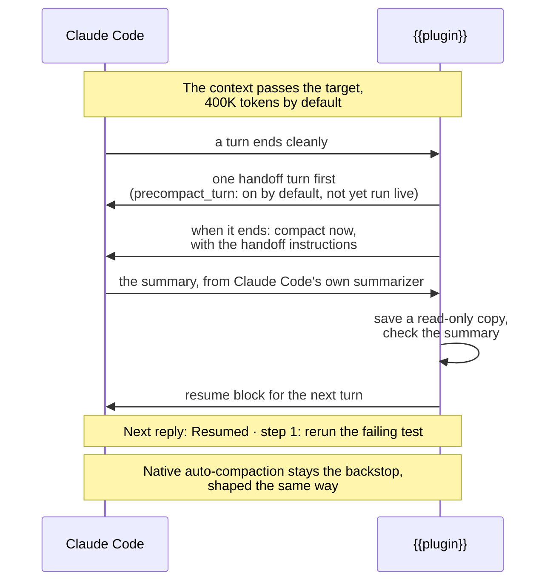
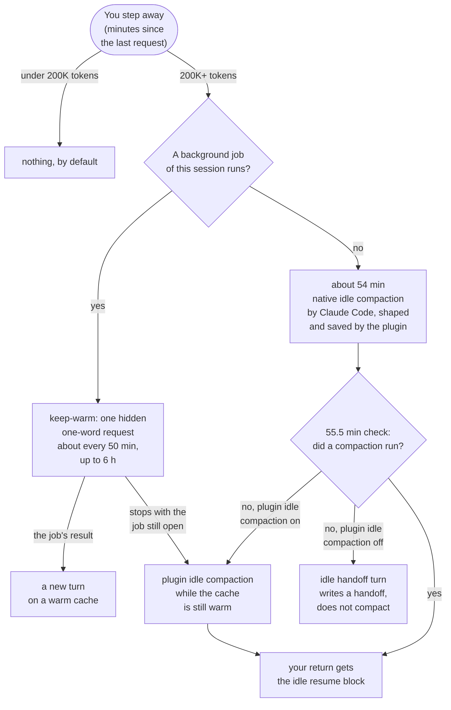
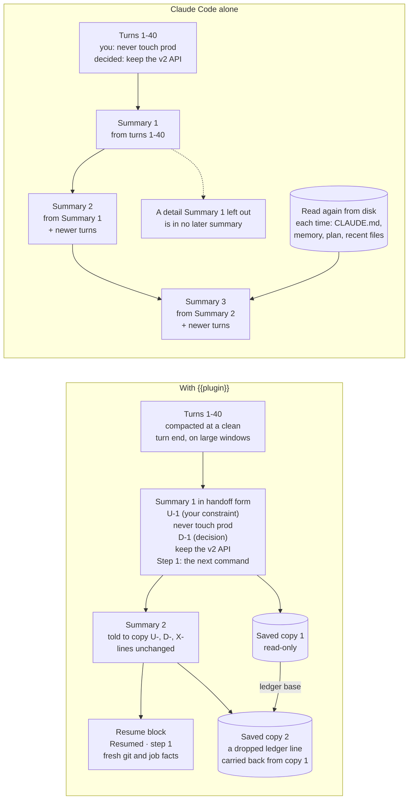

# {{plugin}} <!-- Source of README.md, the GitHub landing page. Keep it short: main concepts, the figures, one line per feature; any fact that needs more than one line goes to docs/. Links: docs/page.md#anchor. Compare only with Claude Code's own behaviour, never name another plugin or tool; every claim about native behaviour links the Claude Code docs. No recall, retention, speed or cost-saving number until the benchmark publishes one under bench/; real-use facts only as labelled plain text. -->

**Compaction that writes a handoff.** A Claude Code plugin for long and unattended sessions.

[](https://github.com/{{repo}}/stargazers) [](https://github.com/{{repo}}/releases) [](LICENSE)
[](https://github.com/{{repo}}/actions/workflows/ci.yml) [](docs/compatibility.md) [](docs/installation.md)

Each Claude Code compaction replaces the conversation with a summary, and the next one works from that summary; details from early on can drop out ([docs](https://code.claude.com/docs/en/how-claude-code-works#when-context-fills-up)). {{plugin}} asks Claude Code's own summarizer for a handoff instead of a plain summary: your constraints in your words, decisions and rejected options, work in flight, open questions and the exact next step. It saves a read-only copy of every summary and checks it; the next turn gets a short resume block, and its reply opens with `Resumed · step 1: …`. On large context windows it compacts at a clean turn end, before Claude Code's own auto-compaction would.

[Install](#install) · [How it works](#how-it-works-with-claude-code) · [Features](#features) · [Docs](docs/README.md) · [Changelog](CHANGELOG.md) · [Contributing](CONTRIBUTING.md)

> [!NOTE]
> Early version (0.x). Some paths have not run live yet; see [Limits and costs](#limits-and-costs). Nothing on this page is a measurement unless it says so.

## How it works with Claude Code

{{plugin}} works through Claude Code's own hooks and summarizer. Native auto-compaction and native idle compaction stay in place. It never edits a summary, never blocks a compaction and never changes Claude Code's own settings such as `idleCompaction` or auto-compaction (it writes only its own options, and only when you apply a change).





*Top: turn-end compaction needs a window of about 329K tokens or more (1M models); Claude Code's own point is about 967K ([docs](https://code.claude.com/docs/en/model-config#default-auto-compact-thresholds)) and can come mid-task ([docs](https://code.claude.com/docs/en/prompt-caching#compacting-the-conversation)). Bottom: native idle compaction runs before the one-hour prompt cache expires, at 200K tokens or more ([docs](https://code.claude.com/docs/en/settings-reference#idlecompaction)); with `"idleCompaction": false` the plugin compacts at about 54 minutes instead. Details: [How it works](docs/how-it-works.md#when-the-plugin-acts-beside-claude-codes-compaction), [Idle compaction](docs/idle-compaction.md), [Keep-warm](docs/keep-warm.md).*

## What carries across repeated compactions

Claude Code's compaction replaces the conversation with a summary ([docs](https://code.claude.com/docs/en/prompt-caching#compacting-the-conversation)), so the next compaction starts from that summary plus the newer turns. Its docs say that "detailed instructions from early in the conversation may be lost" ([docs](https://code.claude.com/docs/en/how-claude-code-works#when-context-fills-up)).



*Illustrative, not measured; turn numbers illustrative. Without the plugin each summary is written from the one before it; with it, `U-`/`D-`/`X-` ledger lines are told to carry unchanged and every summary is saved read-only, with dropped lines carried back into the saved copy. The live conversation still holds only what the summarizer wrote. More in [Compared with Claude Code alone](docs/comparison.md#why-context-fades-over-repeated-compactions).*

**Measured results:** the benchmark method is fixed in advance ([bench/METHOD.md](bench/METHOD.md)); results will be published there.

**From the author's own use (plugin on in every session; not a comparison)**, plugin 0.1.5 to 0.1.9, up to 2026-11-12, n = 51: Claude Code's summary, given {{plugin}}'s instructions, left out at least one ledger line in 47 of 51 repeat compactions; the saved copy kept them on disk, and 7 of 277 restored lines reached the next live summary.

## Features

- **Handoff-shaped summaries.** Native auto-compaction, native idle compaction, your `/compact` (your note comes first) and the plugin's own compactions all get the same handoff instructions. [How it works](docs/how-it-works.md)
- **Compaction at a clean turn end** once the context passes `compact_target_tokens`, with one note past `compact_soft_max_tokens` (600K) asking the model to reach a stopping point (large windows). [How it works](docs/how-it-works.md)
- **A read-only copy of every summary**, with session, branch, commit, trigger and verdict. [Files and storage](docs/files-and-storage.md)
- **A verdict for every compaction** (`ok`, `truncated`, `unshaped`, …); two bad ones in a row pause the plugin's own automation. [How it works](docs/how-it-works.md)
- **A ledger that carries by id:** `U-` constraints in your words, `D-` decisions and `X-` rejected options, which every summary is told to copy unchanged; a dropped line is carried back into the saved copy. [Usage](docs/usage.md)
- **A resume block** with the copy's path, fresh git and background-job facts, and a question you had not answered. [Handoffs and resume](docs/handoffs-and-resume.md)
- **Handoff turns** before a planned compaction and before the last one of a run that stops (cap reached or auto-continue off; not yet run live). [Handoffs and resume](docs/handoffs-and-resume.md)
- **Six skills:** `/{{plugin}}:handoff`, `:resume`, `:status`, `:settings`, `:report` and `:prune`. [Usage](docs/usage.md)
- **Plugin idle compaction and the idle handoff turn** where native idle compaction did not run, and an optional away digest, a short what-happened turn for your return (not yet run live). [Idle compaction](docs/idle-compaction.md)
- **Keep-warm:** hidden one-word requests keep the one-hour prompt cache warm while your background jobs run, so the turn a job's result opens does not re-read the whole conversation at full price. [Keep-warm](docs/keep-warm.md)
- **Usage-limit rules:** plugin idle compaction and keep-warm stop near a reported usage limit. [Near a usage limit](docs/usage-limits.md)
- **Cache state in your status line:** `cache 1h warm 42m left ↻3/7` (keep-warm request 3 of at most 7). [Status line](docs/status-line.md)
- **Background jobs:** a wait helper instead of foreground sleeps; `/{{plugin}}:resume` re-checks jobs that died with the session. [Background jobs](docs/background-jobs.md)
- **Approvals and explicit gates:** approvals are written down with your words and targets; deploys and production writes always ask again. [Safety and approvals](docs/safety-and-approvals.md)
- **Evidence copies:** temp files the session cited are copied to a dated folder, with size caps and secret checks. [Files and storage](docs/files-and-storage.md)
- **Repo mode** (opt-in on both sides): a scanned export of each handoff in the repository; the plugin never stages or commits it. [Repo mode](docs/repo-mode.md)
- **Question queue** (opt-in): questions that wait on you go to a command you configure (`queue_cmd`). [Question queue](docs/question-queue.md)
- **Restart on update** (beta, opt-in, not active in this version): moves a long session onto a newly installed Claude Code. [Restart on update](docs/restart-on-update.md)
- **Local logs and alerts:** content-free event logs and alerts in `/{{plugin}}:status`; no telemetry; `/{{plugin}}:report` zips the logs for you to send yourself. [Privacy and logs](docs/privacy-and-logs.md)

## Install

Needs Claude Code {{cc_min}} or newer (the one-line install needs 2.1.292 or newer) and perl 5.28 or newer (already on macOS, Debian and Ubuntu); git is used when present. In a Claude Code session:

```
/plugin install {{plugin}} --marketplace {{repo}}
```

Answer `y` to add the marketplace and pick a scope; every setting has a working default. If the install summary says the plugin is not active yet, run `/reload-plugins` or start a new session ([docs](https://code.claude.com/docs/en/prompt-caching#when-plugin-changes-apply)). From a shell or the desktop app, the two-step route for older Claude Code versions, and to update or uninstall: [Installation](docs/installation.md#install).

## Quick start

1. **Check it.** Run `/{{plugin}}:status`. It prints the thresholds in effect, with `min_window`, the smallest context window that turns turn-end compaction on.
2. **Work as usual.** Every compaction is shaped from the first one. The reply after it opens with `Resumed · step 1: …`, and `/{{plugin}}:status` shows its verdict and the copy's path.
3. **Before a break or `/clear`,** run `/{{plugin}}:handoff`. Later, `/{{plugin}}:resume` picks it up and checks its claims against the live state first. A walkthrough: [Getting started](docs/getting-started.md).

## Limits and costs

- **Window size.** Turn-end compaction, the nudge, the handoff turns, plugin idle compaction, the idle handoff turn and keep-warm need a window of about 329K tokens or more with the defaults (1M-context models): on 1M windows it compacts at 400K, on smaller ones the target is lowered to fit, and under about 329K they are off ([details](docs/configuration.md#how-the-thresholds-are-clamped)). Every compaction Claude Code runs is still shaped, checked, saved and resumed.
- **Platforms.** macOS 13 or newer. Linux is beta: the helper's checks pass, but there is no full test run or live session yet. Windows: WSL 2 only, not yet tested. Without perl 5.28 or newer, no copies are saved.
- **Not yet run live:** end-to-end runs in a real session, the handoff turns, the idle paths and the report skill ([full list](docs/limitations.md#limits)).
- **Costs.** Extra requests count toward your usage limits: the handoff turn before each planned compaction (`precompact_turn`), more compactions on 1M windows (it compacts at 400K), keep-warm requests (`keep_warm_hours`), plugin idle compaction (`idle_compact`) and the idle handoff turn (`idle_handoff_turn`), which by default also runs near a usage limit (`idle_handoff_near_limit`). Each can be turned off: [Configuration](docs/configuration.md).

## Documentation

- **Start:** [Getting started](docs/getting-started.md) · [Installation](docs/installation.md) · [Usage](docs/usage.md) · [FAQ](docs/faq.md) · [Troubleshooting](docs/troubleshooting.md)
- **Compaction and resume:** [How it works](docs/how-it-works.md) · [Handoffs and resume](docs/handoffs-and-resume.md) · [Compared with Claude Code alone](docs/comparison.md) · [Design principles](docs/design-principles.md)
- **Unattended sessions:** [Idle compaction](docs/idle-compaction.md) · [Keep-warm](docs/keep-warm.md) · [Near a usage limit](docs/usage-limits.md) · [Status line](docs/status-line.md) · [Background jobs](docs/background-jobs.md) · [Safety and approvals](docs/safety-and-approvals.md) · [Question queue](docs/question-queue.md) · [Restart on update](docs/restart-on-update.md)
- **Reference:** [Configuration](docs/configuration.md) · [Files and storage](docs/files-and-storage.md) · [Repo mode](docs/repo-mode.md) · [Privacy and logs](docs/privacy-and-logs.md) · [Compatibility](docs/compatibility.md) · [Limits](docs/limitations.md) · [Upgrading](docs/upgrading.md)

## Contributing

Bug reports, docs fixes, test cases and code are welcome; read [CONTRIBUTING.md](CONTRIBUTING.md) first. Questions and ideas go to [Discussions](https://github.com/{{repo}}/discussions), bugs to [Issues](https://github.com/{{repo}}/issues/new/choose), and security reports through GitHub's private reporting ([SECURITY.md](SECURITY.md)). This project follows a [Code of Conduct](CODE_OF_CONDUCT.md). Stars help other people find the project.

## License

[Apache License 2.0](LICENSE). See also [NOTICE](NOTICE).

<sub>Claude Code is a product of Anthropic. This project is independent and is not affiliated with or endorsed by Anthropic.</sub>
